# BÁO CÁO ĐẶC TẢ YÊU CẦU PHẦN MỀM (SOFTWARE REQUIREMENTS SPECIFICATION - SRS)

---

**Dự án:** Wanderly — Nền tảng Lập Kế hoạch Du lịch & Kết nối Dịch vụ Bản địa Thông minh  
**Phiên bản tài liệu:** 2.1 (Chuẩn hóa Học thuật & Nghiệp vụ Sprint 1 – Sprint 4)  
**Ngày phát hành:** 28/10/2026  
**Ngôn ngữ tài liệu:** Tiếng Việt Chuẩn (Standard Vietnamese)  
**Ngăn xếp công nghệ:** Laravel 11 (PHP 8.2+) | MySQL 8.0 | Tailwind CSS 3 | Alpine.js 3 | VietQR Napas 247 | AI Copilot (Open-Meteo & LLM)  
**Đường dẫn lưu trữ:** `docs/SRS.md`  

---

## MỤC LỤC TÀI LIỆU

1. [PHẦN 1: GIỚI THIỆU & TỔNG QUAN ĐỀ TÀI](#phần-1-giới-thiệu--tổng-quan-đề-tài)
   - 1.1. Mục đích tài liệu
   - 1.2. Bối cảnh & Lý do phát triển đề tài
   - 1.3. Phạm vi sản phẩm (Product Scope)
   - 1.4. Danh mục tác nhân & Phân cấp vai trò hệ thống
   - 1.5. Môi trường công nghệ & Vận hành
   - 1.6. Danh mục thuật ngữ & Từ viết tắt
2. [PHẦN 2: THIẾT KẾ USE CASE UML & ĐẶC TẢ CHI TIẾT (CHUẨN BẢNG)](#phần-2-thiết-kế-use-case-uml--đặc-tả-chi-tiết-chuẩn-bảng)
   - 2.1. Sơ đồ Use Case tổng thể hệ thống
   - 2.2. Bảng đặc tả Use Case chi tiết (Định dạng bảng chuẩn)
     - UC1.1: Đăng nhập hệ thống & Kiểm soát tần suất (Rate Limiting)
     - UC2.1: Tạo mới và thiết lập kế hoạch chuyến đi
     - UC2.2: Kéo-thả sắp xếp lịch trình tương tác (Timeline Drag & Drop)
     - UC2.3: Xem, Chia sẻ công khai và Xuất hành trình PDF
     - UC3.1: Mời thành viên bằng liên kết token & Phân quyền nhóm
     - UC3.2: Biểu quyết địa điểm & Phân tích độ hòa hợp nhóm (Group Mood)
     - UC3.3: Quyết toán công nợ nhóm & Thanh toán qua mã VietQR
     - UC4.1: Đăng yêu cầu du lịch & Chốt hợp đồng báo giá (Reverse Marketplace)
     - UC5.1: Tương tác với Trợ lý ảo AI Co-pilot & Thực thi hành động
3. [PHẦN 3: YÊU CẦU CHỨC NĂNG & THUẬT TOÁN SỬ DỤNG (DẠNG BẢNG CHI TIẾT)](#phần-3-yêu-cầu-chức-năng--thuật-toán-sử-dụng-dạng-bảng-chi-tiết)
   - 3.1. Phân hệ 1: Xác thực & Quản lý Tài khoản
   - 3.2. Phân hệ 2: Quản lý Chuyến đi, Lịch trình & Ngân sách Thời gian thực
   - 3.3. Phân hệ 3: Cộng tác Nhóm, Bầu chọn & Gợi ý Lịch trình Tự động
   - 3.4. Phân hệ 4: Sàn Dịch vụ Đảo (Reverse Marketplace) & Cổng Nhà cung cấp
   - 3.5. Phân hệ 5: Truyền thông, Tương tác & Khám phá Du lịch Việt Nam
   - 3.6. Phân hệ 6: Tiện ích Thông minh, AI Co-pilot & Ngoại tuyến
4. [PHẦN 4: YÊU CẦU PHI CHỨC NĂNG (DẠNG BẢNG CHỈ SỐ ĐO LƯỜNG)](#phần-4-yêu-cầu-phi-chức-năng-dạng-bảng-chỉ-số-đo-lường)
   - 4.1. Hiệu năng & Khả năng mở rộng (Performance & Scalability)
   - 4.2. Bảo mật & Toàn vẹn dữ liệu (Security & Integrity)
   - 4.3. Độ tin cậy & Tính sẵn sàng (Reliability & Availability)
   - 4.4. Tính khả dụng & Trải nghiệm người dùng (Usability & UX)
   - 4.5. Khả năng bảo trì & Tiêu chuẩn mã nguồn (Maintainability & Code Quality)
5. [PHẦN 5: THIẾT KẾ CƠ SỞ DỮ LIỆU (DATABASE DESIGN & ERD)](#phần-5-thiết-kế-cơ-sở-dữ-liệu-database-design--erd)
   - 5.1. Sơ đồ Quan hệ Thực thể tổng thể (Entity-Relationship Diagram)
   - 5.2. Từ điển dữ liệu chi tiết các bảng cốt lõi (Data Dictionary Tables)
   - 5.3. Chiến lược đánh chỉ mục tối ưu hóa truy vấn (Indexing Strategy)
6. [PHẦN 6: MA TRẬN TRUY VẾT YÊU CẦU (REQUIREMENTS TRACEABILITY MATRIX - RTM)](#phần-6-ma-trận-truy-vết-yêu-cầu-requirements-traceability-matrix---rtm)

---

## PHẦN 1: GIỚI THIỆU & TỔNG QUAN ĐỀ TÀI

### 1.1. Mục đích tài liệu
Tài liệu Đặc tả Yêu cầu Phần mềm (SRS) này xác định toàn diện các yêu cầu nghiệp vụ, yêu cầu chức năng có thuyết minh chi tiết thuật toán, yêu cầu phi chức năng định lượng, thiết kế Use Case UML theo cấu trúc bảng chuẩn và mô hình cơ sở dữ liệu quan hệ (ERD) cho nền tảng du lịch thông minh **Wanderly**.

Tài liệu được sử dụng làm căn cứ kỹ thuật để:
- Hướng dẫn thiết kế kiến trúc và lập trình cho đội ngũ kỹ sư phần mềm.
- Xác lập tiêu chí nghiệm thu kiểm thử (Acceptance Criteria) cho đội ngũ đảm bảo chất lượng (QA/QC).
- Làm tài liệu báo cáo kỹ thuật chính thức cho đề tài phần mềm nhóm.

### 1.2. Bối cảnh & Lý do phát triển đề tài
Hiện nay, việc tổ chức du lịch tự túc theo nhóm thường đối mặt với các rào cản lớn:
1. **Lịch trình phân mảnh & Xung đột thời gian:** Thông tin hoạt động thường nằm rải rác trên file văn bản hoặc tin nhắn, dễ dẫn đến trùng giờ di chuyển và không kiểm soát được khoảng cách thực tế giữa các điểm tham quan.
2. **Bất đồng sở thích & Thiếu tiếng nói chung:** Mỗi thành viên có gu du lịch khác nhau (người thích nghỉ dưỡng thong thả, người thích trải nghiệm năng động), gây khó khăn cho việc thống nhất hành trình chung.
3. **Nợ nần chéo & Phức tạp tài chính:** Nhiều người cùng đứng ra trả trước tiền vé, tiền ăn, tiền phòng dẫn đến tình trạng nợ chéo chằng chịt, việc tính toán chia tiền thủ công dễ sai sót và gây tâm lý ái ngại.
4. **Bất đối xứng thông tin dịch vụ bản địa:** Khách du lịch khó tiếp cận được với các nhà xe, hướng dẫn viên bản địa uy tín với mức giá niêm yết minh bạch.

**Wanderly** giải quyết triệt để 4 vấn đề trên thông qua việc tích hợp các thuật toán tối ưu hóa (Greedy Min-Cash-Flow, MCDA Match Engine), chuẩn thanh toán Napas VietQR và mô hình sàn giao dịch đảo (Reverse Marketplace).

### 1.3. Phạm vi sản phẩm (Product Scope)
Hệ thống Wanderly phục vụ trọn vẹn vòng đời của một chuyến đi từ trước, trong và sau hành trình:
- **Trước chuyến đi:** Lập kế hoạch lịch trình kéo-thả trực quan, mời bạn bè cùng tham gia, biểu quyết địa điểm, tự động phân tích độ hòa hợp nhóm, đấu thầu tìm kiếm dịch vụ bản địa giá tốt nhất qua sàn giao dịch đảo.
- **Trong chuyến đi:** Giám sát ngân sách trực tiếp 3 ngưỡng màu, chia tiền lẻ theo người tham gia thực tế (Micro Split-Bill), rút gọn giao dịch nợ qua thuật toán dòng tiền tối thiểu, thanh toán tức thì bằng mã QR ngân hàng, mở hộ chiếu ngoại tuyến khi mất sóng Internet.
- **Sau chuyến đi:** Tự động tạo album nhật ký số (Reverse Memory Scrapbook) từ ảnh chat và cột mốc lịch trình, chia sẻ hành trình lên mạng xã hội du lịch.

### 1.4. Danh mục tác nhân & Phân cấp vai trò hệ thống

| Mã Tác Nhân | Tên Tác Nhân | Phân Loại Vai Trò | Quyền Hạn & Trách Nhiệm Chính |
| :---: | :--- | :--- | :--- |
| **AT01** | Trưởng nhóm du lịch (Leader) | Traveler (`leader`) | Sở hữu chuyến đi; có toàn quyền thiết lập ngân sách, gán người chia tiền, phân quyền thành viên, chốt báo giá trên sàn giao dịch. |
| **AT02** | Thành viên chỉnh sửa (Editor) | Traveler (`editor`) | Thành viên chuyến đi được cấp quyền tạo, sửa, xóa hoạt động trên timeline, kéo-thả vị trí, tick chọn hành trang, tham gia biểu quyết. |
| **AT03** | Thành viên chỉ xem (Viewer) | Traveler (`viewer`) | Thành viên chuyến đi chỉ được xem lịch trình và ngân sách; bị chặn quyền sửa dữ liệu; được xem nợ cá nhân và quét mã VietQR để thanh toán. |
| **AT04** | Nhà cung cấp dịch vụ (Provider) | Provider | Đối tác dịch vụ địa phương (lưu trú, xe, tour, nhà hàng); quản lý danh mục dịch vụ, gửi báo giá Proposal, quản lý đơn đặt và doanh thu. |
| **AT05** | Quản trị viên hệ thống (Admin) | Administrator | Kiểm soát toàn bộ hệ thống; quản lý người dùng, duyệt hồ sơ đối tác, quản trị dữ liệu Điểm đến (Destinations), Khu vực (Zones) và POIs. |
| **AT06** | Khách vãng lai (Guest) | Khách chưa đăng nhập | Xem hành trình công khai qua liên kết `/s/{slug}`, đọc cẩm nang Khám phá Du lịch Việt Nam, đăng ký tài khoản người dùng mới. |

### 1.5. Môi trường công nghệ & Vận hành

| Thành phần | Công nghệ / Nền tảng | Phiên bản / Tiêu chuẩn áp dụng |
| :--- | :--- | :--- |
| **Ngôn ngữ lập trình chính** | PHP | Phiên bản 8.2 trở lên (hỗ trợ tối ưu PHP 8.3) |
| **Khung phát triển (Framework)** | Laravel Framework | Phiên bản 11.x (Kiến trúc MVC + Service Layer) |
| **Hệ quản trị Cơ sở dữ liệu** | MySQL Server | Phiên bản 8.0+ (InnoDB Engine, Collation `utf8mb4_unicode_ci`) |
| **Giao diện & Styling** | Blade + Tailwind CSS | Tailwind CSS 3.x, Responsive chuẩn Mobile-First |
| **Tương tác phía Client** | Alpine.js & Thư viện bổ trợ | Alpine.js 3.x, SortableJS (Kéo-thả), Chart.js (Biểu đồ) |
| **Công cụ đóng gói (Bundler)** | Vite | Vite 5.x kết hợp Laravel Vite Plugin |
| **Chuẩn thanh toán ngân hàng** | VietQR Napas 247 | Chuẩn tạo mã QR thanh toán nhanh liên ngân hàng Việt Nam |
| **Trí tuệ nhân tạo (AI)** | LLM API & Weather Service | Open-Meteo API (Thời tiết), Gemini / OpenAI (AI Co-pilot) |

### 1.6. Danh mục thuật ngữ & Từ viết tắt

| Thuật ngữ / Viết tắt | Tên đầy đủ tiếng Anh | Diễn giải ngữ nghĩa trong hệ thống Wanderly |
| :--- | :--- | :--- |
| **SRS** | Software Requirements Specification | Tài liệu đặc tả yêu cầu phần mềm chuẩn IEEE 830. |
| **FR / NFR** | Functional / Non-Functional Requirements | Yêu cầu chức năng / Yêu cầu phi chức năng. |
| **POI** | Point of Interest | Điểm tham quan, danh lam thắng cảnh, quán ăn hoặc địa điểm dịch vụ cụ thể. |
| **Zone** | Geographic Zone | Phân khu địa lý trong một điểm đến (ví dụ: Bán đảo Sơn Trà, Quận Hải Châu). |
| **Time Slot** | Fixed Day Slot | 4 khung giờ cố định trong ngày: `morning` (06-11h), `midday` (11-14h), `afternoon` (14-18h), `evening` (18-23h). |
| **Travel Request** | Reverse Booking Request | Yêu cầu du lịch do Trưởng nhóm đăng lên sàn để mời các nhà cung cấp chào giá. |
| **Proposal** | Provider Offer / Bid | Gói báo giá kèm danh mục dịch vụ chi tiết do nhà cung cấp gửi tới yêu cầu du lịch. |
| **Min-Cash-Flow** | Minimum Cash Flow Algorithm | Thuật toán tối thiểu hóa số lượng giao dịch chuyển khoản cấn trừ nợ trong nhóm. |
| **RTM** | Requirements Traceability Matrix | Ma trận truy vết kiểm tra tính bao phủ giữa yêu cầu, CSDL, mã nguồn và test case. |

---

## PHẦN 2: THIẾT KẾ USE CASE UML & ĐẶC TẢ CHI TIẾT (CHUẨN BẢNG)

### 2.1. Sơ đồ Use Case tổng thể hệ thống

```mermaid
flowchart TD
    %% Danh sách Tác nhân
    AT06["AT06: Khách vãng lai (Guest)"]
    AT01["AT01: Trưởng nhóm (Leader)"]
    AT02["AT02: Chỉnh sửa (Editor)"]
    AT03["AT03: Chỉ xem (Viewer)"]
    AT04["AT04: Nhà cung cấp (Provider)"]
    AT05["AT05: Quản trị viên (Admin)"]

    %% Kế thừa tác nhân
    AT06 -.->|Đăng ký / Đăng nhập| AT01
    AT01 -.->|Kế thừa quyền cơ bản| AT02
    AT02 -.->|Kế thừa quyền xem| AT03

    %% Phân hệ 1: Auth
    subgraph UC_AUTH["Phân hệ 1: Xác Thực & Tài Khoản"]
        UC1_1["UC1.1: Đăng nhập & Rate Limiting"]
        UC1_2["UC1.2: Đăng ký tài khoản mới"]
        UC1_3["UC1.3: Cập nhật hồ sơ & STK Ngân hàng"]
    end

    %% Phân hệ 2: Chuyến đi & Lịch trình
    subgraph UC_TRIP["Phân hệ 2: Chuyến Đi, Lịch Trình & Ngân Sách"]
        UC2_1["UC2.1: Tạo / Sửa / Nhân bản chuyến đi"]
        UC2_2["UC2.2: Kéo-thả sắp xếp lịch trình Timeline"]
        UC2_3["UC2.3: Xem / Chia sẻ / Xuất hành trình PDF"]
        UC2_4["UC2.4: Giám sát ngân sách 3 ngưỡng màu"]
        UC2_5["UC2.5: Quản lý phòng lưu trú độc lập"]
    end

    %% Phân hệ 3: Cộng tác & Quyết toán nợ
    subgraph UC_COL["Phân hệ 3: Cộng Tác & Quyết Toán Nợ"]
        UC3_1["UC3.1: Mời thành viên bằng Token link"]
        UC3_2["UC3.2: Biểu quyết địa điểm & Group Mood"]
        UC3_3["UC3.3: Quyết toán nợ & Quét mã VietQR"]
        UC3_4["UC3.4: Trò chuyện nhóm & Gửi ảnh (Chat)"]
    end

    %% Phân hệ 4: Reverse Marketplace
    subgraph UC_MKT["Phân hệ 4: Sàn Dịch Vụ Đảo (Marketplace)"]
        UC4_1["UC4.1: Đăng yêu cầu & Chốt báo giá"]
        UC4_2["UC4.2: Gửi báo giá gói Proposal"]
        UC4_3["UC4.3: Quản lý danh mục dịch vụ Catalog"]
    end

    %% Phân hệ 5: AI & Khám phá
    subgraph UC_AI["Phân hệ 5: AI Co-pilot & Tiện Ích"]
        UC5_1["UC5.1: Tương tác với Trợ lý AI Co-pilot"]
        UC5_2["UC5.2: Xem hộ chiếu ngoại tuyến Offline"]
        UC5_3["UC5.3: Quản trị danh mục Điểm đến / POIs"]
    end

    %% Liên kết Khách vãng lai
    AT06 --> UC1_1
    AT06 --> UC1_2
    AT06 --> UC2_3

    %% Liên kết Trưởng nhóm
    AT01 --> UC1_3
    AT01 --> UC2_1
    AT01 --> UC2_2
    AT01 --> UC2_3
    AT01 --> UC2_4
    AT01 --> UC2_5
    AT01 --> UC3_1
    AT01 --> UC3_2
    AT01 --> UC3_3
    AT01 --> UC3_4
    AT01 --> UC4_1
    AT01 --> UC5_1
    AT01 --> UC5_2

    %% Liên kết Editor
    AT02 --> UC2_2
    AT02 --> UC3_2
    AT02 --> UC3_3
    AT02 --> UC3_4
    AT02 --> UC5_1

    %% Liên kết Viewer
    AT03 --> UC2_3
    AT03 --> UC3_2
    AT03 --> UC3_3
    AT03 --> UC5_2

    %% Liên kết Provider
    AT04 --> UC4_2
    AT04 --> UC4_3
    AT04 --> UC3_4

    %% Liên kết Admin
    AT05 --> UC5_3
```

---

### 2.2. Bảng đặc tả Use Case chi tiết (Định dạng bảng chuẩn theo mẫu)

#### Bảng đặc tả UC1.1: Đăng nhập hệ thống & Kiểm soát tần suất

<table border="1" cellpadding="6" cellspacing="0" style="width: 100%; border-collapse: collapse; margin-bottom: 28px; font-size: 14px; border: 1px solid #b2d8d8;">
  <tr>
    <td style="background-color: #c8e6c9; font-weight: bold; width: 18%;">Mã Use case</td>
    <td style="width: 25%; font-weight: bold;">UC1.1</td>
    <td style="background-color: #c8e6c9; font-weight: bold; width: 18%;">Tên Use case</td>
    <td style="font-weight: bold;">Đăng nhập hệ thống & Kiểm soát tần suất (Rate Limiting)</td>
  </tr>
  <tr>
    <td style="background-color: #c8e6c9; font-weight: bold;">Tác nhân</td>
    <td colspan="3">AT06 - Khách vãng lai, AT01/AT02/AT03/AT04/AT05 - Người dùng hệ thống</td>
  </tr>
  <tr>
    <td style="background-color: #c8e6c9; font-weight: bold;">Mô tả</td>
    <td colspan="3">Người dùng nhập thông tin xác thực (Email, Mật khẩu) để truy cập hệ thống. Hệ thống áp dụng thuật toán Sliding Window kiểm soát số lần đăng nhập sai nhằm ngăn chặn tấn công dò mật khẩu (Brute-force).</td>
  </tr>
  <tr>
    <td style="background-color: #c8e6c9; font-weight: bold;">Sự kiện kích hoạt</td>
    <td colspan="3">Người dùng chọn chức năng “Đăng nhập” trên thanh điều hướng hoặc màn hình chính</td>
  </tr>
  <tr>
    <td style="background-color: #c8e6c9; font-weight: bold;">Tiền điều kiện</td>
    <td colspan="3">1. Tài khoản người dùng đã được kích hoạt và tồn tại trong bảng <code>users</code>.</td>
  </tr>
  <tr>
    <td style="background-color: #c8e6c9; font-weight: bold; vertical-align: top;">Luồng sự kiện chính (Thành công)</td>
    <td colspan="3" style="padding: 0;">
      <table border="1" cellpadding="5" cellspacing="0" style="width: 100%; border-collapse: collapse; border: none;">
        <tr style="background-color: #fd7e14; color: white; font-weight: bold; text-align: center;">
          <th style="width: 10%;">STT</th>
          <th style="width: 22%;">Thực hiện bởi</th>
          <th>Hành động</th>
        </tr>
        <tr>
          <td align="center">1.</td>
          <td>Người dùng</td>
          <td>Chọn chức năng đăng nhập trên hệ thống</td>
        </tr>
        <tr>
          <td align="center">2.</td>
          <td>Hệ thống</td>
          <td>Hiển thị biểu mẫu đăng nhập gồm trường Email và Mật khẩu</td>
        </tr>
        <tr>
          <td align="center">3.</td>
          <td>Người dùng</td>
          <td>Nhập địa chỉ Email, Mật khẩu và nhấn nút “Đăng nhập”</td>
        </tr>
        <tr>
          <td align="center">4.</td>
          <td>Hệ thống</td>
          <td>Kiểm tra khóa giới hạn tần suất đăng nhập (Sliding Window RateLimiter)</td>
        </tr>
        <tr>
          <td align="center">5.</td>
          <td>Hệ thống</td>
          <td>Đối soát mật khẩu đã băm (Bcrypt hash verification) với cơ sở dữ liệu</td>
        </tr>
        <tr>
          <td align="center">6.</td>
          <td>Hệ thống</td>
          <td>Cấp phát Session phiên làm việc, thiết lập cookie an toàn và xóa bộ đếm đăng nhập sai</td>
        </tr>
        <tr>
          <td align="center">7.</td>
          <td>Hệ thống</td>
          <td>Chuyển hướng người dùng về trang Bảng điều khiển (Dashboard) và thông báo đăng nhập thành công</td>
        </tr>
      </table>
    </td>
  </tr>
  <tr>
    <td style="background-color: #c8e6c9; font-weight: bold; vertical-align: top;">Luồng sự kiện thay thế</td>
    <td colspan="3" style="padding: 0;">
      <table border="1" cellpadding="5" cellspacing="0" style="width: 100%; border-collapse: collapse; border: none;">
        <tr style="background-color: #fd7e14; color: white; font-weight: bold; text-align: center;">
          <th style="width: 10%;">STT</th>
          <th style="width: 22%;">Thực hiện bởi</th>
          <th>Hành động</th>
        </tr>
        <tr>
          <td align="center">A1</td>
          <td>Hệ thống</td>
          <td>Sai email hoặc mật khẩu (E-AUTH-01) &rarr; Tăng bộ đếm lỗi và hiển thị: “Thông tin đăng nhập không chính xác.”</td>
        </tr>
        <tr>
          <td align="center">A2</td>
          <td>Hệ thống</td>
          <td>Đăng nhập sai quá 5 lần trong 60 giây (E-AUTH-429) &rarr; Khóa tạm thời 60 giây: “Bạn đã thử quá nhiều lần. Vui lòng thử lại sau X giây.”</td>
        </tr>
      </table>
    </td>
  </tr>
  <tr>
    <td style="background-color: #c8e6c9; font-weight: bold;">Hậu điều kiện</td>
    <td colspan="3">1. Phiên xác thực người dùng được kích hoạt an toàn. 2. Người dùng truy cập các tính năng theo đúng vai trò được cấp.</td>
  </tr>
</table>

---

#### Bảng đặc tả UC2.1: Tạo mới và thiết lập kế hoạch chuyến đi

<table border="1" cellpadding="6" cellspacing="0" style="width: 100%; border-collapse: collapse; margin-bottom: 28px; font-size: 14px; border: 1px solid #b2d8d8;">
  <tr>
    <td style="background-color: #c8e6c9; font-weight: bold; width: 18%;">Mã Use case</td>
    <td style="width: 25%; font-weight: bold;">UC2.1</td>
    <td style="background-color: #c8e6c9; font-weight: bold; width: 18%;">Tên Use case</td>
    <td style="font-weight: bold;">Tạo mới và thiết lập kế hoạch chuyến đi</td>
  </tr>
  <tr>
    <td style="background-color: #c8e6c9; font-weight: bold;">Tác nhân</td>
    <td colspan="3">AT01 - Trưởng nhóm du lịch (Traveler / Leader)</td>
  </tr>
  <tr>
    <td style="background-color: #c8e6c9; font-weight: bold;">Mô tả</td>
    <td colspan="3">Người dùng khởi tạo một chuyến đi mới gồm điểm đến, khoảng thời gian thực tế, dự toán tổng ngân sách và cấu hình quyền riêng tư.</td>
  </tr>
  <tr>
    <td style="background-color: #c8e6c9; font-weight: bold;">Sự kiện kích hoạt</td>
    <td colspan="3">Người dùng nhấn nút “Tạo chuyến đi mới” trên trang Dashboard</td>
  </tr>
  <tr>
    <td style="background-color: #c8e6c9; font-weight: bold;">Tiền điều kiện</td>
    <td colspan="3">1. Người dùng đã đăng nhập hệ thống với vai trò Traveler.</td>
  </tr>
  <tr>
    <td style="background-color: #c8e6c9; font-weight: bold; vertical-align: top;">Luồng sự kiện chính (Thành công)</td>
    <td colspan="3" style="padding: 0;">
      <table border="1" cellpadding="5" cellspacing="0" style="width: 100%; border-collapse: collapse; border: none;">
        <tr style="background-color: #fd7e14; color: white; font-weight: bold; text-align: center;">
          <th style="width: 10%;">STT</th>
          <th style="width: 22%;">Thực hiện bởi</th>
          <th>Hành động</th>
        </tr>
        <tr>
          <td align="center">1.</td>
          <td>AT01</td>
          <td>Chọn chức năng tạo chuyến đi mới</td>
        </tr>
        <tr>
          <td align="center">2.</td>
          <td>Hệ thống</td>
          <td>Hiển thị biểu mẫu thiết lập chuyến đi</td>
        </tr>
        <tr>
          <td align="center">3.</td>
          <td>AT01</td>
          <td>Nhập Tên chuyến đi, Điểm đến, Ngày bắt đầu, Ngày kết thúc, Ngân sách dự kiến và Quyền riêng tư (Private/Group/Public)</td>
        </tr>
        <tr>
          <td align="center">4.</td>
          <td>AT01</td>
          <td>Nhấn nút “Lưu chuyến đi”</td>
        </tr>
        <tr>
          <td align="center">5.</td>
          <td>Hệ thống</td>
          <td>Kiểm tra tính hợp lệ dữ liệu (start_date &le; end_date, budget &ge; 0)</td>
        </tr>
        <tr>
          <td align="center">6.</td>
          <td>Hệ thống</td>
          <td>Tạo bản ghi trong bảng <code>trips</code>, tự động phân quyền vai trò <code>leader</code> trong bảng <code>trip_members</code></td>
        </tr>
        <tr>
          <td align="center">7.</td>
          <td>Hệ thống</td>
          <td>Chuyển hướng đến trang chi tiết chuyến đi (Trip Dashboard) và thông báo tạo thành công</td>
        </tr>
      </table>
    </td>
  </tr>
  <tr>
    <td style="background-color: #c8e6c9; font-weight: bold; vertical-align: top;">Luồng sự kiện thay thế</td>
    <td colspan="3" style="padding: 0;">
      <table border="1" cellpadding="5" cellspacing="0" style="width: 100%; border-collapse: collapse; border: none;">
        <tr style="background-color: #fd7e14; color: white; font-weight: bold; text-align: center;">
          <th style="width: 10%;">STT</th>
          <th style="width: 22%;">Thực hiện bởi</th>
          <th>Hành động</th>
        </tr>
        <tr>
          <td align="center">A1</td>
          <td>Hệ thống</td>
          <td>Ngày kết thúc trước ngày bắt đầu (E-TRIP-DATE) &rarr; Hiển thị cảnh báo: “Ngày kết thúc không thể trước ngày bắt đầu.”</td>
        </tr>
        <tr>
          <td align="center">A2</td>
          <td>Hệ thống</td>
          <td>Thiếu tên chuyến đi hoặc điểm đến (E-TRIP-VALID) &rarr; Đánh dấu đỏ trường dữ liệu bắt buộc và yêu cầu bổ sung.</td>
        </tr>
      </table>
    </td>
  </tr>
  <tr>
    <td style="background-color: #c8e6c9; font-weight: bold;">Hậu điều kiện</td>
    <td colspan="3">1. Chuyến đi mới được khởi tạo và lưu trữ an toàn trong cơ sở dữ liệu. 2. Người tạo trở thành Trưởng nhóm (Leader) nắm quyền quản trị chuyến đi.</td>
  </tr>
</table>

---

#### Bảng đặc tả UC2.2: Kéo-thả sắp xếp lịch trình (Timeline Drag & Drop)

<table border="1" cellpadding="6" cellspacing="0" style="width: 100%; border-collapse: collapse; margin-bottom: 28px; font-size: 14px; border: 1px solid #b2d8d8;">
  <tr>
    <td style="background-color: #c8e6c9; font-weight: bold; width: 18%;">Mã Use case</td>
    <td style="width: 25%; font-weight: bold;">UC2.2</td>
    <td style="background-color: #c8e6c9; font-weight: bold; width: 18%;">Tên Use case</td>
    <td style="font-weight: bold;">Kéo-thả sắp xếp lịch trình tương tác (Timeline Drag & Drop)</td>
  </tr>
  <tr>
    <td style="background-color: #c8e6c9; font-weight: bold;">Tác nhân</td>
    <td colspan="3">AT01 - Trưởng nhóm (Leader), AT02 - Thành viên chỉnh sửa (Editor)</td>
  </tr>
  <tr>
    <td style="background-color: #c8e6c9; font-weight: bold;">Mô tả</td>
    <td colspan="3">Người dùng sử dụng thao tác kéo-thả để thay đổi thứ tự ưu tiên, chuyển khung giờ trong ngày (Sáng/Trưa/Chiều/Tối) hoặc chuyển hoạt động sang ngày khác.</td>
  </tr>
  <tr>
    <td style="background-color: #c8e6c9; font-weight: bold;">Sự kiện kích hoạt</td>
    <td colspan="3">Người dùng nhấn giữ chuột và kéo một thẻ hoạt động trên giao diện Timeline</td>
  </tr>
  <tr>
    <td style="background-color: #c8e6c9; font-weight: bold;">Tiền điều kiện</td>
    <td colspan="3">1. Người dùng đã đăng nhập và có quyền Leader hoặc Editor trên chuyến đi. 2. Chuyến đi đã có ít nhất 01 hoạt động được thiết lập.</td>
  </tr>
  <tr>
    <td style="background-color: #c8e6c9; font-weight: bold; vertical-align: top;">Luồng sự kiện chính (Thành công)</td>
    <td colspan="3" style="padding: 0;">
      <table border="1" cellpadding="5" cellspacing="0" style="width: 100%; border-collapse: collapse; border: none;">
        <tr style="background-color: #fd7e14; color: white; font-weight: bold; text-align: center;">
          <th style="width: 10%;">STT</th>
          <th style="width: 22%;">Thực hiện bởi</th>
          <th>Hành động</th>
        </tr>
        <tr>
          <td align="center">1.</td>
          <td>AT01 / AT02</td>
          <td>Nhấp giữ và kéo thẻ hoạt động sang vị trí mới, khung giờ mới hoặc ngày mới</td>
        </tr>
        <tr>
          <td align="center">2.</td>
          <td>Hệ thống</td>
          <td>Thư viện SortableJS cập nhật vị trí trực quan tức thì trên màn hình (Optimistic UI)</td>
        </tr>
        <tr>
          <td align="center">3.</td>
          <td>Hệ thống</td>
          <td>Tự động gửi yêu cầu AJAX PUT tới <code>/ajax/trips/{id}/activities/reorder</code> mang danh sách ID, ngày, khung giờ và thứ tự <code>position</code> mới</td>
        </tr>
        <tr>
          <td align="center">4.</td>
          <td>Hệ thống</td>
          <td>Xác thực quyền qua <code>TripPolicy</code>, mở Database Transaction cập nhật vị trí trong <code>ItineraryService</code></td>
        </tr>
        <tr>
          <td align="center">5.</td>
          <td>Hệ thống</td>
          <td>Thuật toán Interval Overlap kiểm tra xung đột trùng giờ thực tế giữa các hoạt động trong cùng ngày</td>
        </tr>
        <tr>
          <td align="center">6.</td>
          <td>Hệ thống</td>
          <td>Cam kết giao dịch (Commit Transaction) và trả về kết quả thành công HTTP 200 JSON</td>
        </tr>
        <tr>
          <td align="center">7.</td>
          <td>Hệ thống</td>
          <td>Hiển thị Toast thông báo: “Đã lưu thay đổi lịch trình.”</td>
        </tr>
      </table>
    </td>
  </tr>
  <tr>
    <td style="background-color: #c8e6c9; font-weight: bold; vertical-align: top;">Luồng sự kiện thay thế</td>
    <td colspan="3" style="padding: 0;">
      <table border="1" cellpadding="5" cellspacing="0" style="width: 100%; border-collapse: collapse; border: none;">
        <tr style="background-color: #fd7e14; color: white; font-weight: bold; text-align: center;">
          <th style="width: 10%;">STT</th>
          <th style="width: 22%;">Thực hiện bởi</th>
          <th>Hành động</th>
        </tr>
        <tr>
          <td align="center">A1</td>
          <td>Hệ thống</td>
          <td>Người dùng có quyền Viewer cố tình kéo thả (E-AUTH-403) &rarr; Máy chủ trả về HTTP 403, giao diện hoàn tác vị trí cũ và hiển thị: “Bạn chỉ có quyền xem lịch trình.”</td>
        </tr>
        <tr>
          <td align="center">A2</td>
          <td>Hệ thống</td>
          <td>Xung đột khung giờ giữa 2 hoạt động (E-TIME-CONFLICT) &rarr; Hệ thống lưu vị trí nhưng tự động gắn huy hiệu cảnh báo trùng giờ màu cam trên thẻ.</td>
        </tr>
        <tr>
          <td align="center">A3</td>
          <td>Hệ thống</td>
          <td>Mất kết nối mạng trong khi kéo thả (E-NET-500) &rarr; Giao diện hoàn tác (Rollback) vị trí thẻ và hiển thị Toast báo lỗi đường truyền.</td>
        </tr>
      </table>
    </td>
  </tr>
  <tr>
    <td style="background-color: #c8e6c9; font-weight: bold;">Hậu điều kiện</td>
    <td colspan="3">1. Thứ tự hiển thị, ngày và khung giờ của hoạt động được lưu vĩnh viễn trong CSDL. 2. Trạng thái đồng bộ giữa các thành viên được cập nhật chính xác.</td>
  </tr>
</table>

---

#### Bảng đặc tả UC2.3: Xem / Chia sẻ / Xuất hành trình

<table border="1" cellpadding="6" cellspacing="0" style="width: 100%; border-collapse: collapse; margin-bottom: 28px; font-size: 14px; border: 1px solid #b2d8d8;">
  <tr>
    <td style="background-color: #c8e6c9; font-weight: bold; width: 18%;">Mã Use case</td>
    <td style="width: 25%; font-weight: bold;">UC2.3</td>
    <td style="background-color: #c8e6c9; font-weight: bold; width: 18%;">Tên Use case</td>
    <td style="font-weight: bold;">Xem / Chia sẻ / Xuất hành trình</td>
  </tr>
  <tr>
    <td style="background-color: #c8e6c9; font-weight: bold;">Tác nhân</td>
    <td colspan="3">AT01 - Người dùng du lịch tự túc (Trưởng nhóm / Thành viên / Khách vãng lai)</td>
  </tr>
  <tr>
    <td style="background-color: #c8e6c9; font-weight: bold;">Mô tả</td>
    <td colspan="3">Người dùng xem danh sách hành trình đã tạo, chia sẻ hoặc xuất ra định dạng file (PDF, Excel, hình ảnh, v.v...)</td>
  </tr>
  <tr>
    <td style="background-color: #c8e6c9; font-weight: bold;">Sự kiện kích hoạt</td>
    <td colspan="3">Người dùng chọn chức năng “Xem/Chia sẻ/Xuất hành trình”</td>
  </tr>
  <tr>
    <td style="background-color: #c8e6c9; font-weight: bold;">Tiền điều kiện</td>
    <td colspan="3">1. Hành trình đã được lưu trữ trên hệ thống</td>
  </tr>
  <tr>
    <td style="background-color: #c8e6c9; font-weight: bold; vertical-align: top;">Luồng sự kiện chính (Thành công)</td>
    <td colspan="3" style="padding: 0;">
      <table border="1" cellpadding="5" cellspacing="0" style="width: 100%; border-collapse: collapse; border: none;">
        <tr style="background-color: #fd7e14; color: white; font-weight: bold; text-align: center;">
          <th style="width: 10%;">STT</th>
          <th style="width: 25%;">Thực hiện bởi</th>
          <th>Hành động</th>
        </tr>
        <tr>
          <td align="center">1.</td>
          <td>AT01</td>
          <td>Chọn chức năng xem hành trình*</td>
        </tr>
        <tr>
          <td align="center">2.</td>
          <td>Hệ thống</td>
          <td>Hiển thị danh sách hành trình của người dùng</td>
        </tr>
        <tr>
          <td align="center">3.</td>
          <td>AT01</td>
          <td>Chọn hành trình cụ thể</td>
        </tr>
        <tr>
          <td align="center">4.</td>
          <td>Hệ thống</td>
          <td>Hiển thị chi tiết hành trình</td>
        </tr>
        <tr>
          <td align="center">5.</td>
          <td>AT01</td>
          <td>Chọn “Chia sẻ” hoặc “Xuất hành trình”</td>
        </tr>
        <tr>
          <td align="center">6.</td>
          <td>Hệ thống</td>
          <td>Sinh file và cung cấp liên kết tải hoặc chia sẻ</td>
        </tr>
        <tr>
          <td align="center">7.</td>
          <td>Hệ thống</td>
          <td>Thông báo xuất/chia sẻ thành công</td>
        </tr>
      </table>
    </td>
  </tr>
  <tr>
    <td style="background-color: #c8e6c9; font-weight: bold; vertical-align: top;">Luồng sự kiện thay thế</td>
    <td colspan="3" style="padding: 0;">
      <table border="1" cellpadding="5" cellspacing="0" style="width: 100%; border-collapse: collapse; border: none;">
        <tr style="background-color: #fd7e14; color: white; font-weight: bold; text-align: center;">
          <th style="width: 10%;">STT</th>
          <th style="width: 25%;">Thực hiện bởi</th>
          <th>Hành động</th>
        </tr>
        <tr>
          <td align="center">A1</td>
          <td>Hệ thống</td>
          <td>Không có dữ liệu để xuất / thiếu nội dung (E-ITIN-404) &rarr; “Không có hành trình hợp lệ để xuất.”</td>
        </tr>
        <tr>
          <td align="center">A2</td>
          <td>Hệ thống</td>
          <td>Lỗi sinh file/định dạng không hỗ trợ (E-ITIN-500) &rarr; “Không thể xuất file do lỗi định dạng. Vui lòng thử lại.”</td>
        </tr>
      </table>
    </td>
  </tr>
  <tr>
    <td style="background-color: #c8e6c9; font-weight: bold;">Hậu điều kiện</td>
    <td colspan="3">1. Hành trình được hiển thị hoặc chia sẻ thành công</td>
  </tr>
</table>

---

#### Bảng đặc tả UC3.1: Mời thành viên bằng liên kết token & Phân quyền nhóm

<table border="1" cellpadding="6" cellspacing="0" style="width: 100%; border-collapse: collapse; margin-bottom: 28px; font-size: 14px; border: 1px solid #b2d8d8;">
  <tr>
    <td style="background-color: #c8e6c9; font-weight: bold; width: 18%;">Mã Use case</td>
    <td style="width: 25%; font-weight: bold;">UC3.1</td>
    <td style="background-color: #c8e6c9; font-weight: bold; width: 18%;">Tên Use case</td>
    <td style="font-weight: bold;">Mời thành viên bằng liên kết token & Phân quyền nhóm</td>
  </tr>
  <tr>
    <td style="background-color: #c8e6c9; font-weight: bold;">Tác nhân</td>
    <td colspan="3">AT01 - Trưởng nhóm (Leader), AT02 - Thành viên chỉnh sửa (Editor)</td>
  </tr>
  <tr>
    <td style="background-color: #c8e6c9; font-weight: bold;">Mô tả</td>
    <td colspan="3">Trưởng nhóm tạo liên kết mời thành viên có mã token ngẫu nhiên bảo mật và thời hạn hiệu lực 7 ngày để mời người khác gia nhập với vai trò xác định.</td>
  </tr>
  <tr>
    <td style="background-color: #c8e6c9; font-weight: bold;">Sự kiện kích hoạt</td>
    <td colspan="3">Người dùng nhấn nút “Mời thành viên” tại mục Quản lý thành viên chuyến đi</td>
  </tr>
  <tr>
    <td style="background-color: #c8e6c9; font-weight: bold;">Tiền điều kiện</td>
    <td colspan="3">1. Người dùng đã đăng nhập và có quyền Leader hoặc Editor trên chuyến đi.</td>
  </tr>
  <tr>
    <td style="background-color: #c8e6c9; font-weight: bold; vertical-align: top;">Luồng sự kiện chính (Thành công)</td>
    <td colspan="3" style="padding: 0;">
      <table border="1" cellpadding="5" cellspacing="0" style="width: 100%; border-collapse: collapse; border: none;">
        <tr style="background-color: #fd7e14; color: white; font-weight: bold; text-align: center;">
          <th style="width: 10%;">STT</th>
          <th style="width: 22%;">Thực hiện bởi</th>
          <th>Hành động</th>
        </tr>
        <tr>
          <td align="center">1.</td>
          <td>AT01 / AT02</td>
          <td>Chọn chức năng mời thành viên</td>
        </tr>
        <tr>
          <td align="center">2.</td>
          <td>Hệ thống</td>
          <td>Hiển thị modal chọn vai trò phân quyền: <code>Editor</code> (Chỉnh sửa) hoặc <code>Viewer</code> (Chỉ xem)</td>
        </tr>
        <tr>
          <td align="center">3.</td>
          <td>AT01 / AT02</td>
          <td>Chọn vai trò mong muốn và nhấn nút “Tạo liên kết mời”</td>
        </tr>
        <tr>
          <td align="center">4.</td>
          <td>Hệ thống</td>
          <td><code>CollaborationService</code> sinh mã token bảo mật 32 ký tự, lưu vào <code>trip_members</code> với thời hạn 7 ngày</td>
        </tr>
        <tr>
          <td align="center">5.</td>
          <td>Hệ thống</td>
          <td>Cung cấp liên kết dạng <code>/trips/join/{token}</code> kèm nút sao chép</td>
        </tr>
        <tr>
          <td align="center">6.</td>
          <td>Người được mời</td>
          <td>Mở liên kết mời trên trình duyệt và đăng nhập tài khoản</td>
        </tr>
        <tr>
          <td align="center">7.</td>
          <td>Hệ thống</td>
          <td>Xác thực token hợp lệ, thêm người dùng vào nhóm với đúng vai trò và thông báo thành công</td>
        </tr>
      </table>
    </td>
  </tr>
  <tr>
    <td style="background-color: #c8e6c9; font-weight: bold; vertical-align: top;">Luồng sự kiện thay thế</td>
    <td colspan="3" style="padding: 0;">
      <table border="1" cellpadding="5" cellspacing="0" style="width: 100%; border-collapse: collapse; border: none;">
        <tr style="background-color: #fd7e14; color: white; font-weight: bold; text-align: center;">
          <th style="width: 10%;">STT</th>
          <th style="width: 22%;">Thực hiện bởi</th>
          <th>Hành động</th>
        </tr>
        <tr>
          <td align="center">A1</td>
          <td>Hệ thống</td>
          <td>Liên kết mời hết hạn quá 7 ngày (E-INV-EXP) &rarr; Hiển thị thông báo: “Liên kết mời đã hết hạn. Vui lòng liên hệ Trưởng nhóm.”</td>
        </tr>
        <tr>
          <td align="center">A2</td>
          <td>Hệ thống</td>
          <td>Người dùng đã có mặt trong nhóm (E-INV-DUP) &rarr; Chuyển hướng thẳng vào chuyến đi mà không tạo thêm bản ghi trùng.</td>
        </tr>
      </table>
    </td>
  </tr>
  <tr>
    <td style="background-color: #c8e6c9; font-weight: bold;">Hậu điều kiện</td>
    <td colspan="3">1. Người được mời chính thức trở thành thành viên chuyến đi. 2. Quyền hạn của thành viên mới được kiểm soát theo đúng vai trò được cấp.</td>
  </tr>
</table>

---

#### Bảng đặc tả UC3.2: Biểu quyết địa điểm & Phân tích độ hòa hợp nhóm (Group Mood)

<table border="1" cellpadding="6" cellspacing="0" style="width: 100%; border-collapse: collapse; margin-bottom: 28px; font-size: 14px; border: 1px solid #b2d8d8;">
  <tr>
    <td style="background-color: #c8e6c9; font-weight: bold; width: 18%;">Mã Use case</td>
    <td style="width: 25%; font-weight: bold;">UC3.2</td>
    <td style="background-color: #c8e6c9; font-weight: bold; width: 18%;">Tên Use case</td>
    <td style="font-weight: bold;">Biểu quyết địa điểm & Phân tích độ hòa hợp nhóm (Group Mood)</td>
  </tr>
  <tr>
    <td style="background-color: #c8e6c9; font-weight: bold;">Tác nhân</td>
    <td colspan="3">AT01 - Trưởng nhóm, AT02 - Chỉnh sửa, AT03 - Chỉ xem (Tất cả thành viên)</td>
  </tr>
  <tr>
    <td style="background-color: #c8e6c9; font-weight: bold;">Mô tả</td>
    <td colspan="3">Thành viên biểu quyết tán thành (+1) hoặc phản đối (-1) trên danh sách địa điểm đề cử. Hệ thống tự động phân tích sở thích để tính thanh điểm hòa hợp nhóm (Group Mood Harmony Score).</td>
  </tr>
  <tr>
    <td style="background-color: #c8e6c9; font-weight: bold;">Sự kiện kích hoạt</td>
    <td colspan="3">Người dùng nhấn nút vote trên thẻ địa điểm hoặc mở tab “Gu của nhóm”</td>
  </tr>
  <tr>
    <td style="background-color: #c8e6c9; font-weight: bold;">Tiền điều kiện</td>
    <td colspan="3">1. Người dùng là thành viên hợp lệ của chuyến đi.</td>
  </tr>
  <tr>
    <td style="background-color: #c8e6c9; font-weight: bold; vertical-align: top;">Luồng sự kiện chính (Thành công)</td>
    <td colspan="3" style="padding: 0;">
      <table border="1" cellpadding="5" cellspacing="0" style="width: 100%; border-collapse: collapse; border: none;">
        <tr style="background-color: #fd7e14; color: white; font-weight: bold; text-align: center;">
          <th style="width: 10%;">STT</th>
          <th style="width: 22%;">Thực hiện bởi</th>
          <th>Hành động</th>
        </tr>
        <tr>
          <td align="center">1.</td>
          <td>Thành viên</td>
          <td>Mở danh sách các địa điểm hoặc dịch vụ được đề cử trong chuyến đi</td>
        </tr>
        <tr>
          <td align="center">2.</td>
          <td>Thành viên</td>
          <td>Bấm nút Upvote (+1) hoặc Downvote (-1) trên một địa điểm cụ thể</td>
        </tr>
        <tr>
          <td align="center">3.</td>
          <td>Hệ thống</td>
          <td>Lưu lượt biểu quyết vào bảng <code>votes</code>, tự động tính lại điểm số ròng: <code>Score = Upvotes - Downvotes</code></td>
        </tr>
        <tr>
          <td align="center">4.</td>
          <td>Thành viên</td>
          <td>Mở xem tab “Gu của nhóm (Group Mood)”</td>
        </tr>
        <tr>
          <td align="center">5.</td>
          <td>Hệ thống</td>
          <td><code>CollaborationService</code> phân tích sở thích các thành viên, tính tỷ lệ đồng thuận nhịp độ di chuyển (Pace Agreement) và độ trùng lặp sở thích (Tag Overlap)</td>
        </tr>
        <tr>
          <td align="center">6.</td>
          <td>Hệ thống</td>
          <td>Tính toán chỉ số hòa hợp: <code>Harmony Score = (PaceRatio * 45) + (TagRatio * 45) + 10</code></td>
        </tr>
        <tr>
          <td align="center">7.</td>
          <td>Hệ thống</td>
          <td>Hiển thị thanh đo độ hòa hợp (40% - 100%), nhịp độ chung và top 5 sở thích nhóm</td>
        </tr>
      </table>
    </td>
  </tr>
  <tr>
    <td style="background-color: #c8e6c9; font-weight: bold; vertical-align: top;">Luồng sự kiện thay thế</td>
    <td colspan="3" style="padding: 0;">
      <table border="1" cellpadding="5" cellspacing="0" style="width: 100%; border-collapse: collapse; border: none;">
        <tr style="background-color: #fd7e14; color: white; font-weight: bold; text-align: center;">
          <th style="width: 10%;">STT</th>
          <th style="width: 22%;">Thực hiện bởi</th>
          <th>Hành động</th>
        </tr>
        <tr>
          <td align="center">A1</td>
          <td>Hệ thống</td>
          <td>Bấm lại vào nút vote đã chọn trước đó &rarr; Hệ thống tự động hủy lượt biểu quyết (Toggle vote) và cập nhật lại điểm ròng.</td>
        </tr>
        <tr>
          <td align="center">A2</td>
          <td>Hệ thống</td>
          <td>Chưa có thành viên nào nhập sở thích cá nhân &rarr; Mặc định hiển thị điểm hòa hợp 100% với nhịp độ cân bằng (Balanced).</td>
        </tr>
      </table>
    </td>
  </tr>
  <tr>
    <td style="background-color: #c8e6c9; font-weight: bold;">Hậu điều kiện</td>
    <td colspan="3">1. Dữ liệu biểu quyết được lưu lại phục vụ thuật toán Match Engine gợi ý lịch trình. 2. Thanh đo hòa hợp nhóm phản ánh đúng gu chung của tập thể.</td>
  </tr>
</table>

---

#### Bảng đặc tả UC3.3: Quyết toán công nợ nhóm & Thanh toán qua mã VietQR

<table border="1" cellpadding="6" cellspacing="0" style="width: 100%; border-collapse: collapse; margin-bottom: 28px; font-size: 14px; border: 1px solid #b2d8d8;">
  <tr>
    <td style="background-color: #c8e6c9; font-weight: bold; width: 18%;">Mã Use case</td>
    <td style="width: 25%; font-weight: bold;">UC3.3</td>
    <td style="background-color: #c8e6c9; font-weight: bold; width: 18%;">Tên Use case</td>
    <td style="font-weight: bold;">Quyết toán công nợ nhóm & Thanh toán qua mã VietQR</td>
  </tr>
  <tr>
    <td style="background-color: #c8e6c9; font-weight: bold;">Tác nhân</td>
    <td colspan="3">AT01 - Trưởng nhóm, AT02 - Chỉnh sửa, AT03 - Chỉ xem (Tất cả thành viên có nợ)</td>
  </tr>
  <tr>
    <td style="background-color: #c8e6c9; font-weight: bold;">Mô tả</td>
    <td colspan="3">Hệ thống áp dụng thuật toán Greedy Min-Cash-Flow để triệt tiêu nợ chéo, rút gọn toàn bộ công nợ thành các giao dịch trực tiếp tối thiểu kèm mã thanh toán Napas VietQR động.</td>
  </tr>
  <tr>
    <td style="background-color: #c8e6c9; font-weight: bold;">Sự kiện kích hoạt</td>
    <td colspan="3">Người dùng nhấn nút mở ngăn trượt “Quyết toán nợ & VietQR” trên thanh công cụ</td>
  </tr>
  <tr>
    <td style="background-color: #c8e6c9; font-weight: bold;">Tiền điều kiện</td>
    <td colspan="3">1. Chuyến đi có hoạt động đã phát sinh chi phí. 2. Đã xác định người trả trước và người tham gia chia tiền.</td>
  </tr>
  <tr>
    <td style="background-color: #c8e6c9; font-weight: bold; vertical-align: top;">Luồng sự kiện chính (Thành công)</td>
    <td colspan="3" style="padding: 0;">
      <table border="1" cellpadding="5" cellspacing="0" style="width: 100%; border-collapse: collapse; border: none;">
        <tr style="background-color: #fd7e14; color: white; font-weight: bold; text-align: center;">
          <th style="width: 10%;">STT</th>
          <th style="width: 22%;">Thực hiện bởi</th>
          <th>Hành động</th>
        </tr>
        <tr>
          <td align="center">1.</td>
          <td>Người dùng</td>
          <td>Mở ngăn kéo “Quyết toán nợ & VietQR”</td>
        </tr>
        <tr>
          <td align="center">2.</td>
          <td>Hệ thống</td>
          <td><code>SplitBillService</code> tính số dư ròng từng thành viên: <code>Net Balance = Tổng chi trả trước - Tổng tiêu thụ cá nhân</code></td>
        </tr>
        <tr>
          <td align="center">3.</td>
          <td>Hệ thống</td>
          <td><code>MinCashFlowService</code> thực thi thuật toán tham lam ghép cặp chủ nợ lớn nhất với con nợ lớn nhất, cấn trừ số tiền <code>min(credit, debt)</code></td>
        </tr>
        <tr>
          <td align="center">4.</td>
          <td>Hệ thống</td>
          <td>Giản lược toàn bộ mạng lưới nợ thành tối đa <code>N - 1</code> giao dịch trực tiếp và hiển thị chi tiết</td>
        </tr>
        <tr>
          <td align="center">5.</td>
          <td>Người nợ</td>
          <td>Bấm nút “VietQR” tại giao dịch tương ứng của mình</td>
        </tr>
        <tr>
          <td align="center">6.</td>
          <td>Hệ thống</td>
          <td><code>VietQrService</code> tạo mã QR Napas 247 động điền sẵn STK, số tiền chính xác và nội dung định danh <code>WND_SETTLE_{trip_id}_U{from}_TO_U{to}</code></td>
        </tr>
        <tr>
          <td align="center">7.</td>
          <td>Người nợ</td>
          <td>Dùng ứng dụng ngân hàng quét mã, chuyển khoản và bấm “Xác nhận đã chuyển”</td>
        </tr>
        <tr>
          <td align="center">8.</td>
          <td>Hệ thống</td>
          <td>Cập nhật trạng thái giao dịch sang <code>completed</code> và ghi nhận mốc thời gian hoàn tất</td>
        </tr>
      </table>
    </td>
  </tr>
  <tr>
    <td style="background-color: #c8e6c9; font-weight: bold; vertical-align: top;">Luồng sự kiện thay thế</td>
    <td colspan="3" style="padding: 0;">
      <table border="1" cellpadding="5" cellspacing="0" style="width: 100%; border-collapse: collapse; border: none;">
        <tr style="background-color: #fd7e14; color: white; font-weight: bold; text-align: center;">
          <th style="width: 10%;">STT</th>
          <th style="width: 22%;">Thực hiện bởi</th>
          <th>Hành động</th>
        </tr>
        <tr>
          <td align="center">A1</td>
          <td>Hệ thống</td>
          <td>Tất cả thành viên đều hòa vốn (E-SETTLE-ZERO) &rarr; Hiển thị thông báo: “Tất cả các khoản nợ đã được thanh toán hoàn tất!”</td>
        </tr>
        <tr>
          <td align="center">A2</td>
          <td>Hệ thống</td>
          <td>Người nhận chưa thiết lập số tài khoản &rarr; Modal hiển thị trường cho phép nhập số tài khoản tạm thời để người nợ quét mã.</td>
        </tr>
      </table>
    </td>
  </tr>
  <tr>
    <td style="background-color: #c8e6c9; font-weight: bold;">Hậu điều kiện</td>
    <td colspan="3">1. Toàn bộ nợ nần được giải quyết với số lần giao dịch ít nhất. 2. Lịch sử thanh toán được lưu trữ minh bạch kèm minh chứng biên lai.</td>
  </tr>
</table>

---

#### Bảng đặc tả UC4.1: Đăng yêu cầu du lịch & Chốt hợp đồng báo giá (Reverse Marketplace)

<table border="1" cellpadding="6" cellspacing="0" style="width: 100%; border-collapse: collapse; margin-bottom: 28px; font-size: 14px; border: 1px solid #b2d8d8;">
  <tr>
    <td style="background-color: #c8e6c9; font-weight: bold; width: 18%;">Mã Use case</td>
    <td style="width: 25%; font-weight: bold;">UC4.1</td>
    <td style="background-color: #c8e6c9; font-weight: bold; width: 18%;">Tên Use case</td>
    <td style="font-weight: bold;">Đăng yêu cầu du lịch & Chốt hợp đồng báo giá (Reverse Marketplace)</td>
  </tr>
  <tr>
    <td style="background-color: #c8e6c9; font-weight: bold;">Tác nhân</td>
    <td colspan="3">AT01 - Trưởng nhóm (Leader), AT04 - Nhà cung cấp dịch vụ (Provider)</td>
  </tr>
  <tr>
    <td style="background-color: #c8e6c9; font-weight: bold;">Mô tả</td>
    <td colspan="3">Trưởng nhóm đăng yêu cầu du lịch lên sàn giao dịch đảo để các nhà cung cấp địa phương gửi báo giá. Khách hàng so sánh báo giá thông qua trợ lý AI và xác nhận đặt dịch vụ.</td>
  </tr>
  <tr>
    <td style="background-color: #c8e6c9; font-weight: bold;">Sự kiện kích hoạt</td>
    <td colspan="3">Trưởng nhóm chọn tính năng “Đăng tìm đối tác dịch vụ” trên Dashboard chuyến đi</td>
  </tr>
  <tr>
    <td style="background-color: #c8e6c9; font-weight: bold;">Tiền điều kiện</td>
    <td colspan="3">1. Chuyến đi có điểm đến và khoảng thời gian khởi hành xác định. 2. Có các nhà cung cấp đang hoạt động tại địa bàn tương ứng.</td>
  </tr>
  <tr>
    <td style="background-color: #c8e6c9; font-weight: bold; vertical-align: top;">Luồng sự kiện chính (Thành công)</td>
    <td colspan="3" style="padding: 0;">
      <table border="1" cellpadding="5" cellspacing="0" style="width: 100%; border-collapse: collapse; border: none;">
        <tr style="background-color: #fd7e14; color: white; font-weight: bold; text-align: center;">
          <th style="width: 10%;">STT</th>
          <th style="width: 22%;">Thực hiện bởi</th>
          <th>Hành động</th>
        </tr>
        <tr>
          <td align="center">1.</td>
          <td>AT01</td>
          <td>Nhấn “Đăng tìm đối tác dịch vụ”, nhập yêu cầu chi tiết và ngân sách mong muốn</td>
        </tr>
        <tr>
          <td align="center">2.</td>
          <td>Hệ thống</td>
          <td>Tạo bản ghi trong <code>travel_requests</code> với trạng thái <code>open</code> và gửi thông báo tới các Provider phù hợp</td>
        </tr>
        <tr>
          <td align="center">3.</td>
          <td>AT04</td>
          <td>Provider xem yêu cầu, gửi gói đề xuất báo giá (Proposal) gồm danh mục dịch vụ và tổng tiền</td>
        </tr>
        <tr>
          <td align="center">4.</td>
          <td>Hệ thống</td>
          <td><code>ProposalAiOptimizerService</code> phân tích thông số kỹ thuật (specs JSON), tính điểm giá trị và phát hiện chi phí ẩn</td>
        </tr>
        <tr>
          <td align="center">5.</td>
          <td>AT01</td>
          <td>Mở bảng so sánh song song các báo giá, xem huy hiệu đề xuất Best Value / Budget Saver</td>
        </tr>
        <tr>
          <td align="center">6.</td>
          <td>AT01</td>
          <td>Nhấn nút “Chấp nhận báo giá”</td>
        </tr>
        <tr>
          <td align="center">7.</td>
          <td>Hệ thống</td>
          <td>Tạo bản ghi <code>bookings</code>, sinh mã Voucher QR, đồng bộ tiền vào ngân sách và đưa thẻ dịch vụ vào lịch trình Timeline</td>
        </tr>
      </table>
    </td>
  </tr>
  <tr>
    <td style="background-color: #c8e6c9; font-weight: bold; vertical-align: top;">Luồng sự kiện thay thế</td>
    <td colspan="3" style="padding: 0;">
      <table border="1" cellpadding="5" cellspacing="0" style="width: 100%; border-collapse: collapse; border: none;">
        <tr style="background-color: #fd7e14; color: white; font-weight: bold; text-align: center;">
          <th style="width: 10%;">STT</th>
          <th style="width: 22%;">Thực hiện bởi</th>
          <th>Hành động</th>
        </tr>
        <tr>
          <td align="center">A1</td>
          <td>AT01</td>
          <td>Khách chỉ muốn chọn lẻ 1 dịch vụ trong gói &rarr; Sử dụng chức năng Unbundle chọn lẻ, hệ thống tự động tính lại tổng tiền hợp đồng tương ứng.</td>
        </tr>
        <tr>
          <td align="center">A2</td>
          <td>AT01</td>
          <td>Không có báo giá phù hợp &rarr; Trưởng nhóm nhấn “Đóng yêu cầu” để dừng phiên nhận báo giá.</td>
        </tr>
      </table>
    </td>
  </tr>
  <tr>
    <td style="background-color: #c8e6c9; font-weight: bold;">Hậu điều kiện</td>
    <td colspan="3">1. Đơn đặt dịch vụ (Booking) được tạo thành công kèm mã Voucher QR. 2. Lịch trình và ngân sách chuyến đi được tự động đồng bộ hóa.</td>
  </tr>
</table>

---

#### Bảng đặc tả UC5.1: Tương tác với Trợ lý ảo AI Co-pilot & Thực thi hành động

<table border="1" cellpadding="6" cellspacing="0" style="width: 100%; border-collapse: collapse; margin-bottom: 28px; font-size: 14px; border: 1px solid #b2d8d8;">
  <tr>
    <td style="background-color: #c8e6c9; font-weight: bold; width: 18%;">Mã Use case</td>
    <td style="width: 25%; font-weight: bold;">UC5.1</td>
    <td style="background-color: #c8e6c9; font-weight: bold; width: 18%;">Tên Use case</td>
    <td style="font-weight: bold;">Tương tác với Trợ lý ảo AI Co-pilot & Thực thi hành động</td>
  </tr>
  <tr>
    <td style="background-color: #c8e6c9; font-weight: bold;">Tác nhân</td>
    <td colspan="3">AT01 - Trưởng nhóm (Leader), AT02 - Thành viên chỉnh sửa (Editor)</td>
  </tr>
  <tr>
    <td style="background-color: #c8e6c9; font-weight: bold;">Mô tả</td>
    <td colspan="3">Người dùng trò chuyện với Trợ lý AI Co-pilot để nhận tư vấn lịch trình, phân tích bài viết review và yêu cầu AI tự động thêm hoạt động vào hành trình có kiểm duyệt.</td>
  </tr>
  <tr>
    <td style="background-color: #c8e6c9; font-weight: bold;">Sự kiện kích hoạt</td>
    <td colspan="3">Người dùng nhấn vào biểu tượng Trợ lý AI Co-pilot ở góc màn hình chuyến đi</td>
  </tr>
  <tr>
    <td style="background-color: #c8e6c9; font-weight: bold;">Tiền điều kiện</td>
    <td colspan="3">1. Người dùng đã mở trang chi tiết chuyến đi.</td>
  </tr>
  <tr>
    <td style="background-color: #c8e6c9; font-weight: bold; vertical-align: top;">Luồng sự kiện chính (Thành công)</td>
    <td colspan="3" style="padding: 0;">
      <table border="1" cellpadding="5" cellspacing="0" style="width: 100%; border-collapse: collapse; border: none;">
        <tr style="background-color: #fd7e14; color: white; font-weight: bold; text-align: center;">
          <th style="width: 10%;">STT</th>
          <th style="width: 22%;">Thực hiện bởi</th>
          <th>Hành động</th>
        </tr>
        <tr>
          <td align="center">1.</td>
          <td>Người dùng</td>
          <td>Mở ngăn kéo Trợ lý AI Co-pilot</td>
        </tr>
        <tr>
          <td align="center">2.</td>
          <td>Hệ thống</td>
          <td><code>AiCopilotService</code> thu thập ngữ cảnh chuyến đi (Điểm đến, số ngày, ngân sách còn lại, gu nhóm) nạp vào prompt</td>
        </tr>
        <tr>
          <td align="center">3.</td>
          <td>Người dùng</td>
          <td>Nhập yêu cầu: “Gợi ý quán ăn hải sản ngon ở Đà Nẵng chiều ngày 2”, nhấn nút Gửi</td>
        </tr>
        <tr>
          <td align="center">4.</td>
          <td>Hệ thống</td>
          <td>Gửi request tới LLM API, nhận phản hồi định dạng văn bản kèm khối dữ liệu hành động cấu trúc JSON (<code>suggested_action</code>)</td>
        </tr>
        <tr>
          <td align="center">5.</td>
          <td>Hệ thống</td>
          <td>Hiển thị câu trả lời tư vấn kèm nút hành động trực quan: “Thêm vào lịch trình (Buổi chiều - Ngày 2)”</td>
        </tr>
        <tr>
          <td align="center">6.</td>
          <td>Người dùng</td>
          <td>Xem xét gợi ý và nhấn nút “Chấp nhận thêm vào lịch trình”</td>
        </tr>
        <tr>
          <td align="center">7.</td>
          <td>Hệ thống</td>
          <td><code>ActionEngineService</code> thẩm định dữ liệu, gọi <code>ItineraryService</code> lưu hoạt động vào CSDL, cập nhật lại Timeline và tính toán lại ngân sách</td>
        </tr>
      </table>
    </td>
  </tr>
  <tr>
    <td style="background-color: #c8e6c9; font-weight: bold; vertical-align: top;">Luồng sự kiện thay thế</td>
    <td colspan="3" style="padding: 0;">
      <table border="1" cellpadding="5" cellspacing="0" style="width: 100%; border-collapse: collapse; border: none;">
        <tr style="background-color: #fd7e14; color: white; font-weight: bold; text-align: center;">
          <th style="width: 10%;">STT</th>
          <th style="width: 22%;">Thực hiện bởi</th>
          <th>Hành động</th>
        </tr>
        <tr>
          <td align="center">A1</td>
          <td>Hệ thống</td>
          <td>Mất kết nối API bên ngoài hoặc thiếu khóa API (E-AI-FALLBACK) &rarr; Kích hoạt bộ giả lập cục bộ <code>smartLocalSimulate()</code>, trả về gợi ý hợp lý từ kho POIs có sẵn.</td>
        </tr>
        <tr>
          <td align="center">A2</td>
          <td>Người dùng</td>
          <td>Người dùng có quyền Viewer gửi yêu cầu AI &rarr; Hệ thống phản hồi tư vấn nhưng ẩn nút thực thi (chỉ Leader/Editor mới có quyền thêm vào timeline).</td>
        </tr>
      </table>
    </td>
  </tr>
  <tr>
    <td style="background-color: #c8e6c9; font-weight: bold;">Hậu điều kiện</td>
    <td colspan="3">1. Người dùng nhận được tư vấn du lịch phù hợp ngữ cảnh chuyến đi. 2. Hoạt động mới được ghi nhận an toàn vào lịch trình sau khi được người dùng phê duyệt.</td>
  </tr>
</table>

---

## PHẦN 3: YÊU CẦU CHỨC NĂNG & THUẬT TOÁN SỬ DỤNG (DẠNG BẢNG CHI TIẾT)

Mọi yêu cầu chức năng dưới đây đều được trình bày dạng bảng khoa học, nêu rõ mã định danh, mô tả nghiệp vụ, thuật toán giải thuật áp dụng, tiền điều kiện và tiêu chí kiểm thử nghiệm thu.

### 3.1. Phân hệ 1: Xác Thực & Quản Lý Tài Khoản (Authentication & Profile)

| Mã Yêu Cầu | Tên Chức Năng | Mô Tả Nghiệp Vụ & Thuật Toán Áp Dụng | Tiền Điều Kiện / Ràng Buộc | Tiêu Chí Kiểm Thử Nghiệm Thu (Acceptance Criteria) |
| :---: | :--- | :--- | :--- | :--- |
| **FR-01** | Đăng ký tài khoản người dùng | Cho phép khách vãng lai tạo tài khoản mới bằng Họ tên, Email, Mật khẩu. **Thuật toán áp dụng:** Thuật toán băm mật khẩu một chiều **Bcrypt** với chi phí tính toán (Work Factor) chuẩn $12$, đảm bảo an toàn tuyệt đối chống tấn công Rainbow Table. | Email chưa từng được đăng ký trong bảng `users`. Mật khẩu tối thiểu 8 ký tự, có chữ hoa, chữ thường, số và ký tự đặc biệt. | 1. Nhập mật khẩu yếu (dưới 8 ký tự hoặc thiếu số) -> Báo lỗi HTTP 422. 2. Đăng ký thành công -> Bảng `users` có bản ghi mới, mật khẩu được băm dạng `$2y$12$...`. |
| **FR-02** | Đăng nhập & Kiểm soát tần suất | Xác thực người dùng qua Email/Mật khẩu. **Thuật toán áp dụng:** Thuật toán **Sliding Window Rate Limiter** (Bộ giới hạn cửa sổ trượt). Sử dụng bộ đếm cache theo khóa `login:<ip>|<email>`, cho phép tối đa 5 lần thử trong chu kỳ 60 giây. | Người dùng đã có tài khoản trên hệ thống. | 1. Nhập đúng Email/Password -> Đăng nhập thành công, chuyển hướng Dashboard. 2. Đăng nhập sai quá 5 lần/phút -> Nhận mã lỗi HTTP 429 Too Many Requests kèm thời gian chờ thử lại. |
| **FR-03** | Quản lý hồ sơ & Cấu hình VietQR | Cập nhật thông tin cá nhân và cấu hình tài khoản ngân hàng thụ hưởng mặc định. **Thuật toán áp dụng:** Thuật toán chuẩn hóa chuỗi và đối soát mã định danh BIN ngân hàng (Bank Identification Number) theo chuẩn Napas. | Người dùng đã đăng nhập hệ thống. | 1. Lưu thành công Mã ngân hàng (ví dụ: MBBank - BIN `970422`) và STK -> Lưu vào `users.bank_bin` và `users.bank_account_number`. 2. Khi có người quét VietQR trả nợ -> Tự động điền đúng STK này. |

---

### 3.2. Phân hệ 2: Quản Lý Chuyến Đi, Lịch Trình & Ngân Sách (Trip, Timeline & Budget)

| Mã Yêu Cầu | Tên Chức Năng | Mô Tả Nghiệp Vụ & Thuật Toán Áp Dụng | Tiền Điều Kiện / Ràng Buộc | Tiêu Chí Kiểm Thử Nghiệm Thu (Acceptance Criteria) |
| :---: | :--- | :--- | :--- | :--- |
| **FR-04** | Quản lý vòng đời chuyến đi (CRUD & Clone) | Khởi tạo, chỉnh sửa thông tin, xóa và nhân bản chuyến đi (`Duplicate Trip`). **Thuật toán áp dụng:** Thuật toán nhân bản sâu (Deep Clone Pattern) kết hợp xử lý trong Database Transaction để sao chép nguyên vẹn lịch trình và checklist sang chuyến đi mới. | Chỉ Trưởng nhóm (Leader) mới có quyền chỉnh sửa/xóa chuyến đi. | 1. Chọn "Nhân bản chuyến đi" -> Tạo chuyến đi mới mang tên `"Copy of [Tên cũ]"`, sao chép đầy đủ các ngày và hoạt động nhưng làm sạch dữ liệu nợ nần. 2. `start_date > end_date` -> Bị chặn với lỗi validate 422. |
| **FR-05** | Lịch trình kéo-thả phân bổ khung giờ | Hiển thị lịch trình dạng cột 4 khung giờ: Sáng, Trưa, Chiều, Tối. Hỗ trợ kéo-thả đổi chỗ. **Thuật toán áp dụng:** 1. **Interval Scheduling Overlap Test:** Phát hiện xung đột giờ giữa 2 hoạt động cùng ngày: Xung đột xảy ra khi `actStart < newEnd && actEnd > newStart`. 2. **Atomic Positioning Heuristic:** Cập nhật vị trí thứ tự `position` và `time_slot` trong một giao dịch cơ sở dữ liệu duy nhất. | Người dùng phải có quyền Leader hoặc Editor trên chuyến đi. | 1. Kéo thẻ từ Sáng sang Chiều -> Giao diện cập nhật tức thì (Optimistic UI), DB cập nhật `time_slot = 'afternoon'`. 2. Thêm hoạt động trùng khung giờ `start_time` và `end_time` -> Xuất hiện badge cảnh báo xung đột giờ màu cam. |
| **FR-06** | Giám sát ngân sách 3 ngưỡng màu | Tự động tính toán tổng chi phí và đưa ra cảnh báo thời gian thực. **Thuật toán áp dụng:** Thuật toán **Cumulative Budget Burn-rate & Risk Threshold Detector**. Liên tục tính tỷ lệ: `Percentage = (Total Spent / Budget) * 100`. Kích hoạt 3 mức cảnh báo: - Normal (< 80%): Màu xanh lá. - Warning (80% - 95%): Màu vàng cam. - Danger (> 95%): Báo động đỏ. | Ngân sách dự kiến của chuyến đi phải lớn hơn 0. | 1. Thêm hoạt động nâng tổng chi chạm 85% ngân sách -> Widget tự động đổi sang màu vàng cam và bắn Toast cảnh báo. 2. Tổng chi vượt 95% -> Widget chuyển màu đỏ và kích hoạt hộp thoại xác nhận khi thêm chi tiêu mới. |
| **FR-07** | Quản lý phòng lưu trú độc lập | Khay trượt quản lý phòng khách sạn, hỗ trợ bật/tắt tính tiền phòng vào ngân sách. **Thuật toán áp dụng:** Thuật toán loại trừ có điều kiện (Conditional Aggregation) trong SQL: Chỉ cộng chi phí phòng vào ngân sách chuyến đi khi cờ `is_budget_included == true`. | Người dùng có quyền Leader hoặc Editor. | 1. Bật công tắc "Tính vào ngân sách" -> Tổng chi ngân sách tăng thêm đúng bằng tiền phòng. 2. Tắt công tắc -> Tiền phòng lập tức được trừ khỏi tổng chi ngân sách chuyến đi. |
| **FR-08** | Checklist hành trang thông minh | Quản lý danh mục đồ dùng cần chuẩn bị, hỗ trợ nạp nhanh mẫu theo vùng miền. **Thuật toán áp dụng:** Thuật toán đối sánh mẫu danh mục (Rule-based Category Template Mapping). Tự động ánh xạ điểm đến với 3 bộ mẫu: Biển đảo, Vùng núi, Thành phố. | Áp dụng cho tất cả thành viên trong chuyến đi. | 1. Bấm "Nạp mẫu Biển đảo" -> Chèn tự động danh sách đồ bơi, kem chống nắng vào bảng `checklist_items`. 2. Tick chọn hoàn thành -> Thanh tiến độ % cập nhật tăng tương ứng. |
| **FR-09** | Chia sẻ công khai & Xuất PDF A4 | Xuất bản liên kết xem công khai `/s/{slug}` và kết xuất tài liệu PDF. **Thuật toán áp dụng:** Thuật toán sinh chuỗi ngẫu nhiên bảo mật (Cryptographic Pseudorandom Token) chống đoán mò URL; Thuật toán phân trang tài liệu in ấn khổ A4 (CSS Paged Media Engine). | Chuyến đi phải ở trạng thái hợp lệ. | 1. Mở link `/s/{slug}` trên trình duyệt ẩn danh -> Xem được lịch trình chi tiết nhưng không có quyền chỉnh sửa. 2. Bật "Ẩn chi phí" -> Toàn bộ giá tiền biến mất trên link công khai. 3. Bấm "Tải PDF" -> Tải về file `.pdf` rõ nét chuẩn khổ A4. |

---

### 3.3. Phân hệ 3: Cộng Tác Nhóm, Bầu Chọn & Gợi Ý Lịch Trình (Collaboration & Match Engine)

| Mã Yêu Cầu | Tên Chức Năng | Mô Tả Nghiệp Vụ & Thuật Toán Áp Dụng | Tiền Điều Kiện / Ràng Buộc | Tiêu Chí Kiểm Thử Nghiệm Thu (Acceptance Criteria) |
| :---: | :--- | :--- | :--- | :--- |
| **FR-10** | Mời thành viên bằng Token link | Tạo liên kết mời bảo mật có thời hạn 7 ngày kèm vai trò định sẵn (`editor` hoặc `viewer`). **Thuật toán áp dụng:** Thuật toán sinh mã băm an toàn 32 ký tự kết hợp kiểm tra cửa sổ thời gian hiệu lực `token_expires_at >= now()`. | Chỉ Leader hoặc Editor mới được quyền tạo liên kết mời. | 1. Thành viên mới nhấp link mời hợp lệ -> Tham gia chuyến đi với đúng vai trò được định sẵn. 2. Link mời quá hạn 7 ngày -> Báo lỗi từ chối HTTP 403 / thông báo hết hạn. |
| **FR-11** | Phân quyền chuyến đi đa cấp độ | Kiểm soát quyền truy cập chặt chẽ qua Laravel Policy. **Thuật toán áp dụng:** Mô hình phân quyền dựa trên vai trò cấp đối tượng (Object-Level Role-Based Access Control - RBAC). | Kiểm tra trước mọi hành vi thay đổi dữ liệu phía máy chủ. | 1. Thành viên quyền Viewer gửi request POST/PUT/DELETE -> Nhận mã lỗi HTTP 403 Forbidden. 2. Giao diện Viewer hiển thị thanh thông báo màu vàng: *"Bạn đang ở chế độ chỉ đọc"*. |
| **FR-12** | Biểu quyết & Đo lường Group Mood | Thành viên vote (+1/-1) trên địa điểm. Hệ thống đo lường độ hòa hợp nhóm. **Thuật toán áp dụng:** 1. **Net Consensus Score:** `Score = Upvotes - Downvotes`. 2. **Group Mood Harmony Algorithm:** Kết hợp tần suất nhịp độ đa số (`Pace Agreement Ratio`) và độ trùng lặp sở thích (`Tag Overlap Ratio`): `Harmony Score = (PaceRatio * 45) + (TagRatio * 45) + 10` (Thang điểm 40 - 100). | Người dùng là thành viên hợp lệ của chuyến đi. | 1. Bấm vote lại trên địa điểm đã vote -> Hệ thống tự động hủy lượt vote (Toggle). 2. Mở tab "Gu của nhóm" -> Hiển thị điểm hòa hợp, nhịp độ đa số và biểu đồ phân bổ sở thích chính xác. |
| **FR-13** | Gợi ý lịch trình tự động (Match Engine) | Tự động tạo bản nháp lịch trình hoàn chỉnh từ các địa điểm được yêu thích. **Thuật toán áp dụng:** 1. **Multi-Criteria Decision Analysis (MCDA):** `Score = 0.35*Vote + 0.30*Mood + 0.20*Rating - 0.15*CostPenalty`. 2. **Geographic Zone Clustering Heuristic:** Gom các địa điểm có cùng `zone_id` vào cùng một ngày nhằm tối thiểu hóa quãng đường di chuyển của nhóm. | Chuyến đi có điểm đến và ngân sách xác định. | 1. Bấm "Tạo lịch trình gợi ý" -> Sinh lịch trình đầy đủ các ngày kèm bảng thuyết minh chi tiết điểm số (Score Breakdown) cho từng mục đề xuất. |

---

### 3.4. Phân hệ 4: Sàn Dịch Vụ Đảo (Reverse Marketplace) & Cổng Nhà Cung Cấp

| Mã Yêu Cầu | Tên Chức Năng | Mô Tả Nghiệp Vụ & Thuật Toán Áp Dụng | Tiền Điều Kiện / Ràng Buộc | Tiêu Chí Kiểm Thử Nghiệm Thu (Acceptance Criteria) |
| :---: | :--- | :--- | :--- | :--- |
| **FR-14** | Đăng yêu cầu & Nhận báo giá | Khách đăng Travel Request để các Provider địa phương gửi gói đề xuất Proposal. **Thuật toán áp dụng:** Thuật toán đối sánh địa lý (Geographic Destination Matching): Tự động định tuyến yêu cầu du lịch tới các nhà cung cấp có đăng ký phạm vi hoạt động tại điểm đến tương ứng. | Chuyến đi có điểm đến và ngày khởi hành cụ thể. | 1. Traveler đăng yêu cầu thành công -> Trạng thái hiển thị `open`. 2. Provider tại địa bàn nhận được thông báo và gửi gói báo giá thành công. |
| **FR-15** | Cổng đối tác Provider Portal | Quản lý danh mục dịch vụ kèm thông số kỹ thuật (JSON specs), lịch chặn ngày bận và doanh thu. **Thuật toán áp dụng:** Thuật toán lọc giao thoa lịch (Date Disjoint Filter) ngăn chặn khách đặt dịch vụ vào các ngày nhà cung cấp đã đánh dấu bận/nghỉ. | Tài khoản có vai trò hệ thống `role == provider`. | 1. Provider thêm dịch vụ vào Catalog -> Dịch vụ hiển thị sẵn sàng để đưa vào các gói báo giá Proposal. 2. Đánh dấu ngày bận -> Dịch vụ tự động ẩn khỏi danh sách lựa chọn vào ngày đó. |
| **FR-16** | Chốt đơn, cấp Voucher QR & Đồng bộ | Chấp nhận báo giá, tự động tạo Booking, sinh Voucher QR và cập nhật ngân sách. **Thuật toán áp dụng:** Thuật toán sinh mã Voucher định danh mã hóa đối xứng kèm tạo ảnh QR tĩnh; Tự động kích hoạt sự kiện `Event/Listener` đồng bộ chi phí vào `BudgetService`. | Proposal đang ở trạng thái `pending`. | 1. Khách bấm "Chấp nhận báo giá" -> Bản ghi `bookings` được tạo với trạng thái `confirmed`. 2. Tổng ngân sách chuyến đi tự động cộng thêm chi phí của hợp đồng mới. |
| **FR-17** | Cố vấn tối ưu ngân sách mua sắm | Đề xuất mua lẻ rẻ hơn mua trọn gói và đề xuất dịch chuyển ngày giữa tuần. **Thuật toán áp dụng:** 1. **Unbundled Component Optimization:** Tách các hạng mục báo giá (xe, tour, ăn uống), nhặt món rẻ nhất của từng đối tác để ghép Combo; nếu `Tổng Combo < Báo giá trọn gói rẻ nhất` -> Đề xuất phương án nhặt lẻ. 2. **Calendar Off-Peak Shift:** Quét ngày cuối tuần, đề xuất chuyển sang giữa tuần (Thứ 3 - Thứ 5) giúp tiết kiệm 12% - 15%. | Có từ 2 proposals cạnh tranh trở lên gửi tới yêu cầu. | 1. Có phương án combo rẻ hơn gói trọn gói -> Hiển thị widget gợi ý tiết kiệm kèm số tiền chênh lệch. 2. Chuyến đi rơi vào cuối tuần -> Hiển thị khuyến nghị dịch chuyển ngày giữa tuần. |
| **FR-18** | AI đánh giá báo giá & Chi phí ẩn | AI tự động đọc mảng `specs JSON` của báo giá để phát hiện rủi ro và chấm điểm. **Thuật toán áp dụng:** Thuật toán phân tích đường biên hiệu quả (Cost-Benefit Efficiency Ratio): `Value Ratio = Insight Score / Total Price`. Tự động gán các huy hiệu: - **Best Value:** Gói có tỷ số Giá trị/Chi phí tối ưu nhất. - **Budget Saver:** Gói có giá rẻ nhất tuyệt đối. - **Premium Choice:** Gói có điểm chất lượng cao nhất. | Proposal có chứa thông tin chi tiết dịch vụ. | 1. Báo giá có ghi chú "chưa bao gồm vé tham quan" -> Hệ thống phát hiện và đưa vào mục "Cảnh báo chi phí ẩn". 2. Các huy hiệu AI được gán chính xác theo công thức toán học. |

---

### 3.5. Phân hệ 5: Truyền Thông, Tương Tác & Khám Phá (Social, Chat & Discovery)

| Mã Yêu Cầu | Tên Chức Năng | Mô Tả Nghiệp Vụ & Thuật Toán Áp Dụng | Tiền Điều Kiện / Ràng Buộc | Tiêu Chí Kiểm Thử Nghiệm Thu (Acceptance Criteria) |
| :---: | :--- | :--- | :--- | :--- |
| **FR-19** | Hệ thống trò chuyện đa kênh (Chat) | Hỗ trợ 2 kênh: Chat nhóm theo chuyến đi và Chat 1-1 theo Proposal giữa Khách và Đối tác. **Thuật toán áp dụng:** Thuật toán đồng bộ tin nhắn qua cơ chế **Long-Polling / Incremental Polling** dựa trên mốc thời gian `created_at`, hạn chế tối đa tải truy vấn cơ sở dữ liệu. | Người dùng là thành viên chuyến đi hoặc là bên tham gia Proposal. | 1. Gửi tin nhắn văn bản hoặc ảnh đính kèm -> Tin nhắn hiển thị ngay trong khung chat và lưu vào cơ sở dữ liệu. 2. Có tin nhắn mới từ thành viên khác -> Chuông thông báo hiển thị badge đỏ. |
| **FR-20** | Mạng xã hội du lịch (Social Feed) | Đăng bài viết chia sẻ kinh nghiệm kèm thẻ tóm tắt chuyến đi (`Trip Card`); Thích, Bình luận, Lưu bài. **Thuật toán áp dụng:** Thuật toán xếp hạng dòng thời gian (Chronological Feed Sorting) kết hợp eager loading quan hệ chống lỗi truy vấn N+1. | Người dùng đã đăng nhập hệ thống. | 1. Đăng bài viết kèm chuyến đi công khai -> Bài viết xuất hiện trên Bảng tin chung kèm thẻ tóm tắt chuyến đi. 2. Nhấn Like/Save -> Dữ liệu cập nhật tức thời qua AJAX không cần tải lại trang. |
| **FR-21** | Cổng khám phá Du lịch Việt Nam | Tra cứu văn hóa, ẩm thực, mùa vụ lễ hội 3 miền Bắc - Trung - Nam; bấm 1-click đưa địa điểm vào lịch trình. **Thuật toán áp dụng:** Thuật toán phân giải thực thể địa lý (Entity Resolution Heuristic) ánh xạ từ khóa điểm đến sang cơ sở dữ liệu các tỉnh thành Việt Nam. | Áp dụng cho mọi đối tượng người dùng. | 1. Lọc bài viết theo vùng miền (Bắc, Trung, Nam) hoạt động mượt mà. 2. Bấm "Thêm vào lịch trình" tại một địa điểm -> Mở modal chọn chuyến đi để chèn địa điểm vào timeline. |

---

### 3.6. Phân hệ 6: Tiện Ích Thông Minh, AI Co-Pilot & Ngoại Tuyến (Smart Tools & Offline)

| Mã Yêu Cầu | Tên Chức Năng | Mô Tả Nghiệp Vụ & Thuật Toán Áp Dụng | Tiền Điều Kiện / Ràng Buộc | Tiêu Chí Kiểm Thử Nghiệm Thu (Acceptance Criteria) |
| :---: | :--- | :--- | :--- | :--- |
| **FR-22** | Trợ lý AI Co-pilot & Action Engine | Trợ lý ảo tư vấn lịch trình, hòa giải bất đồng và hỗ trợ cập nhật lịch trình có kiểm duyệt. **Thuật toán áp dụng:** 1. **Prompt Context Grounding:** Nạp toàn bộ dữ liệu thực tế của chuyến đi (ngân sách, POIs, ngày) vào prompt để chống hiện tượng ảo giác (Hallucination). 2. **Deterministic Action Dispatcher:** Ép phản hồi LLM về cấu trúc JSON Schema chuẩn; xác thực qua `ActionEngineService` trước khi ghi vào CSDL. | Người dùng có vai trò Leader hoặc Editor mới được quyền xác nhận thay đổi dữ liệu. | 1. Nhập yêu cầu gợi ý quán ăn -> AI phản hồi kèm nút hành động "Thêm vào lịch trình (Buổi tối - Ngày 1)". 2. Bấm "Chấp nhận" -> Hoạt động được thêm vào CSDL và timeline cập nhật tự động. |
| **FR-23** | Quyết toán công nợ nhóm & VietQR | Gán người trả trước và người chia tiền cho từng hoạt động; tối ưu hóa luồng nợ và thanh toán mã QR. **Thuật toán áp dụng:** 1. **Greedy Min-Cash-Flow Algorithm:** Tách thành viên thành 2 nhóm Creditors (dương) và Debtors (âm). Sắp xếp giảm dần, ghép cặp `D_max` trả cho `C_max` số tiền `min(credit, debt)`. Giảm số giao dịch nợ chéo từ tối đa `N*(N-1)/2` xuống **tối đa `N - 1` giao dịch**. 2. **Penny Rounding Integrity:** Bù chênh lệch làm tròn số lẻ cho người cuối cùng để tổng chia khớp chính xác 100% chi phí. 3. **VietQR Dynamic Generator:** Sinh URL mã QR Napas 247 động điền sẵn STK và nội dung định danh `WND_SETTLE_{trip_id}_U{from}_TO_U{to}`. | Hoạt động có phát sinh chi phí (`cost > 0`). | 1. Nhóm 4 người có nợ chéo phức tạp -> Thuật toán tính toán chuẩn xác và giản lược còn đúng 3 giao dịch trực tiếp. 2. Nhấn nút "VietQR" -> Hiển thị mã QR ngân hàng chuẩn xác số tiền và nội dung chuyển tiền. |
| **FR-24** | Hộ chiếu du lịch ngoại tuyến (Offline Pass) | Đóng gói toàn bộ lịch trình, mã voucher QR, hotline khẩn cấp vào bộ nhớ cục bộ trình duyệt. **Thuật toán áp dụng:** Thuật toán đóng gói dữ liệu nén (Compact Data Bundling & LocalStorage Caching Engine) lưu trữ snapshot dữ liệu chuyến đi phía client. | Chuyến đi có lịch trình và các đơn đặt chỗ. | 1. Bật chế độ máy bay ngắt toàn bộ Internet -> Mở trang Hộ chiếu ngoại tuyến vẫn hiển thị đầy đủ lịch trình và mã voucher QR rõ nét. |
| **FR-25** | Album nhật ký số (Reverse Scrapbook) | Tự động tạo cuốn nhật ký hành trình số lưu niệm từ hình ảnh trong chatbox và hoạt động đã hoàn thành. **Thuật toán áp dụng:** Thuật toán phân vùng thời gian (Temporal Binning / Chronological Bucket Mapping): Tính mốc ngày `DayIndex = diffInDays(msgDate, startDate) + 1` để tự động gán ảnh vào đúng ngày diễn ra. | Chuyến đi có hình ảnh được gửi trong phòng chat. | 1. Chuyến đi có gửi ảnh trong khung chat -> Mở trang Kỷ niệm hiển thị ảnh được phân loại chính xác vào từng ngày tương ứng dựa trên thời gian chụp. |

---

## PHẦN 4: YÊU CẦU PHI CHỨC NĂNG (DẠNG BẢNG CHỈ SỐ ĐO LƯỜNG)

Các yêu cầu phi chức năng được chuẩn hóa dưới dạng bảng với các chỉ số đo lường (Metrics), phương pháp kiểm tra cụ thể nhằm đảm bảo hệ thống vận hành ổn định, an toàn và có khả năng mở rộng cao.

| Mã Định Danh | Tên Tiêu Chuẩn Phi Chức Năng | Chỉ Số Đo Lường & Ràng Buộc Kỹ Thuật (Target Metrics) | Phương Pháp Kiểm Tra & Công Cụ Đánh Giá (Verification Method) |
| :---: | :--- | :--- | :--- |
| **NFR-01** | Thời gian phản hồi API (API Latency) | Thời gian xử lý tại máy chủ (Server Response Time) cho các tác vụ nội bộ (kéo-thả timeline, tick checklist, kiểm tra ngân sách, tính số dư nợ) phải **dưới 200 mili-giây** ở điều kiện tải thông thường. | Đo lường bằng công cụ Network Tab của trình duyệt, Laravel Telescope hoặc benchmark bằng Apache Benchmark (`ab -n 500 -c 20`). |
| **NFR-02** | Thời gian tải trang ban đầu (Page Load) | Thời gian tải và hiển thị hoàn chỉnh trang Dashboard chuyến đi (FCP - First Contentful Paint) **dưới 1.5 giây**. Dung lượng tệp JS và CSS được nén gzip qua Vite bundle. | Đánh giá bằng công cụ Google Lighthouse Performance đạt điểm số **>= 85 điểm**. |
| **NFR-03** | Bảo mật xác thực & An toàn dữ liệu | 1. Mật khẩu mã hóa bằng thuật toán Bcrypt với work factor = 12. 2. 100% request thay đổi trạng thái (POST/PUT/DELETE) phải có CSRF Token hợp lệ. 3. Khóa tạm thời 60 giây nếu đăng nhập sai 5 lần liên tiếp trên 1 IP. 4. Chống SQL Injection tuyệt đối qua Eloquent ORM và chống XSS qua Blade escaping. | Kiểm tra bảo mật bằng công cụ quét lỗ hổng OWASP ZAP; kiểm tra request thiếu CSRF bị chặn mã lỗi HTTP 419. |
| **NFR-04** | Kiểm soát phân quyền phía máy chủ | Toàn bộ thao tác can thiệp dữ liệu phải được xác thực quyền qua Laravel Policies (`TripPolicy`, `ActivityPolicy`). Thành viên có quyền `viewer` tuyệt đối bị chặn ở tầng máy chủ, không phụ thuộc vào giao diện client. | Viết Feature Test tự động đóng vai tài khoản Viewer gọi API chỉnh sửa dữ liệu -> Phải luôn nhận về mã lỗi **HTTP 403 Forbidden**. |
| **NFR-05** | Tính sẵn sàng & Chịu lỗi (Availability) | Hệ thống duy trì thời gian hoạt động liên tục (Uptime) tối thiểu **99.5%**. Mọi lỗi ngoại lệ phía backend được bắt (catch) và ghi log chi tiết vào `storage/logs/laravel.log`, hiển thị giao diện báo lỗi thân thiện. | Giám sát trạng thái thông qua endpoint kiểm tra sức khỏe `/healthz` và công cụ uptime monitor. |
| **NFR-06** | Cơ chế dự phòng ngoại cảnh (AI Fallback) | Khi mất kết nối tới API bên ngoài (Open-Meteo, Gemini AI API), hệ thống không được văng lỗi 500 (màn hình đỏ) mà phải tự động chuyển sang bộ giả lập cục bộ thông minh (`smartLocalSimulate()`). | Tháo bỏ cấu hình API key trong file `.env` và ngắt mạng -> Tính năng AI Copilot và xem thời tiết vẫn phản hồi dữ liệu giả lập hợp lệ. |
| **NFR-07** | Thiết kế tương thích thiết bị (Responsive) | Giao diện hiển thị tối ưu, không tràn thanh cuộn ngang, không vỡ layout trên 3 dải độ phân giải chuẩn: - Mobile: Chiều rộng từ 360px trở lên. - Tablet: Chiều rộng từ 768px đến 1024px. - Desktop: Chiều rộng từ 1280px đến 1920px. | Kiểm tra trực quan trên trình duyệt ở các kích thước 360px, 768px, 1024px và 1440px không phát sinh lỗi tràn khung nhìn. |
| **NFR-08** | Chuẩn hóa quốc tế (Localization i18n) | Ngôn ngữ nền tảng của hệ thống là **Tiếng Anh (English First)**. 100% chuỗi hiển thị và câu thông báo lỗi được bọc trong hàm helper `__('...')`. Cấu trúc sẵn sàng hỗ trợ Tiếng Việt qua từ điển `lang/vi.json`. | Chuyển đổi ngôn ngữ hệ thống sang Tiếng Việt -> Toàn bộ tiêu đề, nhãn nút bấm và thông báo phản hồi chuyển ngữ đồng bộ và chính xác. |
| **NFR-09** | Kiến trúc mã nguồn & Khả năng bảo trì | Tuân thủ nghiêm ngặt nguyên tắc **"Skinny Controller, Fat Service"** (Controller không chứa logic tính toán; logic nằm tại `app/Services/`). Mã nguồn PHP đạt 100% tiêu chuẩn PSR-12 của Laravel Pint. | Chạy lệnh kiểm tra định dạng mã nguồn `php artisan pint --test` đạt kết quả 0 lỗi (Exit Code 0). |
| **NFR-10** | Độ bao phủ kiểm thử tự động (Testing) | Hệ thống xây dựng bộ kiểm thử tự động toàn diện bao gồm cả Unit Test và Feature Test cho các module cốt lõi (Auth, Trip, Timeline, Budget, Split-Bill, AI). Tỷ lệ bao phủ kiểm thử đạt **>= 80%**. | Chạy lệnh `php artisan test` đạt kết quả 100% bài kiểm tra màu xanh (Pass), số lượng test cases vượt trên 150 bài. |

---

## PHẦN 5: THIẾT KẾ CƠ SỞ DỮ LIỆU (DATABASE DESIGN & ERD)

### 5.1. Sơ đồ Quan hệ Thực thể tổng thể (Entity-Relationship Diagram)

```mermaid
erDiagram
    USERS ||--o{ TRIPS : "sở hữu (owner)"
    USERS ||--o{ TRIP_MEMBERS : "tham gia"
    TRIPS ||--o{ TRIP_MEMBERS : "có thành viên"
    TRIPS ||--o{ ACTIVITIES : "chứa lịch trình"
    USERS ||--o{ ACTIVITIES : "trả trước (payer)"
    ACTIVITIES ||--o{ ACTIVITY_PARTICIPANTS : "chia tiền cho"
    USERS ||--o{ ACTIVITY_PARTICIPANTS : "cùng chia"
    TRIPS ||--o{ SETTLEMENT_PAYMENTS : "thuộc chuyến đi"
    USERS ||--o{ SETTLEMENT_PAYMENTS : "người trả (from)"
    USERS ||--o{ SETTLEMENT_PAYMENTS : "người nhận (to)"
    TRIPS ||--o{ ROOM_BOOKINGS : "có phòng lưu trú"
    TRIPS ||--o{ CHECKLIST_ITEMS : "có danh mục hành trang"
    USERS ||--o{ MEMBER_PREFERENCES : "thiết lập gu"
    TRIPS ||--o{ MEMBER_PREFERENCES : "áp dụng cho"
    TRIPS ||--o{ VOTES : "bầu chọn trong"
    USERS ||--o{ VOTES : "thực hiện vote"

    DESTINATIONS ||--o{ ZONES : "chia thành các khu vực"
    ZONES ||--o{ POIS : "chứa các địa điểm"
    DESTINATIONS ||--o{ PROVIDERS : "đối tác tại địa phương"
    PROVIDERS ||--o{ SERVICES : "cung ứng dịch vụ"
    PROVIDERS ||--o{ PROVIDER_SCHEDULES : "lịch bận / mở cửa"

    TRIPS ||--o{ TRAVEL_REQUESTS : "chuyển thành yêu cầu"
    TRAVEL_REQUESTS ||--o{ PROPOSALS : "nhận các báo giá"
    PROVIDERS ||--o{ PROPOSALS : "gửi đề xuất báo giá"
    PROPOSALS ||--o{ PROPOSAL_ITEMS : "chứa các món báo giá"
    PROPOSALS ||--o| PROPOSAL_INSIGHTS : "được AI phân tích"
    TRIPS ||--o{ BOOKINGS : "chốt dịch vụ"
    PROVIDERS ||--o{ BOOKINGS : "phục vụ đơn đặt"

    TRIPS ||--o{ MESSAGES : "chat trong chuyến đi"
    USERS ||--o{ MESSAGES : "người gửi"
    USERS ||--o{ POSTS : "đăng bài viết"
    TRIPS ||--o{ POSTS : "đính kèm thẻ trip"
    POSTS ||--o{ COMMENTS : "có bình luận"
    POSTS ||--o{ LIKES : "được thích"

    USERS {
        bigint id PK
        string name
        string email UK
        string password
        string role "traveler | provider | admin"
        string avatar
        string phone
        string bank_bin
        string bank_account_number
        timestamps created_at
    }

    TRIPS {
        bigint id PK
        bigint owner_id FK
        string name
        string destination
        date start_date
        date end_date
        decimal budget "12,2"
        string privacy "private | group | public"
        string share_slug UK
        boolean is_budget_public
        timestamps created_at
    }

    TRIP_MEMBERS {
        bigint id PK
        bigint trip_id FK
        bigint user_id FK
        string role "leader | editor | viewer"
        string invite_token UK
        timestamp token_expires_at
        timestamps created_at
    }

    ACTIVITIES {
        bigint id PK
        bigint trip_id FK
        bigint payer_id FK
        string title
        int day
        string time_slot "morning | midday | afternoon | evening"
        int position
        decimal cost "12,2"
        string location
        string category
        time start_time
        time end_time
        timestamps created_at
    }

    ACTIVITY_PARTICIPANTS {
        bigint id PK
        bigint activity_id FK
        bigint user_id FK
        decimal custom_amount "12,2 (null = chia đều)"
        timestamps created_at
    }

    SETTLEMENT_PAYMENTS {
        bigint id PK
        bigint trip_id FK
        bigint from_user_id FK
        bigint to_user_id FK
        decimal amount "12,2"
        string status "pending | completed"
        string proof_image
        string bank_bin
        string bank_account_number
        timestamp completed_at
        timestamps created_at
    }

    ROOM_BOOKINGS {
        bigint id PK
        bigint trip_id FK
        string room_name
        string hotel_name
        decimal price "12,2"
        date check_in_date
        date check_out_date
        boolean is_budget_included
        timestamps created_at
    }

    CHECKLIST_ITEMS {
        bigint id PK
        bigint trip_id FK
        bigint assigned_to FK
        string title
        string category "clothes | documents | electronics | medical | personal"
        boolean is_completed
        timestamps created_at
    }

    TRAVEL_REQUESTS {
        bigint id PK
        bigint trip_id FK
        bigint user_id FK
        string destination
        decimal budget "12,2"
        string status "open | closed"
        timestamps created_at
    }

    PROPOSALS {
        bigint id PK
        bigint travel_request_id FK
        bigint provider_id FK
        decimal total_price "12,2"
        string status "pending | accepted | rejected"
        text message
        timestamps created_at
    }

    BOOKINGS {
        bigint id PK
        bigint trip_id FK
        bigint provider_id FK
        bigint proposal_id FK
        string item_name
        decimal price "12,2"
        string voucher_code UK
        string status "confirmed | cancelled"
        timestamps created_at
    }
```

---

### 5.2. Từ điển dữ liệu chi tiết các bảng cốt lõi (Data Dictionary Tables)

#### Bảng 1: `users` (Quản lý tài khoản & Thông tin thanh toán)
| Tên Cột (Column) | Kiểu Dữ Liệu | Ràng Buộc | Giá Trị Mặc Định | Ý Nghĩa Nghiệp Vụ |
| :--- | :--- | :--- | :--- | :--- |
| `id` | BIGINT UNSIGNED | PK, Auto Increment | | Khóa chính định danh tài khoản người dùng. |
| `name` | VARCHAR(255) | NOT NULL | | Họ và tên hiển thị của người dùng. |
| `email` | VARCHAR(255) | UNIQUE, NOT NULL | | Địa chỉ thư điện tử dùng để đăng nhập. |
| `password` | VARCHAR(255) | NOT NULL | | Mật khẩu đã được mã hóa bằng thuật toán Bcrypt. |
| `role` | VARCHAR(20) | NOT NULL | `traveler` | Vai trò hệ thống: `traveler`, `provider`, `admin`. |
| `avatar` | VARCHAR(255) | NULLABLE | NULL | Đường dẫn ảnh đại diện lưu trên máy chủ. |
| `phone` | VARCHAR(20) | NULLABLE | NULL | Số điện thoại liên hệ của người dùng. |
| `bank_bin` | VARCHAR(20) | NULLABLE | NULL | Mã BIN ngân hàng chuẩn Napas (ví dụ: `970422` cho MBBank). |
| `bank_account_number` | VARCHAR(50) | NULLABLE | NULL | Số tài khoản ngân hàng thụ hưởng nhận tiền qua VietQR. |
| `created_at`, `updated_at` | TIMESTAMP | NULLABLE | | Mốc thời gian tạo và cập nhật bản ghi. |

#### Bảng 2: `trips` (Kế hoạch chuyến đi du lịch)
| Tên Cột (Column) | Kiểu Dữ Liệu | Ràng Buộc | Giá Trị Mặc Định | Ý Nghĩa Nghiệp Vụ |
| :--- | :--- | :--- | :--- | :--- |
| `id` | BIGINT UNSIGNED | PK, Auto Increment | | Khóa chính định danh chuyến đi. |
| `owner_id` | BIGINT UNSIGNED | FK -> `users.id` | | Trưởng nhóm tạo chuyến đi (Cascade Delete). |
| `name` | VARCHAR(255) | NOT NULL | | Tên kế hoạch chuyến đi (ví dụ: "Đà Nẵng Hội An 4N3Đ"). |
| `destination` | VARCHAR(255) | NOT NULL | | Điểm đến chính của chuyến đi. |
| `start_date` | DATE | NOT NULL | | Ngày khởi hành của chuyến đi. |
| `end_date` | DATE | NOT NULL | | Ngày kết thúc chuyến đi (`end_date >= start_date`). |
| `budget` | DECIMAL(12,2) | NOT NULL | `0.00` | Dự toán ngân sách chuyến đi (Đơn vị tiền tệ: VNĐ). |
| `privacy` | VARCHAR(20) | NOT NULL | `private` | Chế độ hiển thị: `private`, `group`, `public`. |
| `share_slug` | VARCHAR(64) | UNIQUE, NULLABLE | NULL | Chuỗi định danh ngẫu nhiên cho liên kết xem công khai. |
| `is_budget_public` | BOOLEAN | NOT NULL | `FALSE` | Cờ cho phép hiển thị giá tiền trên liên kết công khai. |
| `created_at`, `updated_at` | TIMESTAMP | NULLABLE | | Thời gian tạo và cập nhật chuyến đi. |

#### Bảng 3: `trip_members` (Thành viên nhóm & Phân quyền chuyến đi)
| Tên Cột (Column) | Kiểu Dữ Liệu | Ràng Buộc | Giá Trị Mặc Định | Ý Nghĩa Nghiệp Vụ |
| :--- | :--- | :--- | :--- | :--- |
| `id` | BIGINT UNSIGNED | PK, Auto Increment | | Khóa chính thành viên nhóm. |
| `trip_id` | BIGINT UNSIGNED | FK -> `trips.id` | | Chuyến đi áp dụng (Cascade Delete). |
| `user_id` | BIGINT UNSIGNED | FK -> `users.id`, NULLABLE | NULL | Thành viên (NULL khi mới sinh liên kết mời chưa có người nhận). |
| `role` | VARCHAR(20) | NOT NULL | `editor` | Vai trò trong chuyến đi: `leader`, `editor`, `viewer`. |
| `invite_token` | VARCHAR(64) | UNIQUE, NULLABLE | NULL | Chuỗi token ngẫu nhiên bảo mật của liên kết mời. |
| `token_expires_at` | TIMESTAMP | NULLABLE | NULL | Thời điểm hết hạn của liên kết mời (7 ngày từ khi tạo). |
| `created_at`, `updated_at` | TIMESTAMP | NULLABLE | | Thời gian tạo và cập nhật bản ghi. |

#### Bảng 4: `activities` (Hoạt động trong lịch trình)
| Tên Cột (Column) | Kiểu Dữ Liệu | Ràng Buộc | Giá Trị Mặc Định | Ý Nghĩa Nghiệp Vụ |
| :--- | :--- | :--- | :--- | :--- |
| `id` | BIGINT UNSIGNED | PK, Auto Increment | | Khóa chính định danh hoạt động. |
| `trip_id` | BIGINT UNSIGNED | FK -> `trips.id` | | Chuyến đi chứa hoạt động (Cascade Delete). |
| `payer_id` | BIGINT UNSIGNED | FK -> `users.id`, NULLABLE | NULL | Thành viên đã bỏ tiền túi ra trả trước cho hoạt động. |
| `title` | VARCHAR(255) | NOT NULL | | Tên hoạt động (ví dụ: "Ăn mì Quảng Ếch Bếp Trang"). |
| `day` | INT | NOT NULL | `1` | Ngày thứ mấy trong hành trình (từ ngày 1 đến N). |
| `time_slot` | VARCHAR(20) | NOT NULL | `morning` | 1 trong 4 khung giờ: `morning`, `midday`, `afternoon`, `evening`. |
| `position` | INT | NOT NULL | `0` | Chỉ số thứ tự hiển thị của hoạt động trong khung giờ. |
| `cost` | DECIMAL(12,2) | NOT NULL | `0.00` | Chi phí thực tế của hoạt động (VNĐ). |
| `location` | VARCHAR(255) | NULLABLE | NULL | Địa chỉ hoặc vị trí hoạt động thuần văn bản. |
| `category` | VARCHAR(50) | NOT NULL | `sightseeing` | Phân loại hoạt động (sightseeing, dining, cafe, shopping...). |
| `start_time` | TIME | NULLABLE | NULL | Giờ bắt đầu thực tế (dùng kiểm tra xung đột trùng giờ). |
| `end_time` | TIME | NULLABLE | NULL | Giờ kết thúc thực tế. |
| `created_at`, `updated_at` | TIMESTAMP | NULLABLE | | Mốc thời gian tạo và cập nhật bản ghi. |

#### Bảng 5: `activity_participants` (Danh sách chia tiền theo hoạt động)
| Tên Cột (Column) | Kiểu Dữ Liệu | Ràng Buộc | Giá Trị Mặc Định | Ý Nghĩa Nghiệp Vụ |
| :--- | :--- | :--- | :--- | :--- |
| `id` | BIGINT UNSIGNED | PK, Auto Increment | | Khóa chính bản ghi chia tiền. |
| `activity_id` | BIGINT UNSIGNED | FK -> `activities.id` | | Hoạt động cần chia chi phí (Cascade Delete). |
| `user_id` | BIGINT UNSIGNED | FK -> `users.id` | | Thành viên cùng tham gia thụ hưởng chi phí (Cascade Delete). |
| `custom_amount` | DECIMAL(12,2) | NULLABLE | NULL | Số tiền chia tùy chỉnh (Nếu NULL -> Hệ thống tự động chia đều). |
| Ràng buộc tổ hợp | UNIQUE (`activity_id`, `user_id`) | | | Ngăn chặn việc một thành viên bị gán trùng lặp trong 1 hoạt động. |

#### Bảng 6: `settlement_payments` (Giao dịch quyết toán công nợ nhóm)
| Tên Cột (Column) | Kiểu Dữ Liệu | Ràng Buộc | Giá Trị Mặc Định | Ý Nghĩa Nghiệp Vụ |
| :--- | :--- | :--- | :--- | :--- |
| `id` | BIGINT UNSIGNED | PK, Auto Increment | | Khóa chính giao dịch quyết toán nợ. |
| `trip_id` | BIGINT UNSIGNED | FK -> `trips.id` | | Chuyến đi phát sinh công nợ (Cascade Delete). |
| `from_user_id` | BIGINT UNSIGNED | FK -> `users.id` | | Con nợ (người có nghĩa vụ chuyển khoản trả nợ). |
| `to_user_id` | BIGINT UNSIGNED | FK -> `users.id` | | Chủ nợ (người thụ hưởng nhận lại tiền đã ứng trước). |
| `amount` | DECIMAL(12,2) | NOT NULL | | Số tiền cấn trừ cần chuyển khoản theo thuật toán Min-Cash-Flow. |
| `status` | VARCHAR(20) | NOT NULL | `pending` | Trạng thái chuyển tiền: `pending` (chờ chuyển), `completed` (đã xong). |
| `proof_image` | VARCHAR(255) | NULLABLE | NULL | Đường dẫn ảnh chụp màn hình biên lai chuyển tiền thành công. |
| `bank_bin` | VARCHAR(20) | NULLABLE | NULL | Mã BIN ngân hàng của người nhận khi quét mã VietQR. |
| `bank_account_number` | VARCHAR(50) | NULLABLE | NULL | Số tài khoản ngân hàng của người nhận. |
| `completed_at` | TIMESTAMP | NULLABLE | NULL | Thời điểm bấm xác nhận hoàn tất giao dịch. |

---

### 5.3. Ràng buộc toàn vẹn & Chiến lược đánh chỉ mục (Indexing Strategy)

Nhằm đảm bảo thời gian phản hồi API dưới 200ms và không bị thắt cổ chai khi dữ liệu lớn, cơ sở dữ liệu được cấu hình các chỉ mục tối ưu:

| Tên Bảng (Table) | Cột Đánh Chỉ Mục (Index Columns) | Phân Loại Index | Mục Tiêu Tối Ưu Hóa Hiệu Năng Truy Vấn |
| :--- | :--- | :--- | :--- |
| `users` | `email` | `UNIQUE` | Tìm kiếm tài khoản đăng nhập với độ phức tạp $O(1)$. |
| `trips` | `owner_id`, `created_at` | `INDEX` | Tải danh sách chuyến đi của người dùng tại trang Dashboard tức thì. |
| `trips` | `share_slug` | `UNIQUE` | Truy vấn liên kết chia sẻ công khai không cần quét toàn bộ bảng (Table Scan). |
| `trip_members` | `trip_id`, `user_id` | `UNIQUE` | Đảm bảo mỗi người chỉ có 1 vai trò trong 1 trip; tăng tốc kiểm tra quyền Policy. |
| `trip_members` | `invite_token` | `UNIQUE` | Xác thực nhanh mã token khi người dùng bấm vào liên kết mời tham gia. |
| `activities` | `trip_id`, `day`, `time_slot`, `position` | `COMPOSITE INDEX` | Tối ưu hóa tải Timeline nhiều ngày và cập nhật kéo-thả vị trí atomic. |
| `activities` | `trip_id`, `cost` | `INDEX` | Tăng tốc tính tổng chi phí ngân sách trong `BudgetService`. |
| `activity_participants` | `activity_id`, `user_id` | `UNIQUE` | Chống gán trùng người chia tiền; tăng tốc tính toán số dư Net Balance. |
| `settlement_payments` | `trip_id`, `status` | `INDEX` | Lọc nhanh các khoản nợ chưa thanh toán (`pending`) của chuyến đi. |
| `room_bookings` | `trip_id`, `is_budget_included` | `INDEX` | Lọc nhanh các phòng nghỉ có tính tiền vào tổng ngân sách. |
| `checklist_items` | `trip_id`, `is_completed` | `INDEX` | Tải danh mục đồ đạc và đếm tiến độ % hoàn thành theo thời gian thực. |

---

## PHẦN 6: MA TRẬN TRUY VẾT YÊU CẦU (REQUIREMENTS TRACEABILITY MATRIX - RTM)

Ma trận truy vết bảo đảm tính bao phủ 100%, kết nối trực tiếp từng yêu cầu chức năng (FR) và phi chức năng (NFR) tới Use Case, bảng CSDL, mã nguồn xử lý và các bài kiểm thử tự động tương ứng.

| Mã Yêu Cầu | Mã Use Case | Bảng CSDL Liên Quan | Lớp Xử Lý Nghiệp Vụ (Service / Controller) | Thuật Toán Cốt Lõi Áp Dụng | File Kiểm Thử Tự Động (Tests) | Trạng Thái Nghiệm Thu |
| :---: | :---: | :--- | :--- | :--- | :--- | :---: |
| **FR-01** | `UC1.2` | `users` | `AuthController`, `User` | Bcrypt Password Hashing | `tests/Feature/AuthTest.php` | **Đã nghiệm thu (Pass)** |
| **FR-02** | `UC1.1` | `users`, `cache` | `AuthController`, RateLimiter | Sliding Window Rate Limiting | `tests/Feature/AuthTest.php` | **Đã nghiệm thu (Pass)** |
| **FR-03** | `UC1.3` | `users` | `ProfileController`, `ProfileService` | Napas BIN Sanitization | `tests/Feature/ProfileTest.php` | **Đã nghiệm thu (Pass)** |
| **FR-04** | `UC2.1` | `trips`, `trip_members` | `TripController`, `TripService` | Deep Clone Pattern | `tests/Feature/TripCrudTest.php` | **Đã nghiệm thu (Pass)** |
| **FR-05** | `UC2.2` | `activities` | `ActivityController`, `ItineraryService` | Interval Scheduling Overlap Test | `tests/Feature/TimelineTest.php` | **Đã nghiệm thu (Pass)** |
| **FR-06** | `UC2.4` | `activities`, `room_bookings` | `BudgetService`, `TripController` | Cumulative Burn-Rate Detector | `tests/Feature/BudgetTest.php` | **Đã nghiệm thu (Pass)** |
| **FR-07** | `UC2.5` | `room_bookings` | `RoomBookingController`, `RoomBookingService` | Conditional SQL Aggregation | `tests/Feature/RoomBookingTest.php` | **Đã nghiệm thu (Pass)** |
| **FR-08** | `UC2.5` | `checklist_items` | `ChecklistController`, `ChecklistService` | Category Template Mapping | `tests/Feature/ChecklistTest.php` | **Đã nghiệm thu (Pass)** |
| **FR-09** | `UC2.3` | `trips` | `ShareController`, `PdfExportService` | CSS Paged Media DOM-to-Vector | `tests/Feature/PublicShareTest.php` | **Đã nghiệm thu (Pass)** |
| **FR-10** | `UC3.1` | `trip_members` | `CollaborationService` | Cryptographic Token Windows | `tests/Feature/CollaborationTest.php` | **Đã nghiệm thu (Pass)** |
| **FR-11** | `UC3.1` | `trip_members` | `TripPolicy`, `ActivityPolicy` | Object-Level RBAC Policy | `tests/Feature/TripAuthorizationTest.php` | **Đã nghiệm thu (Pass)** |
| **FR-12** | `UC3.2` | `votes`, `member_preferences` | `VotingService`, `CollaborationService` | Frequency & Jaccard-like Overlap | `tests/Feature/VotingTest.php` | **Đã nghiệm thu (Pass)** |
| **FR-13** | `UC3.2` | `destinations`, `zones`, `pois` | `MatchEngineService` | Multi-Criteria MCDA & Zone Cluster | `tests/Unit/MatchEngineTest.php` | **Đã nghiệm thu (Pass)** |
| **FR-14** | `UC4.1` | `travel_requests`, `proposals` | `TravelRequestController`, `ProposalService` | Geographic Destination Routing | `tests/Feature/MarketplaceTest.php` | **Đã nghiệm thu (Pass)** |
| **FR-15** | `UC4.3` | `providers`, `services` | `ProviderController`, `ProviderService` | Date Disjoint Schedule Filter | `tests/Feature/ProviderTest.php` | **Đã nghiệm thu (Pass)** |
| **FR-16** | `UC4.1` | `bookings` | `MarketplaceBookingService` | Voucher QR Generator & Event Sync | `tests/Feature/BookingTest.php` | **Đã nghiệm thu (Pass)** |
| **FR-17** | `UC4.1` | `proposals`, `travel_requests` | `DynamicBudgetAdvisorService` | Unbundled Combo & Calendar Shift | `tests/Unit/DynamicBudgetAdvisorTest.php` | **Đã nghiệm thu (Pass)** |
| **FR-18** | `UC4.1` | `proposal_insights` | `ProposalAiOptimizerService` | Cost-Benefit Efficiency Frontier | `tests/Unit/ProposalAiOptimizerTest.php` | **Đã nghiệm thu (Pass)** |
| **FR-19** | `UC3.4` | `messages` | `ChatController`, `ChatService` | Incremental Polling Chronology | `tests/Feature/ChatTest.php` | **Đã nghiệm thu (Pass)** |
| **FR-20** | `UC5.2` | `posts`, `comments`, `likes` | `SocialFeedController`, `SocialFeedService` | Eager-Loaded Chronological Feed | `tests/Feature/SocialFeedTest.php` | **Đã nghiệm thu (Pass)** |
| **FR-21** | `UC5.2` | `discovery_articles` | `DiscoveryController`, `DiscoveryService` | Geo-Province Resolver Heuristic | `tests/Feature/DiscoveryTest.php` | **Đã nghiệm thu (Pass)** |
| **FR-22** | `UC5.1` | `ai_chat_messages` | `AiCopilotController`, `ActionEngineService` | Grounded Prompt & Deterministic Dispatch | `tests/Feature/AiCopilotTest.php` | **Đã nghiệm thu (Pass)** |
| **FR-23** | `UC3.3` | `activity_participants`, `settlement_payments` | `SplitBillService`, `MinCashFlowService`, `VietQrService` | Greedy Min-Cash-Flow & Napas VietQR | `tests/Feature/SplitBillTest.php` | **Đã nghiệm thu (Pass)** |
| **FR-24** | `UC5.2` | `trips`, `bookings` | `OfflinePassportService` | Compact Data Bundling & Storage Cache | `tests/Feature/OfflinePassportTest.php` | **Đã nghiệm thu (Pass)** |
| **FR-25** | `UC5.2` | `messages`, `activities` | `ReverseMemoryService` | Temporal Binning Bucket Mapping | `tests/Feature/ReverseMemoryTest.php` | **Đã nghiệm thu (Pass)** |
| **NFR-01** | Toàn hệ thống | Tất cả các bảng | Service Layer, Query Optimization | Indexing & Eloquent Eager Loading | `tests/Feature/PerformanceBenchmarkTest.php` | **Đã nghiệm thu (Pass)** |
| **NFR-03** | Toàn hệ thống | `users`, `sessions` | Middleware `auth`, `throttle`, CSRF | Bcrypt, Token Throttling, Escaping | `tests/Feature/AuthSecurityTest.php` | **Đã nghiệm thu (Pass)** |
| **NFR-04** | Toàn hệ thống | `trips`, `activities` | `TripPolicy`, `ActivityPolicy` | Server-Side Authorization Barrier | `tests/Feature/PolicyEnforcementTest.php` | **Đã nghiệm thu (Pass)** |
| **NFR-08** | Toàn hệ thống | `lang/en.json`, `lang/vi.json` | Laravel Localization Helper `__('...')` | Key-Value Translation Dictionary | `tests/Feature/LocalizationTest.php` | **Đã nghiệm thu (Pass)** |
| **NFR-10** | Toàn hệ thống | Toàn bộ mã nguồn | Laravel Pint, PHPUnit Test Suite | Automated Assertion Suites | 203 Tests Passed (100% Green) | **Đã nghiệm thu (Pass)** |

---

## LỜI KẾT & KÝ DUYỆT BÁO CÁO

Bản đặc tả yêu cầu phần mềm (SRS v2.1) của dự án **Wanderly** đã được hoàn thiện đáp ứng chuẩn mực kỹ thuật phần mềm cao nhất:
1. **Ngôn ngữ chuẩn xác:** Sử dụng Tiếng Việt chuẩn mực, thuật ngữ CNTT đồng bộ và văn phong kỹ thuật học thuật.
2. **Thuyết minh thuật toán toàn diện:** Mọi chức năng tính toán đều được mô tả rõ giải thuật toán học (Greedy Min-Cash-Flow, MCDA Match Engine, Sliding Window, Interval Overlap Test...).
3. **Đặc tả Use Case dạng bảng theo ảnh mẫu:** 100% các Use Case trọng tâm được trình bày theo cấu trúc bảng chuẩn (Mã UC, Tên UC, Tác nhân, Mô tả, Sự kiện kích hoạt, Tiền điều kiện, Luồng sự kiện chính dạng bảng từng bước, Luồng sự kiện thay thế với mã lỗi, Hậu điều kiện).
4. **Trình bày dạng bảng trực quan:** Toàn bộ Yêu cầu chức năng (FR), Yêu cầu phi chức năng (NFR), Cơ sở dữ liệu và Ma trận truy vết (RTM) đều được cơ cấu thành các bảng dữ liệu chuyên nghiệp.
5. **Tính khả thi & Truy vết 100%:** Toàn bộ 25 yêu cầu chức năng và các chỉ số đo lường đã được đối soát khớp với mã nguồn thực tế và vượt qua toàn bộ 203 bài kiểm thử tự động của dự án.
