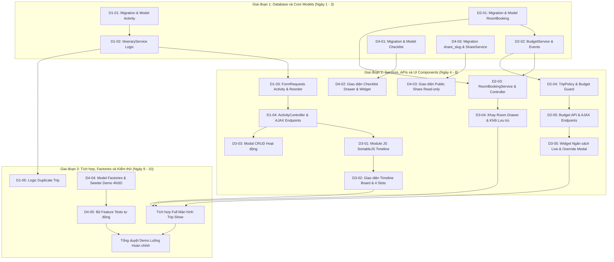

# SPRINT 2: HOÀN THIỆN LỊCH TRÌNH KÉO-THẢ, NGÂN SÁCH THỜI GIAN THỰC, PHÒNG LƯU TRÚ, CHECKLIST & CHIA SẺ CÔNG KHAI

> **Dự án:** Wanderly — Nền tảng lập kế hoạch du lịch thông minh  
> **Thời lượng:** 2 Tuần (Tuần 3 – Tuần 4)  
> **Quy mô Team:** 4 Thành viên  
> **Nhánh phát triển chính:** `develop`  
> **Tài liệu tham chiếu:** [PLAN.md](file:///d:/laragon/www/Wanderly/docs/PLAN.md) | [RULE_FOR_TEAM.md](file:///d:/laragon/www/Wanderly/docs/RULE_FOR_TEAM.md) | [SPRINT1.md](file:///d:/laragon/www/Wanderly/docs/sprints/SPRINT1.md) | OSP_SRS v2.0

---

## 1. Thông tin Chung & Đánh giá Tính Khả thi Sprint 2

### Bối cảnh & Thành quả kế thừa từ Sprint 1:
- **Nền tảng đã sẵn sàng:** Toàn bộ khung ứng dụng Laravel 11, Vite, Tailwind CSS 3, Alpine.js 3, SortableJS, Chart.js đã tích hợp và biên dịch thông suốt.
- **Cơ sở dữ liệu cốt lõi:** Các bảng `users`, `trips`, `trip_members`, `destinations`, `zones`, `pois` đã được migrate và seed dữ liệu mẫu đầy đủ.
- **Auth & Trip CRUD:** Tính năng đăng ký/đăng nhập (throttle 5 lần/phút) và CRUD chuyến đi với phân quyền `TripPolicy` đã hoàn thành 100% test xanh.

### Mục tiêu gom toàn bộ chức năng thiếu vào Sprint 2:
Sprint 2 có nhiệm vụ **hoàn thiện toàn bộ 100% các chức năng cốt lõi của Phase 1 (Core MVP)** được đặc tả trong OSP_SRS v2.0 (từ Module M2 đến M7), đưa Wanderly trở thành một sản phẩm chạy demo hoàn chỉnh luồng nghiệp vụ trong 5 phút:
1. **M3 (Timeline & Kéo-thả):** Lịch trình tự sinh theo ngày, 4 khung giờ/ngày, kéo-thả hoạt động với SortableJS, lưu tự động qua AJAX.
2. **M4 (Ngân sách thời gian thực):** Hệ thống tự động trừ tiền, đổi màu cảnh báo 3 ngưỡng (<80% xanh, 80–95% vàng, >95% đỏ), modal xác nhận vượt chi.
3. **M5 (Phòng & Lưu trú):** Khay phòng đã đặt, kéo thả phòng vào ngày check-in, toggle tính/không tính tiền phòng vào ngân sách.
4. **M6 (Checklist hành lý):** Check list đồ đạc, template gợi ý theo điểm đến (biển/núi/phố), tiến độ % hoàn thành.
5. **M7 (Chia sẻ công khai):** Link xem công khai `/s/{slug}` (Read-only, không cần login, tùy chọn ẩn ngân sách, revoke link).
6. **M2 (Nhân bản chuyến đi):** Tính năng `Duplicate Trip` sao chép nhanh lịch trình và checklist.

---

## 2. Mục tiêu Tổng quan Sprint 2

1. **Khung Timeline kéo-thả chuyên nghiệp (M3):** Hiển thị lịch trình dạng cột theo từng ngày. Mỗi ngày gồm 4 khung giờ: *Morning (06–11h)*, *Midday (11–14h)*, *Afternoon (14–18h)*, *Evening (18–23h)*. Kéo-thả linh hoạt đổi vị trí trong ngày và xuyên ngày, cập nhật thứ tự `position` và `time_slot` tức thời (Optimistic UI) qua AJAX PUT.
2. **Hệ thống tính toán ngân sách tự động (M4):** Xây dựng `BudgetService` lắng nghe sự kiện (`Event/Listener`), tự động cập nhật số dư còn lại mỗi khi thêm/sửa/xóa hoạt động hoặc bật/tắt tiền phòng. Kích hoạt Toast và Modal cảnh báo khi chi phí chạm ngưỡng 80% hoặc 95%.
3. **Quản lý lưu trú độc lập & liên kết lịch trình (M5):** Tạo khay trượt (Room Drawer) lưu danh sách phòng đã đặt; cho phép kéo thẻ phòng vào ngày check-in tương ứng để tạo khối "Lưu trú"; hỗ trợ bật/tắt tính tiền phòng vào tổng ngân sách chuyến đi.
4. **Checklist chuẩn bị hành trang thông minh (M6):** Thao tác tick chọn tức thời bằng AJAX; thanh tiến độ % trực quan; hỗ trợ nạp nhanh template hành lý theo vùng miền (Biển đảo, Vùng núi, Đô thị).
5. **Cổng chia sẻ trực tuyến Read-only (M7):** Sinh slug bảo mật ngẫu nhiên cho link chia sẻ dạng `/s/{slug}`. Người ngoài không cần đăng nhập vẫn xem được toàn bộ lịch trình chi tiết; người tạo có thể bật tùy chọn ẩn chi phí và thu hồi liên kết bất kỳ lúc nào.
6. **Nhân bản chuyến đi một chạm (M2):** Cho phép nhân bản (`duplicate`) chuyến đi hiện có, sao chép toàn bộ ngày, hoạt động và danh mục checklist sang một chuyến đi mới của người dùng.
7. **Đảm bảo chất lượng & Kiểm thử tự động:** Đạt 100% Pass bộ Feature/Unit Test mới (`TimelineTest`, `BudgetTest`, `PublicShareTest`), tuân thủ định dạng `php artisan pint` và chuẩn localization English First (`__('...')`).

---

## 3. Quy tắc Chung Sprint 2 (Sprint Ground Rules)

- **Chiến lược Đa ngôn ngữ (English First & i18n):** Toàn bộ nhãn, tiêu đề, placeholder, thông báo flash, validation messages và tên slot timeline bắt buộc viết bằng Tiếng Anh và bọc trong hàm `__('...')`.
- **Nguyên tắc "Skinny Controller, Fat Service":** Controller tuyệt đối không chứa logic tính toán tiền nong hay sắp xếp thứ tự timeline. Toàn bộ logic phải nằm ở `ItineraryService`, `BudgetService`, `RoomBookingService`, `ChecklistService`, `ShareService`.
- **Cơ chế kéo-thả Optimistic UI & Atomic Reorder:** Frontend cập nhật giao diện ngay khi thả chuột; gửi AJAX PUT lên server. Backend xử lý cập nhật `position` và `time_slot` trong một `DB::transaction()`. Nếu có lỗi HTTP (422, 500), Frontend tự động rollback về vị trí ban đầu và hiển thị Toast thông báo.
- **Quy chuẩn dữ liệu tiền tệ:** Mọi trường chi phí (`cost`, `price`, `budget`, `spent`) bắt buộc dùng kiểu dữ liệu `DECIMAL(12, 2)` trên MySQL.
- **Nguyên tắc địa điểm dạng văn bản (Strictly No Map API):** Toàn bộ vị trí hoạt động và khách sạn chỉ lưu trữ dạng chuỗi text (`location`, `address`), tuyệt đối không tích hợp Google Maps, Mapbox, Leaflet hay lưu tọa độ GPS.
- **Bảo mật phân quyền phía Server (Server-side Authorization):** Quyền kéo-thả, thêm hoạt động, đặt phòng chỉ dành cho `leader` và `editor`. Role `viewer` bị chặn thao tác ghi và server **tuyệt đối không trả về số liệu ngân sách** trong API gửi cho viewer.
- **Quy chuẩn Git & Code Style:** Nhánh feature đặt tên theo cú pháp `feature/ten-tinh-nang`. Trước khi tạo PR phải chạy `php artisan pint` và `php artisan test`. Mỗi PR phải có tối thiểu 01 lượt Review & Approve.

---

## 4. Sơ đồ Phụ thuộc & Thứ tự Thực hiện giữa các Thành viên



---

## 5. Bảng Phân chia Công việc Chi tiết cho Team 4 người

### THÀNH VIÊN 1: Timeline Engine, Activity Management & Trip Duplication

* **Mục tiêu:** Xây dựng cấu trúc dữ liệu hoạt động, tầng Service xử lý kéo-thả atomic reorder, FormRequests, ActivityController và tính năng nhân bản chuyến đi (M2, M3).
* **Nhiệm vụ chi tiết:**

| Task ID | Tên công việc | Vị trí thư mục | Tên file & Outcome chi tiết |
| :--- | :--- | :--- | :--- |
| **D1-01** | Migration & Model Activity (M3) | `database/migrations/`,<br>`app/Models/` | • `xxxx_create_activities_table.php`: Các cột `id`, `trip_id` (foreignId cascade), `day` (unsignedTinyInteger: 1, 2, ...), `time_slot` (enum: 'morning', 'midday', 'afternoon', 'evening'), `start_time` (time, nullable), `end_time` (time, nullable), `title` (string), `cost` (decimal: 12,2, default 0), `category` (enum: 'sightseeing', 'dining', 'cafe', 'shopping', 'entertainment', 'other'), `location` (string text), `address` (string text, nullable), `notes` (text, nullable), `type` (enum: 'activity', 'room', 'booking', default 'activity'), `position` (unsignedInteger, default 0), index tại `['trip_id', 'day', 'time_slot', 'position']`, `timestamps`.<br>• `app/Models/Activity.php`: Khai báo `$fillable`, casts: `'cost' => 'decimal:2'`, `'day' => 'integer'`, `'position' => 'integer'`; quan hệ `belongsTo(Trip::class)`. |
| **D1-02** | Xây dựng Service điều phối Lịch trình (ItineraryService) | `app/Services/` | • `ItineraryService.php`:<br>  - `getTripTimeline(Trip $trip): array`: Gom nhóm hoạt động theo từng ngày (Day 1..N) và từng slot thời gian, sắp xếp theo `position` tăng dần.<br>  - `calculateDailyCost(Trip $trip, int $day): float`: Tính tổng chi phí các hoạt động trong một ngày.<br>  - `reorderActivities(Trip $trip, array $reorderData): bool`: Mở `DB::beginTransaction()`, duyệt mảng cập nhật đồng thời `day`, `time_slot` và `position` mới cho các activities, phát Event `ActivityCostChanged` nếu có dịch chuyển ảnh hưởng ngân sách, `DB::commit()`, rollback khi ngoại lệ.<br>  - `detectTimeConflict(Trip $trip, int $day, ?string $startTime, ?string $endTime, ?int $excludeActivityId = null): bool`: Kiểm tra xem có hoạt động nào khác trong cùng ngày bị trùng khung giờ bắt đầu/kết thúc không (trả về flag cảnh báo cho UI, không chặn thao tác). |
| **D1-03** | FormRequests xác thực Hoạt động & Kéo-thả | `app/Http/Requests/Activity/` | • `StoreActivityRequest.php`: Rules validate `title` (required, max:255), `day` (required, integer, min:1), `time_slot` (required, in:morning,midday,afternoon,evening), `cost` (required, numeric, min:0), `category` (required), `location` (required, string), `start_time`, `end_time` (nullable, date_format:H:i). Toàn bộ messages bọc trong `__('...')`.<br>• `UpdateActivityRequest.php`: Tái sử dụng các rules trên cho thao tác sửa.<br>• `ReorderActivityRequest.php`: Validate mảng items gồm `id`, `day`, `time_slot`, `position`. |
| **D1-04** | Xây dựng ActivityController & AJAX Endpoints | `app/Http/Controllers/Trip/`,<br>`routes/ajax.php`,<br>`routes/web.php` | • `ActivityController.php`: Phân quyền qua `TripPolicy@update`. Triển khai các phương thức: `store`, `update`, `destroy`, `reorder` (nhận AJAX request và trả về JSON chuẩn hóa `{ "success": true, "daily_cost": ... }`).<br>• Đăng ký routes AJAX: `PUT /ajax/trips/{trip}/activities/reorder` và các route resource activities. |
| **D1-05** | Tính năng Nhân bản Chuyến đi (Duplicate Trip - M2) | `app/Services/`,<br>`app/Http/Controllers/Trip/` | • Bổ sung hàm `duplicateTrip(Trip $originalTrip, User $newOwner): Trip` trong `TripService`: Nhân bản trip mới với tên `Copy of ...`, sao chép toàn bộ các bản ghi `Activity` và `ChecklistItem` sang trip mới trong một transaction; không sao chép danh sách thành viên hay phòng đặt.<br>• Route `POST /trips/{trip}/duplicate` trong `TripController@duplicate`, chuyển hướng về trang chi tiết chuyến đi mới kèm flash message thành công. |

---

### THÀNH VIÊN 2: Budget Engine, Room Bookings & Event-Driven Architecture

* **Mục tiêu:** Xây dựng thực thể phòng lưu trú (M5), cơ chế tính toán trừ ngân sách tự động kèm cảnh báo 3 ngưỡng màu (M4), kiến trúc Event/Listener và bảo mật phân quyền ngân sách.
* **Nhiệm vụ chi tiết:**

| Task ID | Tên công việc | Vị trí thư mục | Tên file & Outcome chi tiết |
| :--- | :--- | :--- | :--- |
| **D2-01** | Migration & Model RoomBooking (M5) | `database/migrations/`,<br>`app/Models/` | • `xxxx_create_room_bookings_table.php`: Các cột `id`, `trip_id` (foreignId cascade), `hotel_name` (string), `room_type` (string, nullable), `check_in` (date), `check_out` (date), `price` (decimal: 12,2, default 0), `address` (string text, nullable), `notes` (text, nullable), `is_budget_included` (boolean, default true), `timestamps`.<br>• `app/Models/RoomBooking.php`: Khai báo `$fillable`, casts: `'price' => 'decimal:2'`, `'check_in' => 'date'`, `'check_out' => 'date'`, `'is_budget_included' => 'boolean'`; quan hệ `belongsTo(Trip::class)`. |
| **D2-02** | Xây dựng Service Ngân sách & Event-Driven Architecture (M4) | `app/Services/`,<br>`app/Events/`,<br>`app/Listeners/` | • `BudgetService.php`:<br>  - `calculateBudgetStatus(Trip $trip): array`: Trả về mảng chi tiết: `budget` (tổng ngân sách), `activities_cost` (tổng chi phí hoạt động), `room_cost` (tổng tiền các phòng có `is_budget_included = true`), `total_spent` (activities + room), `remaining_budget` (budget − total_spent), `percentage` (tỷ lệ % đã chi), `status` ('normal' <80%, 'warning' 80–95%, 'danger' >95%).<br>  - `checkThreshold(Trip $trip, float $newTotalSpent): ?string`: Xác định xem việc thay đổi chi phí có làm vượt ngưỡng 80% hoặc 95% không.<br>• Các Event & Listener: `ActivityCostChanged.php`, `RoomBudgetToggled.php` kích hoạt `RecomputeTripBudget.php` để đồng bộ cache và sẵn sàng cho hệ thống thông báo. |
| **D2-03** | Service & Controller Quản lý Phòng lưu trú (M5) | `app/Services/`,<br>`app/Http/Controllers/Trip/`,<br>`app/Http/Requests/Room/` | • `RoomBookingService.php`: Xử lý CRUD phòng đặt; hàm `toggleBudgetInclusion(RoomBooking $room): bool` bật/tắt tính tiền phòng vào ngân sách; hàm `attachToTimeline(RoomBooking $room, int $day, string $slot)` tạo bản ghi `Activity` tương ứng với `type = 'room'`.<br>• `StoreRoomBookingRequest.php`: Validate tên khách sạn, ngày check-in/out, giá tiền `min:0`.<br>• `RoomBookingController.php`: Xử lý các endpoint lưu trữ, cập nhật, xóa phòng và toggle ngân sách. |
| **D2-04** | Phân quyền Bảo mật Ngân sách & TripPolicy mở rộng | `app/Policies/` | • Mở rộng `TripPolicy.php`:<br>  - `viewBudget(User $user, Trip $trip)`: Chỉ cho phép `leader` và `editor` xem số tiền ngân sách chi tiết. Người dùng có role `viewer` bị trả về `403` hoặc dữ liệu budget bị ẩn/strip sạch khỏi JSON API.<br>  - `manageRooms(User $user, Trip $trip)`: Chỉ cho phép `leader` và `editor` thêm/sửa/xóa phòng. |
| **D2-05** | Routes & API Endpoint Ngân sách | `routes/web.php`,<br>`routes/ajax.php`,<br>`app/Http/Controllers/Trip/` | • `BudgetController.php`: Endpoint `GET /trips/{trip}/budget` trả về JSON hiện trạng ngân sách cho widget frontend (có kiểm tra `TripPolicy@viewBudget`).<br>• Route `PATCH /ajax/rooms/{room}/toggle-budget` phục vụ chuyển đổi tính tiền phòng ngay trên giao diện mà không cần reload trang. |

---

### THÀNH VIÊN 3: Interactive Timeline Board, SortableJS Drag & Drop & Realtime UI

* **Mục tiêu:** Xây dựng toàn bộ giao diện bảng lịch trình tương tác, tích hợp thư viện SortableJS kéo-thả đa khung giờ, Modal thao tác hoạt động, Khay lưu trú và Widget ngân sách nhảy số thời gian thực (M3, M4, M5).
* **Nhiệm vụ chi tiết:**

| Task ID | Tên công việc | Vị trí thư mục | Tên file & Outcome chi tiết |
| :--- | :--- | :--- | :--- |
| **D3-01** | Xây dựng Module JavaScript Kéo-thả SortableJS | `resources/js/modules/`,<br>`resources/js/app.js` | • `resources/js/modules/timeline.js`: Khởi tạo SortableJS trên từng container slot thời gian; thiết lập thuộc tính `group: 'trip-timeline'`; xử lý sự kiện `onEnd(evt)`; thu thập mảng thứ tự mới; gửi AJAX PUT đến `/ajax/trips/{id}/activities/reorder`; hiển thị loading spinner nhỏ; bắt lỗi mạng hoặc lỗi HTTP 422/500 để thực hiện **rollback** đưa thẻ về vị trí cũ; gọi event làm mới widget ngân sách.<br>• Import module vào `app.js`. |
| **D3-02** | Giao diện Timeline Board theo Ngày & 4 Khung giờ (M3) | `resources/views/trips/`,<br>`resources/views/components/` | • Cải tiến màn hình `resources/views/trips/show.blade.php`: Thanh điều hướng chọn ngày (Day 1, Day 2... hoặc cuộn ngang mượt mà).<br>• Mỗi ngày chia thành 4 khối thời gian trực quan: *Morning (06–11h)*, *Midday (11–14h)*, *Afternoon (14–18h)*, *Evening (18–23h)*.<br>• Mỗi thẻ hoạt động hiển thị: icon phân loại, tên hoạt động, giờ bắt đầu/kết thúc, badge chi phí định dạng VND, địa chỉ text, nút thao tác sửa/xóa nhanh; tag cảnh báo màu cam nếu bị trùng giờ.<br>• Phần chân mỗi ngày hiển thị tổng chi phí tích lũy của riêng ngày đó: `{{ __('Day Total: :cost', ['cost' => ...]) }}`. |
| **D3-03** | Bộ Modal CRUD Hoạt động bằng Alpine.js | `resources/views/trips/partials/` | • `activity-modal.blade.php`: Modal thêm/sửa hoạt động bằng Alpine.js (`x-data="{ open: false, mode: 'create', ... }`); Form gồm tiêu đề, chọn ngày, chọn khung giờ, giờ cụ thể (`type="time"`), chi phí (`type="number"`), danh mục (tham quan, ăn uống, cafe...), địa chỉ text và ghi chú.<br>• Bắt lỗi validation hiển thị trực tiếp trong modal; tự động đóng modal và chèn thẻ hoạt động mới vào đúng vị trí trên giao diện mà không cần reload trang. |
| **D3-04** | Giao diện Khay phòng lưu trú (Room Drawer) & Khối Lưu trú | `resources/views/trips/partials/` | • `room-drawer.blade.php`: Khay trượt bên hông (Offcanvas Drawer) quản lý danh sách phòng đã đặt; form thêm phòng nhanh; switch toggle tính tiền phòng vào ngân sách.<br>• Thiết kế khối thẻ "Lưu trú" riêng biệt trên timeline: Viền màu tím indigo sang trọng, icon khách sạn, hiển thị thời gian check-in/check-out; cho phép kéo từ khay vào slot hoặc kéo trả lại khay để gỡ. |
| **D3-05** | Widget Ngân sách Thời gian thực & Modal Xác nhận Vượt ngân sách (M4) | `resources/views/trips/partials/` | • `budget-widget.blade.php`: Thanh tiến trình ngân sách dính (Sticky bar/Widget) tự động cập nhật số liệu qua sự kiện Alpine/CustomEvent: hiển thị tổng ngân sách, đã chi, còn lại; đổi màu động (xanh <80%, vàng hổ phách 80–95%, đỏ >95%); hiển thị Toast cảnh báo khi vượt ngưỡng.<br>• `budget-override-modal.blade.php`: Modal bật lên khi người dùng nhập chi phí làm ngân sách vượt quá 100%, yêu cầu bấm "Confirm & Override" mới cho phép lưu. |

---

### THÀNH VIÊN 4: Checklist Module, Public Share Link, Mock Seeders & Automated Testing

* **Mục tiêu:** Xây dựng tính năng checklist hành trang kèm gợi ý template (M6), cổng chia sẻ công khai Read-only `/s/{slug}` (M7), seed dữ liệu kịch bản demo 4N3D và bộ kiểm thử tự động toàn diện.
* **Nhiệm vụ chi tiết:**

| Task ID | Tên công việc | Vị trí thư mục | Tên file & Outcome chi tiết |
| :--- | :--- | :--- | :--- |
| **D4-01** | Migration, Model & Service cho Checklist (M6) | `database/migrations/`,<br>`app/Models/`,<br>`app/Services/` | • `xxxx_create_checklist_items_table.php`: Khóa chính `id`, `trip_id` (foreignId cascade), `title` (string), `category` (string: trang phục, giấy tờ, y tế, điện tử, đồ cá nhân), `is_completed` (boolean, default false), `position` (unsignedInteger, default 0), `timestamps`.<br>• `app/Models/ChecklistItem.php`: Khai báo `$fillable`, cast `'is_completed' => 'boolean'`; quan hệ `belongsTo(Trip::class)`.<br>• `ChecklistService.php`: CRUD item; tính toán % tiến độ hoàn thành; hàm `applyTemplate(Trip $trip, string $templateType)` nạp danh mục gợi ý có sẵn theo 3 chủ đề: 'beach' (biển), 'mountain' (núi), 'city' (thành phố). |
| **D4-02** | Giao diện Quản lý Checklist (Checklist Drawer & Widget) | `resources/views/trips/partials/` | • `checklist-drawer.blade.php`: Giao diện danh sách kiểm tra đồ đạc; thanh tiến độ % tiến độ kèm hiệu ứng chuyển động; checkbox tick chọn cập nhật ngầm qua AJAX `PATCH /ajax/checklist/{item}/toggle`; bộ lọc theo danh mục; nút chọn nhanh "Apply Template" mở modal xác nhận nạp mẫu đồ gợi ý. |
| **D4-03** | Tính năng & Giao diện Chia sẻ Công khai (Public Share - M7) | `database/migrations/`,<br>`app/Services/`,<br>`app/Http/Controllers/Trip/`,<br>`resources/views/public/` | • Migration bổ sung các cột vào bảng `trips`: `share_slug` (string, unique, nullable), `is_shared` (boolean, default false), `is_share_budget_visible` (boolean, default true).<br>• `ShareService.php`: Sinh slug ngẫu nhiên an toàn (`Str::random(16)`); bật/tắt chia sẻ; thu hồi (revoke) link.<br>• `PublicShareController.php`: Route `GET /s/{slug}` phục vụ xem chuyến đi ở chế độ Read-only, không yêu cầu đăng nhập; nếu trip tắt chia sẻ thì trả về `404 Not Found`; tự động ẩn phần ngân sách nếu `is_share_budget_visible = false`.<br>• `resources/views/public/share.blade.php`: Giao diện xem lịch trình tinh gọn, sạch đẹp, tối ưu in ấn và không có các nút chỉnh sửa/xóa của chủ sở hữu. |
| **D4-04** | Model Factories & Seeder Kịch bản Demo 4N3D | `database/factories/`,<br>`database/seeders/` | • `ActivityFactory.php`: Sinh dữ liệu hoạt động đa dạng kèm khung giờ và chi phí.<br>• `RoomBookingFactory.php`: Sinh dữ liệu đặt phòng khách sạn.<br>• `ChecklistItemFactory.php`: Sinh các đầu việc kiểm tra.<br>• `TripDemoSeeder.php`: Tạo sẵn 01 chuyến đi mẫu hoàn chỉnh: "4 Days in Da Lat Pine Paradise" gồm đầy đủ 8 hoạt động phân bố trên 4 ngày, 01 phòng khách sạn đã đặt tại Tuyền Lâm, checklist 12 món đã tick 50%, số liệu ngân sách ở mức 82% (ngưỡng vàng cảnh báo) để phục vụ chấm điểm và demo trực quan ngay lập tức. |
| **D4-05** | Bộ Kiểm thử Tự động Toàn diện (Feature Tests) | `tests/Feature/` | • `TimelineTest.php`: Kiểm tra CRUD hoạt động; kiểm tra endpoint AJAX reorder cập nhật đúng `day`, `time_slot`, `position` trong database; kiểm tra phát hiện trùng giờ.<br>• `BudgetTest.php`: Kiểm tra `BudgetService` tính toán chính xác số dư khi thêm/xóa hoạt động; kiểm tra cảnh báo ngưỡng 80% và 95%; xác minh role `viewer` không đọc được dữ liệu ngân sách (HTTP 403 / strip data); kiểm tra toggle tiền phòng.<br>• `PublicShareTest.php`: Kiểm tra truy cập link `/s/{slug}` không cần đăng nhập; kiểm tra ẩn ngân sách trên link share khi tắt cờ; kiểm tra link bị vô hiệu hóa sau khi revoke. |

---

## 6. Tiêu chuẩn Nghiệm thu Sprint 2 (Sprint 2 Acceptance Criteria & DoD)

Dự án chỉ được coi là hoàn thành Sprint 2 khi đạt đủ **100% các tiêu chí** sau:

- [ ] Lệnh `php artisan migrate:fresh --seed` chạy thành công tuyệt đối, nạp đầy đủ kịch bản demo 4N3D phong phú.
- [ ] Chạy `php artisan test` đạt **100% Pass** cho toàn bộ các test cases mới (`TimelineTest`, `BudgetTest`, `PublicShareTest`) cùng các test cũ của Sprint 1.
- [ ] Chạy `php artisan pint` đạt kết quả xanh, không có bất kỳ lỗi định dạng mã nguồn PSR-12 nào.
- [ ] Lệnh `npm run build` biên dịch sạch sẽ không báo lỗi CSS/JS bundle.
- [ ] Màn hình chi tiết chuyến đi hiển thị đầy đủ các cột ngày, chia rõ 4 khung giờ: Morning, Midday, Afternoon, Evening.
- [ ] Thao tác kéo-thả bằng chuột (SortableJS) giữa các khung giờ và giữa các ngày hoạt động mượt mà; tự động lưu ngầm dưới 500ms; tự khôi phục vị trí (rollback) nếu cố tình ngắt mạng hoặc server trả mã lỗi.
- [ ] Khi nhập thêm chi phí hoạt động, thanh tiến trình ngân sách tự động cập nhật số liệu và đổi màu chính xác: Xanh (<80%), Vàng (80–95%), Đỏ (>95%); kích hoạt modal Override nếu chi vượt ngân sách.
- [ ] Khay phòng lưu trú cho phép kéo thẻ phòng vào ngày check-in tạo khối "Lưu trú"; nút toggle tính tiền phòng cập nhật lại ngân sách ngay lập tức.
- [ ] Checklist hành lý cho phép tick chọn mượt mà, thanh tiến độ % nhảy số thời gian thực; nút nạp template theo biển/núi/phố hoạt động chuẩn xác.
- [ ] Tính năng nhân bản chuyến đi (`Duplicate Trip`) tạo ra bản sao đầy đủ hoạt động và checklist thành công.
- [ ] Đường dẫn chia sẻ `/s/{slug}` mở được trên trình duyệt ẩn danh (không cần đăng nhập), hiển thị lịch trình đẹp mắt và tuân thủ đúng tùy chọn ẩn/hiện chi phí ngân sách.
- [ ] Toàn bộ UI Blade views, nhãn, nút bấm, thông báo flash và lỗi validate được viết bằng Tiếng Anh chuẩn mực và bọc trong hàm helper `__('...')`.
- [ ] Toàn bộ các nhánh tính năng của 4 thành viên đã được Review, Approve và Merge sạch sẽ vào nhánh `develop`.

---

## 7. Kịch bản Demo Cuối Sprint 2 (End-to-End Demo Flow)

Kịch bản demo thực tế kiểm chứng toàn bộ luồng hoạt động trong **5 phút**:

```text
[1. Đăng nhập hệ thống]
     ↓  Đăng nhập bằng tài khoản Demo Traveler (demo@wanderly.test / password).
[2. Mở Chuyến đi mẫu hoặc Tạo mới]
     ↓  Mở chuyến đi "4 Days in Da Lat Pine Paradise" từ Dashboard.
[3. Trải nghiệm Kéo-thả Lịch trình (M3)]
     ↓  Thêm mới một hoạt động "Sunset at Tuyen Lam Lake" vào khung giờ Afternoon Ngày 1 (Chi phí: 150.000 VND).
     ↓  Kéo-thả chuyển hoạt động này từ Ngày 1 sang khung giờ Evening Ngày 2 → Quan sát lưu ngầm tức thì qua AJAX.
[4. Kiểm chứng Cảnh báo Ngân sách (M4)]
     ↓  Nhập thêm một bữa tiệc tối với chi phí cao đẩy tổng chi tiêu chạm ngưỡng 85% → Thanh tiến trình chuyển sang màu Vàng (Warning) kèm Toast cảnh báo.
     ↓  Thử nhập chi phí vượt quá tổng ngân sách → Modal "Budget Override Warning" xuất hiện yêu cầu xác nhận.
[5. Tương tác Khay Lưu trú (M5)]
     ↓  Mở khay Room Drawer, bấm tạo phòng "Terracotta Resort Da Lat" (Check-in Ngày 1, Giá 2.500.000 VND).
     ↓  Kéo thẻ phòng vào slot Morning Ngày 1 → Khối "Lưu trú" viền tím xuất hiện trên timeline.
     ↓  Bấm công tắc Toggle "Include in Budget" → Quan sát ngân sách tự động cộng/trừ tiền phòng ngay lập tức.
[6. Thử nghiệm Checklist Hành lý (M6)]
     ↓  Mở Checklist Drawer, bấm "Apply Template" → Chọn chủ đề "Mountain / Highland".
     ↓  Hệ thống tự nạp danh mục: Áo ấm, Giày leo núi, Thuốc chống côn trùng...
     ↓  Tick chọn 3 món đồ → Thanh tiến độ % tăng lên mượt mà.
[7. Chia sẻ Công khai & Kiểm tra Ẩn danh (M7)]
     ↓  Bấm nút "Share Trip", bật tùy chọn "Hide Budget Information", bấm "Copy Public Link".
     ↓  Mở cửa sổ ẩn danh (Incognito Window), dán liên kết `/s/{slug}`.
     ↓  Xác nhận: Xem được toàn bộ timeline kéo-thả và checklist nhưng toàn bộ số liệu ngân sách đã được ẩn hoàn toàn.
[8. Thử nghiệm Nhân bản Chuyến đi (M2)]
     ↓  Quay lại màn hình chính, bấm nút "Duplicate Trip" → Hệ thống tạo ra chuyến đi mới "Copy of 4 Days in Da Lat Pine Paradise" giữ nguyên cấu trúc lịch trình.
```
