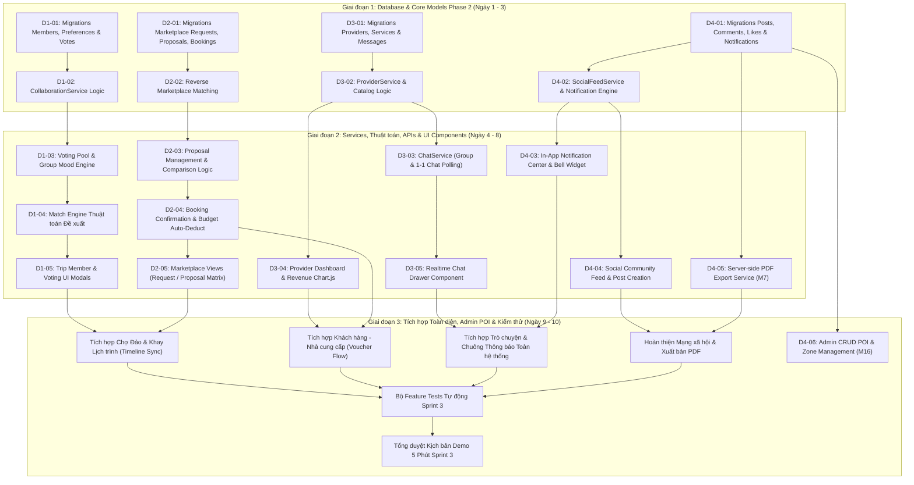

# SPRINT 3: CỘNG TÁC NHÓM, REVERSE MARKETPLACE, QUẢN LÝ NHÀ CUNG CẤP, CHAT, MẠNG XÃ HỘI & XUẤT PDF

> **Dự án:** Wanderly — Nền tảng lập kế hoạch du lịch thông minh  
> **Thời lượng:** 2 Tuần (Tuần 5 – Tuần 6)  
> **Quy mô Team:** 4 Thành viên  
> **Nhánh phát triển chính:** `develop`  
> **Tài liệu tham chiếu:** [PLAN.md](file:///d:/Dev/Projects/School/Wanderly/docs/PLAN.md) | [RULE_FOR_TEAM.md](file:///d:/Dev/Projects/School/Wanderly/docs/RULE_FOR_TEAM.md) | [SPRINT1.md](file:///d:/Dev/Projects/School/Wanderly/docs/sprints/SPRINT1.md) | [SPRINT2.md](file:///d:/Dev/Projects/School/Wanderly/docs/sprints/SPRINT2.md) | OSP_SRS v2.0

---

## 1. Thông tin Chung & Đánh giá Tính Khả thi Sprint 3

### Bối cảnh & Thành quả kế thừa từ Sprint 1 và Sprint 2:
- **Phase 1 (Core MVP) đã hoàn thành 100%:**
  - Nền tảng xác thực đa vai trò (Traveler, Admin) với cơ chế Rate Limiting chống brute-force 5 lần/phút.
  - Quản lý chuyến đi (CRUD, đếm ngược ngày đi, nhân bản chuyến đi `Duplicate Trip`).
  - Lịch trình kéo-thả tương tác SortableJS 4 khung giờ/ngày (Optimistic UI, lưu ngầm AJAX PUT, phát hiện trùng giờ).
  - Quản lý ngân sách thời gian thực tự động trừ chi phí và đổi màu cảnh báo 3 ngưỡng (<80% xanh, 80–95% vàng, >95% đỏ).
  - Khay phòng lưu trú độc lập, kéo thẻ vào ngày check-in, bật/tắt tính tiền phòng vào ngân sách.
  - Checklist hành trang thông minh hỗ trợ 3 bộ template mẫu theo điểm đến (Biển đảo, Vùng núi, Thành phố).
  - Đường dẫn chia sẻ trực tuyến Read-only `/s/{slug}` hỗ trợ ẩn thông tin ngân sách và thu hồi liên kết.
  - Toàn bộ cơ sở dữ liệu vị trí là thuần văn bản (Strictly Text-based POIs), tuyệt đối không phụ thuộc vào bất kỳ Map API nào.
  - Toàn bộ giao diện và thông báo hệ thống tuân thủ nghiêm ngặt chiến lược **English First & i18n Ready (`__('...')`)**.

### Mục tiêu Sprint 3: Triển khai toàn bộ Phase 2 (Cộng tác & Marketplace):
Sprint 3 đưa Wanderly từ một công cụ lập kế hoạch cá nhân trở thành một **nền tảng kết nối cộng đồng và hệ sinh thái du lịch tương tác đa chiều**:
1. **M8 (Thành viên, Phân quyền & Vote cộng tác):** Mời thành viên bằng token link bảo mật (hạn 7 ngày) hoặc username; phân quyền chặt chẽ (`leader`, `editor`, `viewer`); biểu quyết địa điểm/dịch vụ (+1/-1); tính toán chỉ số sở thích chung của nhóm (**Group Mood**).
2. **M9 (Match Engine):** Thuật toán gợi ý lịch trình bản nháp thông minh theo luật điểm số, khớp nhịp điệu (pace), gom địa điểm cùng khu vực (zone), khống chế trong trần ngân sách và giải thích chi tiết điểm số từng mục.
3. **M10 (Reverse Marketplace):** Mô hình sàn giao dịch đảo — khách chuyển chuyến đi thành `Travel Request`; các nhà cung cấp địa phương gửi gói đề xuất (`Proposal`); khách so sánh trực quan, chấp nhận trọn gói hoặc chọn lẻ để sinh `Booking`, tự động cấp mã voucher và đồng bộ vào ngân sách cùng khay kéo-thả timeline.
4. **M11 (Cổng Nhà cung cấp dịch vụ - Provider Portal):** Đăng ký hồ sơ đơn vị cung ứng dịch vụ (lưu trú, xe, tour, nhà hàng, chụp ảnh, hướng dẫn viên); quản lý danh mục dịch vụ (`Catalog` kèm `specs JSON`); lịch làm việc và chặn ngày trống; Dashboard phân tích doanh thu bằng Chart.js và quản lý vòng đời booking.
5. **M12 (Hệ thống Chat đa kênh):** Trò chuyện nhóm theo chuyến đi và trò chuyện trực tiếp 1-1 theo Proposal/Booking giữa khách và nhà cung cấp; hỗ trợ tin nhắn văn bản, hình ảnh đính kèm và badge số tin chưa đọc (AJAX Polling).
6. **M13 (Mạng xã hội du lịch thu nhỏ v1):** Bảng tin cộng đồng (Social Feed); đăng bài viết trải nghiệm đính kèm thẻ tóm tắt chuyến đi (`Trip Card`); tương tác thích (Like), bình luận (Comment) và lưu bài viết (Bookmark).
7. **M7 bổ sung (Xuất PDF Lịch trình):** Kết xuất lịch trình toàn diện sang tài liệu PDF chuyên nghiệp từ phía máy chủ (Server-side PDF Export).
8. **M15 (Trung tâm Thông báo In-App):** Chuông thông báo trên thanh tiêu đề nhận diện biến động ngân sách, lời mời nhóm, đề xuất dịch vụ mới và trạng thái đơn đặt.
9. **M16 bổ sung (Admin Quản trị Điểm đến):** Bảng điều khiển quản trị CRUD Điểm đến (Destinations), Khu vực (Zones) và Địa điểm (POIs) làm giàu kho dữ liệu cho Match Engine.

---

## 2. Mục tiêu Tổng quan Sprint 3

1. **Cơ chế Cộng tác nhóm & Bầu chọn dân chủ (M8):** Xây dựng luồng mời bạn bè gia nhập chuyến đi qua liên kết token ngẫu nhiên có thời hạn 7 ngày; kiểm soát quyền hạn bằng `TripPolicy` mở rộng; tính toán thanh phần trăm hòa hợp sở thích nhóm (`Group Mood`) dựa trên tags yêu thích và nhịp điệu di chuyển (`pace`); cho phép biểu quyết (+1/-1) trên danh sách ứng viên đề cử.
2. **Cỗ máy Đề xuất Lịch trình theo Luật (Match Engine - M9):** Phát triển thuật toán tự động đề xuất lịch trình tối ưu dựa trên công thức hàm mục tiêu:  
   $$\text{Score} = w_1 \cdot \text{Vote} + w_2 \cdot \text{Mood} + w_3 \cdot \text{Rating} - w_4 \cdot \left(\frac{\text{Cost}}{\text{Budget}}\right)$$  
   kèm ràng buộc số hoạt động/ngày theo nhịp độ (3, 4 hoặc 5 hoạt động), nhóm các địa điểm cùng Zone vào chung một ngày và hiển thị minh bạch bảng giải thích điểm số (Score Breakdown).
3. **Mô hình Chợ Dịch vụ Đảo (Reverse Marketplace - M10):** Chuyển đổi chuyến đi thành yêu cầu du lịch (`Travel Request`); tự động khớp và thông báo đến các nhà cung cấp phù hợp; tiếp nhận và so sánh song song các gói đề xuất (`Proposals`); chấp nhận hợp đồng nguyên bundle hoặc tách lẻ, tự động trừ tiền trong `BudgetService`, sinh mã voucher an toàn và đưa thẻ dịch vụ vào khay lịch trình.
4. **Không gian làm việc cho Nhà cung cấp (Provider Portal - M11):** Tạo phân hệ riêng cho Provider với hồ sơ công khai, quản lý biểu giá và thông số kỹ thuật (`specs JSON`) của dịch vụ; lịch khả dụng kèm tính năng chặn ngày bận; Dashboard trực quan với biểu đồ doanh thu theo thời gian qua Chart.js.
5. **Hệ thống Trò chuyện Đa luồng (Chat - M12):** Triển khai luồng chat nhóm nội bộ giữa các thành viên chuyến đi và kênh chat riêng 1-1 giữa khách với từng đối tác cung cấp dịch vụ; hỗ trợ upload ảnh, badge thông báo tin chưa đọc, vận hành mượt mà qua cơ chế AJAX Polling (chu kỳ 3-5 giây).
6. **Mạng xã hội Chia sẻ Hành trình (Social Feed - M13):** Cho phép người dùng đăng bài trải nghiệm đính kèm liên kết thẻ chuyến đi công khai; trang feed khám phá bài viết cộng đồng; hỗ trợ thả tim, bình luận và lưu trữ bài viết yêu thích.
7. **Kết xuất Tài liệu Lịch trình PDF (Export PDF - M7):** Tạo dịch vụ xuất PDF chuyên nghiệp gồm trang bìa phong cách, chi tiết lộ trình từng ngày và khung giờ, bảng tổng kết tài chính và danh mục hành lý.
8. **Chuông Thông báo Tức thời & Quản trị Nội dung (M15, M16):** Tích hợp trung tâm thông báo in-app cho toàn bộ sự kiện quan trọng trong hệ thống; bổ sung module Admin quản lý danh mục POIs/Zones phục vụ vận hành.
9. **Đảm bảo Chất lượng & Kiểm thử Tự động:** Hoàn thiện bộ Feature Tests mới (`CollaborationTest`, `MarketplaceTest`, `ChatSocialTest`, `PdfExportTest`) đạt 100% Pass, code sạch theo chuẩn `php artisan pint` và đa ngôn ngữ English First.

---

## 3. Quy tắc Chung Sprint 3 (Sprint Ground Rules)

- **Chiến lược Đa ngôn ngữ (English First & i18n):** Toàn bộ nhãn, tiêu đề, trạng thái booking, thông báo flash, validation messages và nội dung email/PDF bắt buộc viết bằng **Tiếng Anh** và bọc trong hàm helper `__('...')`.
- **Nguyên tắc Phân tầng Kiến trúc (Skinny Controller, Fat Service):** Controller tuyệt đối không chứa logic so khớp thuật toán, tính toán ma trận điểm, sinh mã voucher hay xử lý file PDF. Toàn bộ logic nghiệp vụ phải nằm trong các Service tương ứng (`CollaborationService`, `MatchEngineService`, `MarketplaceService`, `ProviderService`, `ChatService`, `SocialFeedService`, `PdfExportService`, `NotificationService`).
- **Nguyên tắc Cơ sở Dữ liệu & Tính Toàn vẹn Giao dịch (ACID Transactions):**
  - Tuyệt đối không chỉnh sửa các migration cũ đã merge. Mọi bảng mới hoặc bổ sung cột phải viết migration mới có hàm `down()` hoàn chỉnh.
  - Mọi thao tác tài chính, tạo Booking, trừ ngân sách và chấp nhận Proposal bắt buộc bọc trong `DB::transaction()`.
  - Tiền tệ và đơn giá dịch vụ bắt buộc dùng kiểu `DECIMAL(12, 2)`.
  - Cột cấu hình linh hoạt (sở thích, thông số kỹ thuật dịch vụ, dữ liệu thông báo) sử dụng kiểu `JSON`.
- **Nguyên tắc Vị trí Dạng Văn bản (Strictly No Map API):** Toàn bộ dữ liệu điểm đến, khu vực của nhà cung cấp và địa điểm đề xuất chỉ lưu dạng chuỗi văn bản (`name`, `address`, `zone_id`), tuyệt đối không tích hợp bản đồ ngoài hay lưu tọa độ GPS.
- **Bảo mật & Phân quyền Phía Server (Server-side Authorization):**
  - Mọi thao tác mời thành viên, biểu quyết, chấp nhận báo giá, quản lý dịch vụ phải được kiểm duyệt qua Policy (`TripPolicy`, `ProviderPolicy`, `BookingPolicy`).
  - Phân quyền rõ ràng 3 cấp độ trong chuyến đi: `leader` (toàn quyền), `editor` (thao tác nội dung, không xóa chuyến đi hay đổi link chia sẻ), `viewer` (chỉ xem, không thấy dữ liệu ngân sách chi tiết).
- **Quy chuẩn Git & Đánh giá Mã nguồn (Pull Request):**
  - Làm việc trên nhánh `feature/ten-tinh-nang` tạo từ `develop`.
  - Chạy `php artisan pint` và `php artisan test` đạt kết quả xanh trước khi tạo Pull Request.
  - Cấm tự merge PR của chính mình; bắt buộc có tối thiểu 01 lượt Review và Approve từ thành viên khác.

---

## 4. Sơ đồ Phụ thuộc & Thứ tự Thực hiện giữa các Thành viên



---

## 5. Bảng Phân chia Công việc Chi tiết cho Team 4 người

### THÀNH VIÊN 1: Group Collaboration, Voting Engine & Match Engine (M8, M9)

* **Mục tiêu:** Xây dựng hệ thống mời thành viên qua liên kết token an toàn, cơ chế biểu quyết (+1/-1) trên danh sách ứng viên, tính toán thanh chỉ số sở thích nhóm (**Group Mood**), thuật toán gợi ý lịch trình tự động theo luật điểm số (**Match Engine**) và giao diện tương tác nhóm.
* **Nhiệm vụ chi tiết:**

| Task ID | Tên công việc | Vị trí thư mục | Tên file & Outcome chi tiết |
| :--- | :--- | :--- | :--- |
| **D1-01** | Migration & Models Thành viên, Sở thích & Bầu chọn (M8) | `database/migrations/`,<br>`app/Models/` | • `xxxx_add_invite_token_to_trip_members_table.php`: Bổ sung `invite_token` (string, unique, nullable), `token_expires_at` (datetime, nullable).<br>• `xxxx_create_member_preferences_table.php`: Các cột `id`, `trip_id` (foreignId cascade), `user_id` (foreignId cascade), `interests` (json: mảng tag như `sightseeing`, `foodie`, `nature`, `chill`), `pace` (enum: 'relaxed', 'balanced', 'packed'), `timestamps`, unique `['trip_id', 'user_id']`.<br>• `xxxx_create_votes_table.php`: Khóa chính `id`, `trip_id` (foreignId cascade), `user_id` (foreignId cascade), `votable_type` (string), `votable_id` (unsignedBigInteger), `value` (tinyInteger: +1 hoặc -1), `timestamps`, unique `['trip_id', 'user_id', 'votable_type', 'votable_id']`.<br>• Các Models: `MemberPreference.php`, `Vote.php` với đầy đủ relations và casts. |
| **D1-02** | Xây dựng Service Quản lý Cộng tác & Lời mời (CollaborationService) | `app/Services/` | • `CollaborationService.php`:<br>  - `generateInviteLink(Trip $trip, string $role = 'editor'): string`: Sinh link token ngẫu nhiên có hiệu lực 7 ngày (dạng `/trips/join/{token}`).<br>  - `acceptInvite(string $token, User $user): Trip`: Xác thực token, kiểm tra hạn sử dụng, thêm user vào bảng `trip_members` với role tương ứng; ngăn chặn duplicate thành viên.<br>  - `removeMember(Trip $trip, User $member, User $actor): bool`: Xóa thành viên khỏi chuyến đi (áp dụng quy tắc bảo toàn: chuyến đi luôn phải còn $\ge 1$ Leader).<br>  - `calculateGroupMood(Trip $trip): array`: Thu thập toàn bộ tags sở thích và pace của các thành viên; tính toán ma trận tỷ lệ % hòa hợp nhóm (Group Mood Breakdown); trả về nhịp điệu chung được số đông tán thành. |
| **D1-03** | Xây dựng Service Biểu quyết Ứng viên (VotingService) | `app/Services/` | • `VotingService.php`:<br>  - `getCandidatePool(Trip $trip): Collection`: Tập hợp danh sách ứng viên đề cử gồm các POI seed của điểm đến, dịch vụ do Provider chào hàng và địa điểm do thành viên thêm.<br>  - `castVote(Trip $trip, User $user, string $votableType, int $votableId, int $value): Vote`: Ghi nhận hoặc thay đổi phiếu bầu (+1/-1); cập nhật điểm số tổng của mục trong thời gian thực.<br>  - `getVotingLeaderboard(Trip $trip): Collection`: Trả về bảng xếp hạng các địa điểm được yêu thích nhất theo số điểm vote ròng. |
| **D1-04** | Thuật toán Đề xuất Lịch trình theo Luật (MatchEngineService - M9) | `app/Services/` | • `MatchEngineService.php`:<br>  - Áp dụng công thức tính điểm chuẩn xác:<br>    $$\text{Score} = w_1 \cdot \text{VoteScore} + w_2 \cdot \text{MoodMatch} + w_3 \cdot \text{Rating} - w_4 \cdot \left(\frac{\text{Cost}}{\text{Budget}}\right)$$<br>  - Ràng buộc cấu hình: Tự động gom các hoạt động có cùng `zone_id` vào chung một ngày để tối ưu lộ trình; phân bổ số lượng hoạt động theo pace của nhóm (Relaxed: 3 hđ/ngày, Balanced: 4 hđ/ngày, Packed: 5 hđ/ngày); đảm bảo tổng chi phí bản nháp $\le$ ngân sách chuyến đi.<br>  - `generateDraftItinerary(Trip $trip): array`: Trả về cấu trúc lịch trình gợi ý kèm mảng giải thích chi tiết điểm số (Score Breakdown) cho từng mục để nhóm dễ dàng xem xét và áp dụng vào timeline chính thức. |
| **D1-05** | Giao diện Thành viên, Bầu chọn & Modal Gợi ý Match Engine | `app/Http/Controllers/Trip/`,<br>`resources/views/trips/partials/` | • `TripMemberController.php`, `VoteController.php`, `MatchEngineController.php`.<br>• `member-modal.blade.php`: Modal mời bạn bè qua link/email, hiển thị danh sách thành viên kèm badge vai trò (`Leader`, `Editor`, `Viewer`), thanh tiến độ **Group Mood** trực quan.<br>• `voting-drawer.blade.php`: Khay biểu quyết với các thẻ ứng viên kèm nút vote `+1` / `-1` đổi màu tương tác.<br>• `match-engine-modal.blade.php`: Modal xem trước bản nháp lịch trình do hệ thống tự sinh kèm bảng giải thích điểm số và nút "Apply to Timeline" (chỉ dành cho Leader/Editor). |

---

### THÀNH VIÊN 2: Reverse Marketplace Engine, Proposals & Booking System (M10, M11)

* **Mục tiêu:** Xây dựng mô hình sàn giao dịch đảo (Reverse Marketplace) nơi khách đăng nhu cầu (`Travel Request`), hệ thống tự động so khớp thông báo đến Provider, tiếp nhận báo giá (`Proposal`), Traveler so sánh song song và chấp nhận hợp đồng tạo `Booking`, tự động sinh mã voucher, trừ ngân sách và gắn dịch vụ vào khay kéo-thả.
* **Nhiệm vụ chi tiết:**

| Task ID | Tên công việc | Vị trí thư mục | Tên file & Outcome chi tiết |
| :--- | :--- | :--- | :--- |
| **D2-01** | Migration & Models Sàn giao dịch Đảo (M10, M11) | `database/migrations/`,<br>`app/Models/` | • `xxxx_create_travel_requests_table.php`: `id`, `trip_id` (foreignId cascade), `needs` (json: yêu cầu phòng, xe, tour, ăn uống), `pace` (string), `max_budget` (decimal: 12,2), `status` (enum: 'open', 'bidding', 'fulfilled', 'cancelled', default 'open'), `timestamps`.<br>• `xxxx_create_proposals_table.php`: `id`, `request_id` (foreignId cascade), `provider_id` (foreignId cascade), `total_price` (decimal: 12,2), `message` (text), `valid_until` (datetime), `status` (enum: 'pending', 'accepted', 'rejected', 'expired', default 'pending'), `timestamps`.<br>• `xxxx_create_proposal_items_table.php`: `id`, `proposal_id` (foreignId cascade), `service_id` (foreignId nullable), `name` (string), `price` (decimal: 12,2), `specs` (json, nullable), `timestamps`.<br>• `xxxx_create_bookings_table.php`: `id`, `trip_id` (foreignId cascade), `provider_id` (foreignId cascade), `proposal_id` (foreignId nullable), `item_name` (string), `price` (decimal: 12,2), `status` (enum: 'confirmed', 'ongoing', 'completed', 'cancelled', default 'confirmed'), `voucher_code` (string, unique), `timestamps`.<br>• Các Models: `TravelRequest.php`, `Proposal.php`, `ProposalItem.php`, `Booking.php`. |
| **D2-02** | Xây dựng Service Đăng Nhu cầu & Khớp Đối tác (TravelRequestService) | `app/Services/` | • `TravelRequestService.php`:<br>  - `publishRequest(Trip $trip, array $needs): TravelRequest`: Tạo yêu cầu từ chuyến đi; kiểm tra trạng thái trip.<br>  - `matchProviders(TravelRequest $request): Collection`: Tìm kiếm các nhà cung cấp thỏa mãn đồng thời: thuộc đúng điểm đến (`destination`), danh mục dịch vụ phù hợp với `needs`, và **không bị vướng lịch chặn ngày** (`blocked_dates`).<br>  - Kích hoạt Event `TravelRequestCreated` để tự động bắn thông báo đến các Provider phù hợp. |
| **D2-03** | Service Quản lý Gói Báo giá & So sánh Đối chiếu (ProposalService) | `app/Services/` | • `ProposalService.php`:<br>  - `submitProposal(Provider $provider, TravelRequest $request, array $data): Proposal`: Tạo gói báo giá gồm lời nhắn, thời hạn hiệu lực và danh sách các item dịch vụ kèm đơn giá ưu đãi.<br>  - `updateProposal(Proposal $proposal, array $data): Proposal`: Cho phép nhà cung cấp chỉnh sửa báo giá khi chưa được chấp nhận; khóa sửa đổi khi đã được phê duyệt.<br>  - `getComparisonMatrix(TravelRequest $request): array`: Chuẩn hóa dữ liệu để hiển thị bảng so sánh song song giữa các Provider (về tổng giá tiền, các dịch vụ bao gồm, đánh giá sao, ưu đãi đi kèm). |
| **D2-04** | Service Chấp nhận Hợp đồng & Xử lý Giao dịch (MarketplaceBookingService) | `app/Services/` | • `MarketplaceBookingService.php`:<br>  - `acceptFullBundle(Proposal $proposal, User $traveler): array`: Mở `DB::beginTransaction()`, chuyển trạng thái proposal sang 'accepted', từ chối các proposal cạnh tranh khác; tạo bản ghi `Booking` cho từng item; sinh mã voucher độc nhất (ví dụ: `WND-DALAT-9842`); tự động gọi `BudgetService` ghi nhận chi phí; tự động tạo bản ghi `Activity` dạng `type = 'booking'` đẩy vào khay lịch trình; `DB::commit()`.<br>  - `acceptSingleItem(ProposalItem $item, User $traveler): Booking`: Hỗ trợ khách chọn ghép lẻ 1 dịch vụ ưng ý trong gói báo giá.<br>  - Phát sinh Event `BookingConfirmed` thông báo cho Provider. |
| **D2-05** | Controllers & Giao diện Chợ Đảo (Marketplace Views) | `app/Http/Controllers/Trip/`,<br>`resources/views/marketplace/` | • `TravelRequestController.php`, `ProposalController.php`, `BookingController.php`.<br>• `resources/views/marketplace/request-create.blade.php`: Form đăng nhu cầu du lịch.<br>• `resources/views/marketplace/compare.blade.php`: Bảng so sánh song song trực quan giữa các gói đề xuất; các nút bấm "Accept Entire Bundle" hoặc "Pick Item" kích hoạt modal xác nhận trừ ngân sách. |

---

### THÀNH VIÊN 3: Provider Portal, Service Catalog & In-App / 1-1 Chat System (M11, M12)

* **Mục tiêu:** Xây dựng cổng quản trị dành riêng cho Nhà cung cấp dịch vụ địa phương (`Provider Portal`), danh mục dịch vụ kèm cấu hình linh hoạt (`specs JSON`), lịch làm việc & chặn ngày, Dashboard phân tích công suất/doanh thu bằng Chart.js và hệ thống Trò chuyện đa kênh (Chat nhóm chuyến đi & Chat 1-1 theo booking).
* **Nhiệm vụ chi tiết:**

| Task ID | Tên công việc | Vị trí thư mục | Tên file & Outcome chi tiết |
| :--- | :--- | :--- | :--- |
| **D3-01** | Migration & Models Nhà cung cấp & Tin nhắn (M11, M12) | `database/migrations/`,<br>`app/Models/` | • `xxxx_create_providers_table.php`: `id`, `user_id` (foreignId cascade), `business_name` (string), `service_type` (enum: 'accommodation', 'transport', 'tour', 'restaurant', 'photo', 'guide'), `destination_id` (foreignId cascade), `bio` (text, nullable), `rating` (decimal: 2,1, default 5.0), `phone` (string), `address` (string), `is_verified` (boolean, default false), `timestamps`.<br>• `xxxx_create_services_table.php`: `id`, `provider_id` (foreignId cascade), `name` (string), `price` (decimal: 12,2), `tags` (json), `specs` (json: ví dụ xe số ghế, khách sạn loại giường, tour lịch trình), `image` (string, nullable), `timestamps`.<br>• `xxxx_create_provider_schedules_table.php`: `id`, `provider_id` (foreignId cascade), `blocked_date` (date), `reason` (string, nullable), unique `['provider_id', 'blocked_date']`.<br>• `xxxx_create_messages_table.php`: `id`, `trip_id` (foreignId nullable), `booking_id` (foreignId nullable), `sender_id` (foreignId cascade), `receiver_id` (foreignId nullable), `content` (text), `attachment` (string, nullable), `is_read` (boolean, default false), `timestamps`.<br>• Các Models: `Provider.php`, `Service.php`, `ProviderSchedule.php`, `Message.php`. |
| **D3-02** | Service Quản trị Danh mục & Lịch Nhà cung cấp (ProviderService) | `app/Services/` | • `ProviderService.php`:<br>  - `registerProvider(User $user, array $data): Provider`: Đăng ký nâng cấp tài khoản sang vai trò `provider`.<br>  - CRUD Catalog dịch vụ kèm upload ảnh đại diện và validate cấu trúc `specs JSON`.<br>  - `blockDate(Provider $provider, string $date, string $reason)` / `unblockDate(...)`: Quản lý danh sách các ngày bận/kín chỗ, ngăn chặn hệ thống ghép request vào các ngày này.<br>  - `getProviderStats(Provider $provider): array`: Thống kê số booking hôm nay, công suất %, tổng doanh thu và dữ liệu biểu đồ doanh thu theo 6 tháng gần nhất. |
| **D3-03** | Service Trò chuyện Đa luồng & Polling (ChatService - M12) | `app/Services/` | • `ChatService.php`:<br>  - `sendTripMessage(Trip $trip, User $sender, string $content, $attachment = null): Message`: Gửi tin nhắn vào kênh chat nhóm của chuyến đi.<br>  - `sendDirectMessage(Booking $booking, User $sender, string $content, $attachment = null): Message`: Gửi tin nhắn trao đổi 1-1 giữa khách và nhà cung cấp về đơn đặt dịch vụ.<br>  - `fetchMessages(array $filters, ?int $lastMessageId = null): Collection`: Lấy danh sách tin nhắn mới phục vụ cơ chế AJAX Polling định kỳ.<br>  - `getUnreadCount(User $user): int`: Đếm tổng số tin nhắn chưa đọc của người dùng. |
| **D3-04** | Giao diện Bảng điều khiển Nhà cung cấp (Provider Dashboard) | `resources/views/provider/`,<br>`app/Http/Controllers/Provider/` | • `ProviderDashboardController.php`, `ProviderServiceController.php`.<br>• `resources/views/provider/dashboard.blade.php`: Giao diện chuyên nghiệp gồm 4 thẻ KPI (Doanh thu tháng, Đơn hôm nay, Tỷ lệ lấp đầy %, Đánh giá); biểu đồ doanh thu tương tác render bằng Chart.js; danh sách Request đang mở thầu; danh sách Booking đang chờ đón khách.<br>• `resources/views/provider/calendar.blade.php`: Giao diện lịch tháng cho phép click để nhanh chóng chặn/mở ngày nhận khách. |
| **D3-05** | Component Hộp thoại Trò chuyện Trực tuyến (Chat Box Component) | `resources/views/components/`,<br>`resources/js/modules/` | • `chat-drawer.blade.php`: Hộp thoại chat trượt bên góc phải màn hình bằng Alpine.js; hỗ trợ tab chuyển đổi giữa "Trip Group Chat" và "Provider Direct Chat".<br>• `resources/js/modules/chat.js`: Module tự động kích hoạt chu kỳ Polling mỗi 4 giây khi mở hộp thoại; hiển thị preview ảnh upload; tự động cuộn xuống cuối khi có tin mới; âm thanh thông báo nhẹ khi có tin nhắn đến. |

---

### THÀNH VIÊN 4: Social Travel Feed, In-App Notifications, PDF Export & Admin Management (M7, M13, M15, M16 & Testing)

* **Mục tiêu:** Xây dựng mạng xã hội du lịch thu nhỏ v1 (`Social Feed`), hệ thống chuông thông báo in-app (`Notification Center`), dịch vụ kết xuất lịch trình chuyên nghiệp sang file PDF server-side (M7), giao diện quản trị Admin danh mục địa điểm (M16) và toàn bộ bộ kiểm thử tự động Sprint 3.
* **Nhiệm vụ chi tiết:**

| Task ID | Tên công việc | Vị trí thư mục | Tên file & Outcome chi tiết |
| :--- | :--- | :--- | :--- |
| **D4-01** | Migration & Models Mạng xã hội & Thông báo (M13, M15) | `database/migrations/`,<br>`app/Models/` | • `xxxx_create_posts_table.php`: `id`, `user_id` (foreignId cascade), `trip_id` (foreignId nullable), `title` (string), `content` (text), `images` (json, nullable), `likes_count` (unsignedInteger, default 0), `comments_count` (unsignedInteger, default 0), `timestamps`.<br>• `xxxx_create_comments_table.php`: `id`, `post_id` (foreignId cascade), `user_id` (foreignId cascade), `content` (text), `timestamps`.<br>• `xxxx_create_likes_table.php`: `post_id` (foreignId cascade), `user_id` (foreignId cascade), `timestamps`, unique `['post_id', 'user_id']`.<br>• `xxxx_create_post_saves_table.php`: `post_id` (foreignId cascade), `user_id` (foreignId cascade), `timestamps`, unique `['post_id', 'user_id']`.<br>• `xxxx_create_notifications_table.php`: `id` (uuid), `user_id` (foreignId cascade), `type` (string), `title` (string), `message` (string), `action_url` (string, nullable), `read_at` (timestamp, nullable), `timestamps`.<br>• Các Models: `Post.php`, `Comment.php`, `Like.php`, `PostSave.php`, `Notification.php`. |
| **D4-02** | Xây dựng Mạng Xã hội Du lịch v1 (SocialFeedService - M13) | `app/Services/`,<br>`resources/views/social/` | • `SocialFeedService.php`: Tạo bài đăng; đính kèm thẻ chuyến đi công khai (`Trip Card` tự động trích xuất điểm đến, số ngày, tổng chi phí tóm tắt); xử lý Like/Unlike, thêm Comment và Lưu bài viết (Bookmark).<br>• `resources/views/social/feed.blade.php`: Dòng thời gian hiển thị bài viết cộng đồng; hiển thị thẻ Trip đính kèm tinh tế; nút bấm sao chép chuyến đi mẫu (`Clone Trip to My Account`) tạo ngay bản sao cá nhân để lên lịch trình.<br>• `resources/views/social/post-card.blade.php`: Component thẻ bài viết tương tác mượt mà không reload trang. |
| **D4-03** | Trung tâm Thông báo In-App (NotificationService - M15) | `app/Services/`,<br>`resources/views/components/` | • `NotificationService.php`: Phát sinh thông báo tự động khi: Ngân sách vượt ngưỡng (M4), Có lời mời gia nhập chuyến đi (M8), Nhận đề xuất dịch vụ mới (M10), Cập nhật trạng thái Booking (M11), Có tin nhắn hoặc bình luận mới (M12, M13); hàm đánh dấu đã đọc (`markAsRead`).<br>• `notification-bell.blade.php`: Icon quả chuông trên thanh Navigation kèm badge đỏ đếm số lượng chưa đọc; dropdown danh sách thông báo mới; click để chuyển ngay đến màn hình liên quan. |
| **D4-04** | Dịch vụ Xuất Bản Lịch trình PDF (PdfExportService - M7) | `app/Services/`,<br>`app/Http/Controllers/Trip/` | • Cài đặt và cấu hình thư viện xuất PDF (`barryvdh/laravel-dompdf`):<br>  - `PdfExportService.php`: Thu thập toàn bộ dữ liệu chuyến đi (Bìa chuyến đi, thời gian, danh sách thành viên, ma trận lịch trình chi tiết từng ngày/khung giờ, bảng tổng kết ngân sách thực chi và danh mục checklist hành lý).<br>  - Render view chuyên biệt in ấn `resources/views/trips/pdf/export.blade.php` với CSS in ấn chuẩn khổ giấy A4, font chữ tiếng Anh/tiếng Việt rõ nét, ngắt trang hợp lý (`page-break-inside: avoid`).<br>  - Route `GET /trips/{trip}/export-pdf` tải về file PDF định dạng chuẩn: `Wanderly_Itinerary_{Trip_Name}.pdf`. |
| **D4-05** | Phân hệ Admin Quản trị Điểm đến & Bộ Kiểm thử Tự động Sprint 3 | `app/Http/Controllers/Admin/`,<br>`resources/views/admin/`,<br>`tests/Feature/` | • Quản trị dữ liệu hệ thống (M16): `AdminDestinationController.php` cung cấp giao diện CRUD Điểm đến (Destinations), Khu vực (Zones) và Địa điểm văn bản (POIs) để làm giàu nguồn dữ liệu cho Quick-pick và Match Engine.<br>• Bộ Feature Tests tự động toàn diện:<br>  - `CollaborationTest.php`: Kiểm tra tạo token mời, tham gia nhóm, tính toán Group Mood, cơ chế bầu chọn và ma trận phân quyền `TripPolicy`.<br>  - `MarketplaceTest.php`: Kiểm tra đăng Travel Request, gửi Proposal, ghép bundle tạo Booking, sinh voucher và tự động trừ ngân sách.<br>  - `ChatSocialTest.php`: Kiểm tra gửi/nhận tin nhắn chat, tương tác Like/Comment mạng xã hội, chuông thông báo in-app.<br>  - `PdfExportTest.php`: Kiểm tra endpoint xuất PDF trả về đúng HTTP 200 và header `application/pdf`. |

---

## 6. Tiêu chuẩn Nghiệm thu Sprint 3 (Sprint 3 Acceptance Criteria & DoD)

Dự án chỉ được coi là hoàn tất Sprint 3 khi thỏa mãn **100% các tiêu chí** sau:

- [ ] Lệnh `php artisan migrate:fresh --seed` chạy thông suốt, không phát sinh lỗi khóa ngoại, nạp đầy đủ dữ liệu mẫu mở rộng (Tài khoản Provider, Catalog dịch vụ, Travel Request mẫu, Bài đăng mạng xã hội).
- [ ] Chạy `php artisan test` đạt **100% Pass** cho toàn bộ các Feature Tests mới (`CollaborationTest`, `MarketplaceTest`, `ChatSocialTest`, `PdfExportTest`) và toàn bộ các bộ test cũ của Sprint 1 & 2.
- [ ] Chạy `php artisan pint` đạt kết quả sạch sẽ 100%, tuân thủ định dạng PSR-12.
- [ ] Lệnh `npm run build` biên dịch thành công, không có cảnh báo xung đột thư viện JavaScript/CSS.
- [ ] Tính năng mời thành viên hoạt động chính xác qua token link có hạn 7 ngày; phân định quyền hạn chặt chẽ giữa Leader, Editor và Viewer.
- [ ] Bảng biểu quyết cho phép thành viên vote `+1` / `-1` mượt mà; thanh tiến độ **Group Mood** phản ánh đúng tỷ lệ hòa hợp sở thích của nhóm.
- [ ] Thuật toán **Match Engine** tự động đề xuất được khung lịch trình bản nháp đúng nhịp điệu (pace), gom đúng cụm khu vực (zone), không vượt ngân sách và hiển thị rõ ràng bảng giải thích điểm số.
- [ ] Luồng Chợ đảo (Reverse Marketplace) chạy thông suốt: Đăng request $\rightarrow$ Provider gửi proposal $\rightarrow$ Khách so sánh đối chiếu $\rightarrow$ Chấp nhận bundle tạo booking $\rightarrow$ Sinh mã voucher duy nhất $\rightarrow$ Tự động trừ tiền trong ngân sách chuyến đi và đẩy dịch vụ vào khay lịch trình.
- [ ] Giao diện **Provider Dashboard** hiển thị đầy đủ số liệu thống kê đơn đặt, công suất và biểu đồ doanh thu trực quan bằng Chart.js; chức năng chặn ngày bận hoạt động chính xác.
- [ ] Hệ thống Chat hoạt động ổn định trên cả 2 kênh: Chat nhóm chuyến đi và Chat 1-1 theo đơn đặt giữa khách với Provider qua cơ chế AJAX Polling.
- [ ] Mạng xã hội du lịch cho phép đăng bài đính kèm thẻ tóm tắt chuyến đi; tương tác Like, Comment và Lưu bài viết phản hồi tức thì.
- [ ] Tính năng xuất PDF (`/trips/{id}/export-pdf`) tạo ra tài liệu in ấn đẹp mắt, đầy đủ bìa, lịch trình, bảng tài chính và checklist.
- [ ] Chuông thông báo in-app trên thanh Navigation nhảy số đếm chính xác và đánh dấu đã đọc mượt mà.
- [ ] Toàn bộ UI Blade views, nhãn, nút bấm, thông báo flash và email/PDF được viết bằng Tiếng Anh chuẩn mực và bọc trong hàm helper `__('...')`.
- [ ] Mọi Pull Request của 4 thành viên được Review, Approve và Merge đầy đủ vào nhánh `develop`.

---

## 7. Kịch bản Demo Cuối Sprint 3 (End-to-End Demo Flow)

Kịch bản demo tổng hợp nghiệm thu toàn diện các tính năng mới trong **5 phút**:

```text
[1. Mời Thành viên & Trải nghiệm Cộng tác Nhóm (M8)]
     ↓  Leader mở chuyến đi Đà Lạt, bấm "Invite Member" → Copy link token mời tham gia nhóm.
     ↓  Đăng nhập tài khoản Member 2 trên trình duyệt khác, mở link mời → Chọn sở thích ("Sightseeing", "Cafe") và pace ("Balanced").
     ↓  Quan sát thanh Group Mood trên màn hình chuyến đi tự động nhảy số hòa hợp nhóm đạt 88%.
     ↓  Thành viên thực hiện Vote +1 cho địa điểm "Tuyen Lam Lake" và "Lam Vien Square" trong khay đề cử.

[2. Chạy Thử Thuật toán Match Engine (M9)]
     ↓  Leader bấm "Auto Suggest Draft Itinerary" trong màn hình Timeline.
     ↓  Hệ thống tính điểm Match Engine, gom các điểm quanh Hồ Tuyền Lâm vào cùng 1 ngày, hiển thị bảng Score Breakdown.
     ↓  Leader bấm "Apply Suggestion" → Khung lịch trình tự động được điền các hoạt động tối ưu.

[3. Trải nghiệm Sàn Giao dịch Đảo - Reverse Marketplace (M10, M11)]
     ↓  Leader bấm "Post as Travel Request" để tìm dịch vụ đưa đón và tour tham quan tại Đà Lạt.
     ↓  Chuyển sang tài khoản Provider (nhà xe / tour guide), truy cập Provider Dashboard → Nhận thấy thông báo request mới phù hợp.
     ↓  Provider tạo Proposal: Gói ưu đãi gồm "Private Car 4-Seats 2 Days" + "Coffee Farm Tour", tổng giá 1.800.000 VND.
     ↓  Leader quay lại màn hình chuyến đi, mở bảng so sánh Proposal → Bấm "Accept Bundle".
     ↓  Hệ thống lập tức sinh 2 Booking với mã voucher duy nhất (vd: WND-DL-8821), trừ ngay 1.800.000 VND vào ngân sách chuyến đi và xuất hiện thẻ dịch vụ trong khay kéo-thả lịch trình.

[4. Trò chuyện Trực tiếp Đa kênh (M12)]
     ↓  Mở hộp thoại Chat trên màn hình chuyến đi:
     ↓  - Kênh "Trip Chat": Các thành viên nhắn tin bàn luận về kế hoạch ngày 1.
     ↓  - Kênh "Provider Chat": Khách nhắn tin trực tiếp cho nhà xe đính kèm ảnh điểm đón → Provider nhận tin tức thì qua AJAX Polling.

[5. Khám phá Mạng Xã hội Du lịch (M13)]
     ↓  Leader truy cập mục "Community Feed", tạo bài viết chia sẻ: "Our upcoming Dalat trip plan!", đính kèm thẻ Trip Card công khai.
     ↓  Người dùng khác xem bài viết trên Feed, bấm "Like", để lại bình luận và bấm nút "Clone Trip" để nhân bản lịch trình này về tài khoản của mình.

[6. Xuất Bản Lịch trình PDF & Chuông Thông báo (M7, M15)]
     ↓  Leader bấm nút "Export PDF" → Trình duyệt tải về file `Wanderly_Itinerary_Dalat.pdf` định dạng chuẩn A4 cực kỳ sắc nét.
     ↓  Kiểm tra biểu tượng Chuông thông báo trên thanh tiêu đề: Nhận đầy đủ các thông báo biến động ngân sách, chấp nhận proposal và tin nhắn mới; bấm "Mark all as read".
```
