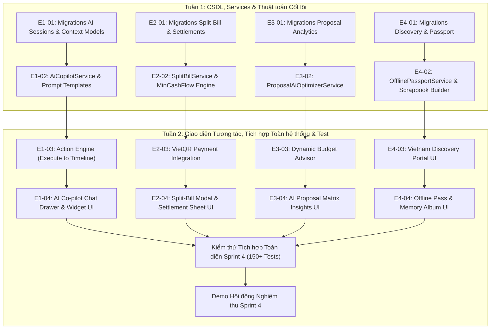

# SPRINT 4: AI CO-PILOT, CHIA TIỀN TỐI ƯU LUỒNG, AI MARKETPLACE, HỘ CHIẾU NGOẠI TUYẾN & KHÁM PHÁ DU LỊCH VIỆT NAM

> **Dự án:** Wanderly — Nền tảng lập kế hoạch du lịch thông minh  
> **Thời lượng:** 2 Tuần (Tuần 7 – Tuần 8)  
> **Quy mô Team:** 4 Thành viên  
> **Nhánh phát triển chính:** `develop`  
> **Tài liệu tham chiếu:** [PLAN.md](file:///d:/laragon/www/Wanderly/docs/PLAN.md) | [RULE_FOR_TEAM.md](file:///d:/laragon/www/Wanderly/docs/RULE_FOR_TEAM.md) | [SPRINT1.md](file:///d:/laragon/www/Wanderly/docs/sprints/SPRINT1.md) | [SPRINT2.md](file:///d:/laragon/www/Wanderly/docs/sprints/SPRINT2.md) | [SPRINT3.md](file:///d:/laragon/www/Wanderly/docs/sprints/SPRINT3.md) | OSP_SRS v2.0

---

## 1. Thông tin Chung & Đánh giá Tính Khả thi Sprint 4

### 1.1. Bối cảnh & Thành quả kế thừa từ Sprint 1, 2 và 3 (100% Hoàn thành)
Trải qua 3 sprint nền tảng, hệ thống Wanderly đã đạt mức độ hoàn thiện kiến trúc vững chắc:
- **Core MVP (Sprint 1 & 2):** Xác thực phân quyền đa vai trò, CRUD chuyến đi, kéo-thả lịch trình SortableJS 4 khung giờ/ngày, phát hiện trùng giờ, quản lý ngân sách 3 ngưỡng màu, khay lưu trú, checklist hành lý và link chia sẻ `/s/{slug}`.
- **Phase 2 Collaboration & Marketplace (Sprint 3):** Mời nhóm bằng link token 7 ngày, tính thanh hòa hợp `Group Mood`, cỗ máy gợi ý `Match Engine`, sàn giao dịch đảo `Reverse Marketplace`, cổng `Provider Portal`, hệ thống chat trực tuyến 2 kênh, mạng xã hội `Social Feed` và kết xuất `PDF Export` chuẩn khổ A4.
- **Chất lượng kiểm định:** 28 migrations toàn vẹn, 139 tests tự động đạt 100% Pass, code format chuẩn PSR-12 qua Laravel Pint, frontend Vite compile 0 lỗi.

### 1.2. Mục tiêu Sprint 4: Đột phá Trải nghiệm Người dùng & Hệ sinh thái Thông minh (Phase 3 Innovation)
Sprint 4 nâng cấp Wanderly từ một công cụ quản lý du lịch thành một **nền tảng du lịch thông minh toàn diện (Smart Travel Ecosystem)** đón đầu xu hướng công nghệ:
1. **F1 (Wanderly AI Co-pilot & Action Engine):** Trợ lý AI tích hợp qua LLM API (không cần train model). Đóng vai trò thành viên ảo trong nhóm: hòa giải bất đồng sở thích (`AI Group Mediator`), phân tích bài viết review/hình ảnh thành lịch trình nháp kéo-thả, và chủ động cảnh báo thích ứng thời tiết. Toàn bộ thao tác được kiểm duyệt chặt chẽ qua Rule Engine và Server-side Policies.
2. **F2 (Micro Split-Bill & Min-Cash-Flow):** Chia tiền chi tiết theo từng hoạt động thực tế (chỉ tính tiền cho những người tham gia, ghi nhận người ứng trước); ứng dụng thuật toán **Tối thiểu hóa luồng tiền (Min-Cash-Flow)** giúp giảm thiểu số lượt chuyển khoản còn mức tối thiểu (1-2 giao dịch); tự sinh mã QR thanh toán Napas VietQR động.
3. **F3 (AI Reverse Marketplace Optimizer):** Nâng cấp sàn giao dịch đảo với AI phân tích báo giá: tự động phát hiện chi phí ẩn/chưa bao gồm, so sánh chất lượng tiện ích (xe đời mới, hướng dẫn viên chụp ảnh), và đề xuất combo dịch vụ tối ưu nhất theo trần ngân sách.
4. **F4 (Reverse Memory & Offline Travel Passport):** 
   - *Offline Passport:* Lưu bản tóm tắt lịch trình, mã voucher QR và hotline khẩn cấp vào bộ nhớ trình duyệt cục bộ để mở ngoại tuyến khi đi vào vùng mất sóng (đèo núi, hải đảo).
   - *Reverse Memory:* Tự động thu thập ảnh trong chatbox và các mốc timeline đã hoàn thành sau chuyến đi để kết xuất thành **Nhật ký số (Digital Travel Scrapbook / PDF Album)** lưu niệm.
5. **F5 (Vietnam Travel Discovery & Promotion — Khám phá & Quảng bá Du lịch Việt Nam):** Xây dựng phân hệ cổng thông tin khám phá văn hóa, ẩm thực, mùa vụ lễ hội của các vùng miền Việt Nam (Bắc – Trung – Nam); kết nối 1-click để đưa điểm đến vào Timeline hoặc tìm kiếm dịch vụ đối tác địa phương trên Marketplace.

---

## 2. Mục tiêu Tổng quan Sprint 4

1. **Trợ lý AI Đưa ra Quyết định Thực thi (Actionable AI - F1):** Kết nối API mô hình ngôn ngữ lớn (Gemini 1.5 Flash / OpenAI GPT-4o-mini). Cung cấp Prompt Templates có cấu trúc, inject ngữ cảnh chuyến đi (thành viên, budget, POIs) và ép output dạng JSON Schema. Laravel Action Engine xác thực tính hợp lệ trước khi gọi vào `ItineraryService`.
2. **Giải quyết Triệt để Bài toán Chia tiền Nhóm (Split-Bill & VietQR - F2):** Hỗ trợ gắn thẻ thành viên tham gia trên từng `Activity`. Thuật toán đồ thị luồng rút gọn nợ chéo, hiển thị bảng đối soát minh bạch kèm mã QR chuyển khoản ngân hàng quét tức thì trên điện thoại.
3. **Trợ thủ Đàm phán Báo giá cho Khách (Marketplace Insights - F3):** Khách du lịch không cần đọc hàng trang thông số kỹ thuật; AI tự động đọc mảng `specs JSON` của các Proposal để tóm tắt ưu/nhược điểm và cảnh báo chi phí phát sinh.
4. **Đảm bảo Trải nghiệm Ngoại tuyến & Lưu giữ Kỷ niệm (Offline & Memory - F4):** Giải quyết nỗi lo mất sóng khi du lịch bằng thẻ thông tin ngoại tuyến (Offline Travel Pass) và tạo giá trị cảm xúc sau chuyến đi bằng album kỷ niệm tự động.
5. **Lan tỏa Giá trị Văn hóa Du lịch Bản địa (Vietnam Discovery - F5):** Tạo trang chuyên đề quảng bá du lịch Việt Nam với dữ liệu mẫu chất lượng cao, bài viết gợi ý hành trình theo chủ đề, hỗ trợ quảng bá đối tác bản địa đã xác minh.
6. **Bảo đảm Chất lượng & Kiểm thử Tự động:** Mở rộng bộ Feature Tests đạt thêm tối thiểu 20 bài test mới, duy trì 100% Pass và tuân thủ định dạng PSR-12.

---

## 3. Quy tắc Chung Sprint 4 (Sprint Ground Rules)

- **Nguyên tắc "AI Đề xuất — Laravel Quyết định" (AI Suggests, Backend Governs):**
  - Tuyệt đối không cho phép API bên ngoài ghi thẳng vào database. Mọi phản hồi từ LLM phải được parse qua schema JSON, kiểm tra tính tồn tại của dữ liệu (`destination_id`, `poi_id`), xác thực qua Form Request và kiểm duyệt quyền Leader/Editor qua `TripPolicy` trước khi lưu.
- **Nguyên tắc "Prompt Grounding" (Chống AI ảo giác):**
  - Trong nội dung System Prompt, luôn nạp danh mục các POI và dịch vụ có thật trong database của Wanderly. Bắt buộc AI chỉ được chọn trong các thực thể hợp lệ, không tự bịa địa điểm ảo.
- **Nguyên tắc Tính toán Tài chính Chính xác (Financial Accuracy):**
  - Mọi phép chia tiền lẻ làm tròn đến hàng đơn vị (VND), không để thất thoát sai số thập phân.
  - Sử dụng Transaction ACID khi ghi nhận các giao dịch thanh toán giải trừ nợ (`settlement_payments`).
- **Nguyên tắc Ngoại tuyến Nhẹ nhàng (Lightweight Offline Cache):**
  - Không cố gắng biến toàn bộ ứng dụng Laravel Blade phức tạp thành Full-PWA 2 chiều. Tập trung lưu bản snapshot JSON/HTML tĩnh của thẻ `Travel Passport` vào `localStorage`/Cache API để xem 1 chiều (Read-only Offline).
- **Nguyên tắc Nội dung Khám phá Việt Nam (Curated Content):**
  - Tập trung chất lượng thay vì số lượng: Xây dựng dữ liệu chuẩn mực và đẹp mắt cho **3 điểm đến tiêu biểu đại diện 3 miền** (Hà Giang - Miền Bắc, Hội An - Miền Trung, Miền Tây/Phú Quốc - Miền Nam) kèm hình ảnh chất lượng cao.
- **Chuẩn mực Đa ngôn ngữ (English First & i18n):** Tiếp tục duy trì chuẩn tiếng Anh chuẩn mực làm ngôn ngữ gốc, bọc trong `__('...')` sẵn sàng cho đa ngữ.
- **Quy chuẩn Git Flow:** Nhánh tính năng `feature/sprint-4-ten-module`, chạy `php artisan pint` và `php artisan test` xanh trước khi gửi PR vào `develop`.

---

## 4. Sơ đồ Phụ thuộc & Tiến độ giữa các Thành viên



---

## 5. Bảng Phân chia Công việc Chi tiết cho Team 4 người

### THÀNH VIÊN 1: Wanderly AI Co-pilot & Action Engine (E1-xx)

* **Mục tiêu:** Tích hợp mô hình ngôn ngữ lớn (LLM API) thông qua prompt kỹ thuật, xây dựng cơ chế kiểm soát ngữ cảnh an toàn và cỗ máy thực thi hành động (**Action Engine**) để tự động hòa giải nhóm, chuyển bài review thành lịch trình và thích ứng thời tiết.
* **Nhiệm vụ chi tiết:**

| Task ID | Tên công việc | Vị trí thư mục | Tên file & Outcome chi tiết |
| :--- | :--- | :--- | :--- |
| **E1-01** | Migration & Model Phiên hội thoại AI | `database/migrations/`,<br>`app/Models/` | • `xxxx_create_ai_chat_messages_table.php`: `id`, `trip_id` (foreignId nullable), `user_id` (foreignId), `role` (enum: user, assistant, system), `content` (text), `suggested_action` (json, nullable: action type & params), `is_applied` (boolean default false), `timestamps`.<br>• Model: `AiChatMessage.php`. |
| **E1-02** | Xây dựng Service Kết nối AI & Quản lý Prompt (AiCopilotService) | `app/Services/` | • `AiCopilotService.php`:<br>  - `callLlm(array $messages, array $tools = []): array`: Kết nối LLM API (Google Gemini 1.5 Flash hoặc OpenAI GPT-4o-mini) với cấu hình Temperature thấp (0.2–0.4) chống bịa đặt.<br>  - `buildTripContext(Trip $trip): array`: Gom dữ liệu thời gian thực (điểm đến, số ngày, trần ngân sách, tags sở thích của từng thành viên, Group Mood hiện tại, các POI có sẵn).<br>  - `mediateGroupConflict(Trip $trip, string $userPrompt): array`: Phân tích bất đồng giữa các thành viên, tìm điểm giao thoa và trả về phương án hòa giải kèm thông số hoạt động đề xuất. |
| **E1-03** | Cỗ máy Thực thi Hành động An toàn (ActionEngineService) | `app/Services/` | • `ActionEngineService.php`:<br>  - `parseAndValidateAction(array $aiPayload, Trip $trip, User $actor): array`: Giải mã JSON từ AI; xác thực xem địa điểm có tồn tại trong DB không; kiểm tra xem có vượt quá ngân sách không.<br>  - `executeAction(string $actionType, array $params, Trip $trip, User $actor): bool`: Gọi trực tiếp vào `ItineraryService::createActivity()` hoặc `ItineraryService::reorderActivities()` để cập nhật Timeline sau khi Leader xác nhận.<br>  - `ingestReviewText(string $rawText, Trip $trip): array`: Trích xuất danh sách địa điểm từ bài văn review thô, tự động nhóm vào 4 khung giờ sáng/trưa/chiều/tối. |
| **E1-04** | Trợ lý Thời tiết Tự động (WeatherAdaptiveService) | `app/Services/` | • `WeatherAdaptiveService.php`:<br>  - Kết nối API thời tiết dự báo ngắn hạn theo điểm đến chuyến đi.<br>  - Phát hiện các hoạt động ngoài trời (`outdoor`) bị trùng khung giờ có mưa lớn, sinh cảnh báo và đề xuất hoạt động trong nhà (`indoor`) thay thế. |
| **E1-05** | Giao diện Chatbot Trực quan (AI Co-pilot Drawer & Action Card) | `resources/views/components/`,<br>`resources/js/modules/` | • `ai-copilot-drawer.blade.php`: Hộp thoại AI Co-pilot trượt góc màn hình; hiển thị tin nhắn chat kèm thẻ **Action Card** (có nút "Review & Apply to Timeline").<br>• `resources/js/modules/ai-copilot.js`: Xử lý gửi tin nhắn không reload, hiển thị hiệu ứng gõ chữ / skeleton loading khi chờ AI phản hồi. |

---

### THÀNH VIÊN 2: Micro Split-Bill, Min-Cash-Flow & VietQR (E2-xx)

* **Mục tiêu:** Xây dựng hệ thống chia sẻ chi phí vi mô theo từng hoạt động thực tế, giải thuật tối thiểu hóa luồng tiền nợ chéo (**Min-Cash-Flow Algorithm**), bảng đối soát thanh toán và mã chuyển khoản ngân hàng VietQR tự động.
* **Nhiệm vụ chi tiết:**

| Task ID | Tên công việc | Vị trí thư mục | Tên file & Outcome chi tiết |
| :--- | :--- | :--- | :--- |
| **E2-01** | Migration & Models Chia tiền & Đối soát | `database/migrations/`,<br>`app/Models/` | • `xxxx_create_activity_participants_table.php`: `activity_id` (foreignId cascade), `user_id` (foreignId cascade), `custom_amount` (decimal 12,2 nullable: hỗ trợ chia đều hoặc số tiền cụ thể), `timestamps`, unique `['activity_id', 'user_id']`.<br>• `xxxx_add_payer_to_activities_table.php`: Bổ sung `payer_id` (foreignId users nullable: người thanh toán tiền trước).<br>• `xxxx_create_settlement_payments_table.php`: `trip_id` (foreignId), `from_user_id` (foreignId), `to_user_id` (foreignId), `amount` (decimal 12,2), `status` (enum: pending, completed), `proof_image` (string nullable), `timestamps`.<br>• Các Models: `ActivityParticipant.php`, `SettlementPayment.php`. |
| **E2-02** | Xây dựng Service Chia tiền Hoạt động (SplitBillService) | `app/Services/` | • `SplitBillService.php`:<br>  - `assignParticipants(Activity $activity, array $userIds, ?int $payerId = null): void`: Gán danh sách người cùng tham gia và người đứng ra thanh toán.<br>  - `calculateTripBalances(Trip $trip): array`: Tính toán số dư ròng (Net Balance) của từng thành viên: $\text{Balance}(u) = \text{Tổng tiền đã chi} - \text{Tổng tiền phải chịu}$.<br>  - Phân loại rõ ràng ai là người đang "chủ nợ" ($> 0$) và ai là người đang "con nợ" ($< 0$). |
| **E2-03** | Thuật toán Tối thiểu hóa Luồng tiền (MinCashFlowService) | `app/Services/` | • `MinCashFlowService.php`:<br>  - Áp dụng giải thuật Tham lam (Greedy Min-Cash-Flow): Liên tục ghép cặp người âm tiền nhiều nhất với người dương tiền nhiều nhất để tất toán dứt điểm từng khoản.<br>  - `generateSettlementPlan(Trip $trip): array`: Trả về danh sách rút gọn các giao dịch chuyển khoản trực tiếp (chỉ còn $N-1$ giao dịch tối đa thay vì nợ chéo ma trận phức tạp). |
| **E2-04** | Dịch vụ Sinh mã Thanh toán VietQR (VietQrService) | `app/Services/` | • `VietQrService.php`:<br>  - `generateQrUrl(string $bankBin, string $accountNumber, float $amount, string $memo): string`: Sinh URL mã QR theo chuẩn VietQR Napas (nhúng tự động số tiền, ngân hàng người nhận và nội dung ck: `WND_SETTLE_{Trip_ID}`).<br>  - `confirmPayment(SettlementPayment $payment): bool`: Đánh dấu khoản nợ đã hoàn tất chuyển tiền. |
| **E2-05** | Giao diện Tích chọn Người tham gia & Bảng Thanh toán | `resources/views/trips/partials/`,<br>`app/Http/Controllers/Trip/` | • `SplitBillController.php`: Endpoints AJAX lưu người tham gia và lấy kế hoạch tất toán nợ.<br>• `split-bill-modal.blade.php`: Modal tích chọn nhanh các thành viên tham gia hoạt động, chọn người thanh toán.<br>• `settlement-drawer.blade.php`: Khay đối soát nợ cuối chuyến đi: tóm tắt thu chi từng người, danh sách giao dịch chuyển tiền kèm nút bấm hiển thị mã VietQR chuyển khoản nhanh. |

---

### THÀNH VIÊN 3: AI Reverse Marketplace Optimizer & Proposal Insights (E3-xx)

* **Mục tiêu:** Nâng tầm sàn giao dịch đảo với trợ lý AI phân tích báo giá: bóc tách chi phí ẩn, nhận diện chất lượng thiết bị/tiện ích, gợi ý tối ưu lịch trình theo biểu giá đối tác và hỗ trợ liên kết dịch vụ vào các điểm đến khám phá.
* **Nhiệm vụ chi tiết:**

| Task ID | Tên công việc | Vị trí thư mục | Tên file & Outcome chi tiết |
| :--- | :--- | :--- | :--- |
| **E3-01** | Migration & Model Báo cáo Đề xuất & Insights | `database/migrations/`,<br>`app/Models/` | • `xxxx_create_proposal_insights_table.php`: `id`, `proposal_id` (foreignId cascade), `pros` (json: mảng điểm mạnh), `cons` (json: mảng điểm yếu), `hidden_costs` (json: cảnh báo chi phí phát sinh nếu có), `summary_verdict` (text: nhận xét tổng quan), `score` (unsignedTinyInteger: 1-100), `timestamps`.<br>• Model: `ProposalInsight.php`. |
| **E3-02** | Xây dựng Service Phân tích Đề xuất bằng AI (ProposalAiOptimizerService) | `app/Services/` | • `ProposalAiOptimizerService.php`:<br>  - `analyzeProposal(Proposal $proposal, TravelRequest $request): ProposalInsight`: Đọc chi tiết các `proposal_items` và trường `specs JSON`, gửi prompt đối chiếu với yêu cầu của khách.<br>  - Bóc tách tự động: nhận diện các khoản chưa bao gồm (vd: vé vào cổng, tip tài xế, phí cầu đường bến bãi) để khách không bị bất ngờ.<br>  - `compareMultipleProposals(TravelRequest $request): array`: Xếp hạng các gói đề xuất theo tiêu chí: Giá rẻ nhất, Dịch vụ cao cấp nhất, và Lựa chọn cân bằng nhất (Best Value). |
| **E3-03** | Cố vấn Tối ưu Ngân sách Động (DynamicBudgetAdvisorService) | `app/Services/` | • `DynamicBudgetAdvisorService.php`:<br>  - `suggestOptimalBookingDates(Trip $trip, Provider $provider): array`: Phân tích lịch trống và bảng giá dịch vụ để gợi ý khách đổi lịch sang các ngày trong tuần (thứ 2 - thứ 5) để hưởng mức chiết khấu tốt hơn cuối tuần.<br>  - `generateBundleSuggestions(TravelRequest $request): array`: Gợi ý ghép các dịch vụ lẻ của nhiều đối tác khác nhau thành 1 combo rẻ hơn mua trọn gói đơn lẻ. |
| **E3-04** | Giao diện So sánh Báo giá Nâng cao & AI Insights | `resources/views/marketplace/` | • Cập nhật [`marketplace/compare.blade.php`](file:///d:/laragon/www/Wanderly/resources/views/marketplace/compare.blade.php): Thêm thẻ **AI Insights Badge** trên từng cột đề xuất (hiển thị nhãn: `Best Value`, `Budget Saver`, `Premium Choice`).<br>• Hiển thị danh sách checklist các chi phí ẩn được cảnh báo rõ ràng bằng màu vàng nổi bật. |
| **E3-05** | Tích hợp Dịch vụ vào Cổng Khám phá Du lịch Việt Nam | `app/Services/`,<br>`resources/views/` | • Tạo liên kết 2 chiều giữa danh mục dịch vụ của Provider (`services`) với các địa điểm nổi tiếng trong bài viết Khám phá Việt Nam (vd: bài viết về Hà Giang hiển thị ngay dịch vụ "Thuê xe máy cào cào" của đối tác địa phương uy tín). |

---

### THÀNH VIÊN 4: Hộ chiếu Ngoại tuyến, Kỷ niệm Hành trình & Cổng Khám phá Du lịch Việt Nam (E4-xx)

* **Mục tiêu:** Xây dựng tính năng xem thông tin lịch trình & voucher ngoại tuyến (Offline Travel Passport), kết xuất album nhật ký ảnh sau chuyến đi (Reverse Memory), và phát triển Cổng thông tin Khám phá & Quảng bá Du lịch Việt Nam toàn diện.
* **Nhiệm vụ chi tiết:**

| Task ID | Tên công việc | Vị trí thư mục | Tên file & Outcome chi tiết |
| :--- | :--- | :--- | :--- |
| **E4-01** | Migration & Models Cổng Khám phá Du lịch Việt Nam | `database/migrations/`,<br>`app/Models/` | • `xxxx_create_discovery_regions_table.php`: `id`, `name` (Miền Bắc, Miền Trung, Miền Nam, Tây Nguyên), `slug`, `description`, `cover_image`.<br>• `xxxx_create_discovery_articles_table.php`: `id`, `region_id` (foreignId), `destination_id` (foreignId nullable), `title`, `slug`, `category` (culture, cuisine, festival, nature), `content` (longText), `best_season` (string), `featured_image`, `is_published`, `views_count`, `timestamps`.<br>• Các Models: `DiscoveryRegion.php`, `DiscoveryArticle.php`. |
| **E4-02** | Dịch vụ Hộ chiếu Du lịch Ngoại tuyến (OfflinePassportService) | `app/Services/`,<br>`resources/js/` | • `OfflinePassportService.php`:<br>  - `generateOfflineSnapshot(Trip $trip): array`: Gom toàn bộ dữ liệu cần thiết: tóm tắt lịch trình rút gọn, danh sách voucher booking kèm mã QR tĩnh, số điện thoại hotline nhà xe và y tế.<br>• `resources/js/modules/offline-passport.js`: Lưu dữ liệu vào `localStorage` của trình duyệt; hiển thị thông báo "Sẵn sàng hoạt động ngoại tuyến khi mất sóng 4G/5G". |
| **E4-03** | Dịch vụ Album Kỷ niệm Hành trình (ReverseMemoryService) | `app/Services/`,<br>`resources/views/trips/` | • `ReverseMemoryService.php`:<br>  - Tự động quét toàn bộ ảnh đính kèm đã gửi trong hộp thoại `messages` của chuyến đi và ảnh đại diện các hoạt động đã hoàn thành.<br>  - Sắp xếp ảnh theo dòng thời gian (Day 1 ➔ Day N).<br>• `resources/views/trips/memory-scrapbook.blade.php`: Giao diện nhật ký số dạng lật trang ảnh kỷ niệm (Photo Timeline Album); hỗ trợ xuất file PDF ảnh lưu niệm hoặc chia sẻ nhanh lên Community Social Feed. |
| **E4-04** | Xây dựng Cổng Khám phá Du lịch Việt Nam (DiscoveryService) | `app/Services/`,<br>`app/Http/Controllers/` | • `DiscoveryService.php`:<br>  - Tìm kiếm bài viết theo vùng miền, mùa du lịch, món ăn đặc sản và trải nghiệm văn hóa.<br>  - Cung cấp tính năng **"Add to Current Trip"**: Bấm 1 nút trên bài viết để thêm ngay địa điểm vào chuyến đi đang lên lịch.<br>  - Cung cấp bộ sưu tập **Hành trình mẫu theo chủ đề** (vd: "4 ngày săn mây Y Tý", "Food tour 48h tại Huế").<br>• `DiscoveryController.php`: Các routes công khai phục vụ tra cứu. |
| **E4-05** | Giao diện Cổng Khám phá & Giao diện Hộ chiếu Offline | `resources/views/discovery/` | • `discovery/index.blade.php`: Trang chủ Khám phá Việt Nam với banner hình ảnh tuyệt đẹp, lọc theo vùng miền, top trải nghiệm đặc sắc.<br>• `discovery/show.blade.php`: Trang chi tiết bài viết văn hóa/ẩm thực kèm danh sách dịch vụ địa phương liên kết.<br>• `trips/offline-passport.blade.php`: Thẻ Hộ chiếu du lịch ngoại tuyến tối giản, hiển thị mã QR voucher rõ nét dễ quét. |

---

## 6. Tiêu chuẩn Nghiệm thu Sprint 4 (Sprint 4 DoD & Acceptance Criteria)

Dự án chỉ được coi là hoàn tất Sprint 4 khi thỏa mãn **100% các tiêu chí** sau:

- [ ] Lệnh `php artisan migrate:fresh --seed` chạy thành công, nạp đầy đủ dữ liệu mẫu cho bài viết Khám phá Việt Nam (3 miền Bắc - Trung - Nam), cấu hình tài chính chia tiền và dữ liệu mẫu AI Chatbot.
- [ ] Chạy `php artisan test` đạt **100% Pass** cho toàn bộ các bài test mới của Sprint 4 (`AiCopilotTest`, `SplitBillTest`, `ProposalOptimizerTest`, `DiscoveryTest`) cùng 139 bài test cũ của Sprint 1, 2, 3 (Tổng cộng $\ge 155$ tests).
- [ ] Lệnh `php vendor/bin/pint --test` đạt kết quả sạch sẽ 100%, tuân thủ PSR-12.
- [ ] Lệnh `npm run build` biên dịch trơn tru, không có lỗi xung đột thư viện JavaScript.
- [ ] **AI Co-pilot:** Xử lý chính xác luồng hòa giải nhóm: khi nhập yêu cầu dung hòa, AI phản hồi đúng JSON, hiển thị nút Action Card và chỉ ghi vào Timeline khi người dùng xác nhận thành công.
- [ ] **Micro Split-Bill:** Thuật toán Min-Cash-Flow tính toán chính xác số dư nợ, số lượt chuyển tiền được rút gọn tối đa, hiển thị đúng mã VietQR chứa đúng số tiền và thông tin tài khoản người nhận.
- [ ] **Marketplace AI Optimizer:** Hiển thị rõ ràng các điểm mạnh/yếu, cảnh báo chi phí chưa bao gồm trên bảng so sánh Proposal.
- [ ] **Offline Travel Passport:** Mở được giao diện thẻ du lịch ngoại tuyến khi giả lập ngắt mạng (Offline mode trên Chrome DevTools) với đầy đủ mã QR voucher và lịch trình rút gọn.
- [ ] **Vietnam Discovery Portal:** Điều hướng mượt mà, phân loại rõ ràng 3 miền, tính năng "Thêm vào chuyến đi" chuyển đúng địa điểm vào giỏ đề xuất của chuyến đi hiện tại.
- [ ] Toàn bộ chuỗi Pull Requests của 4 thành viên được Review, Approve và Merge đầy đủ vào nhánh `develop`.

---

## 7. Kịch bản Demo Cuối Sprint 4 (End-to-End Demo Flow)

Kịch bản demo nghiệm thu 5 tính năng đột phá trong **6 phút**:

```text
[1. Khám phá Điểm đến & Thêm vào Chuyến đi (F5 - 1 phút)]
     ↓  Khách truy cập menu "Khám phá Việt Nam", chọn vùng "Miền Bắc" → Mở bài viết "Hà Giang: Mùa hoa tam giác mạch".
     ↓  Đọc danh mục ẩm thực (Thắng dền, cháo ấu tẩu), bấm nút "Thêm vào chuyến đi Hà Giang sắp tới" → Địa điểm tự động nạp vào khay đề cử của Trip.

[2. Trải nghiệm Trợ lý AI Co-pilot Hòa giải Nhóm (F1 - 1.5 phút)]
     ↓  Mở chuyến đi Hà Giang, mở hộp thoại "AI Co-pilot".
     ↓  Nhập câu hỏi: "Nhóm mình 2 người thích trekking ngắm cảnh, 2 người thích ngồi cafe chill. Ngân sách 400k cho cả nhóm, hãy tìm điểm dung hòa".
     ↓  AI phản hồi thẻ Action Card: Đề xuất "Cafe Mã Pí Lèng Panorama - ngắm hẻm Tu Sản và đi bộ nhẹ trên vách đá".
     ↓  Leader bấm "Apply to Timeline" → Hoạt động tự động xuất hiện trên Lịch trình ngày 2 khung giờ Chiều.

[3. AI Phân tích & Tối ưu Báo giá Marketplace (F3 - 1 phút)]
     ↓  Mở bảng so sánh 3 gói Proposal thuê xe ô tô tại Hà Giang.
     ↓  Quan sát nhãn AI Insights: Gói 1 được gắn mác "Best Value", Gói 2 bị AI cảnh báo chi phí ẩn: "Chưa bao gồm xăng xe và phí bến bãi đèo".
     ↓  Leader tự tin bấm "Accept Bundle" cho Gói 1 và nhận voucher an toàn.

[4. Chia tiền Vi mô & Quét mã VietQR Tất toán Nợ (F2 - 1.5 phút)]
     ↓  Trên Timeline, mở hoạt động "Bữa tối lẩu gà đen 800.000 VND": Tích chọn 4 thành viên cùng ăn, đánh dấu Thành viên A ứng tiền trước.
     ↓  Mở khay "Đối soát nợ chuyến đi (Settlement Drawer)":
     ↓  Quan sát thuật toán Min-Cash-Flow tự động rút gọn: Thành viên B và C chỉ cần chuyển khoản trực tiếp cho Thành viên A.
     ↓  Bấm nút "Thanh toán VietQR" trên giao diện → Hiển thị mã QR ngân hàng có sẵn số tiền và nội dung để quét thanh toán tức thì.

[5. Kích hoạt Hộ chiếu Ngoại tuyến & Xem Album Kỷ niệm (F4 - 1 phút)]
     ↓  Bật tính năng "Lưu Offline Passport" → Bật chế độ Airplane Mode / Offline trên trình duyệt để chứng minh vẫn mở được thẻ voucher QR và lịch trình.
     ↓  Sau khi chuyến đi hoàn tất, bấm "Xem Nhật ký Kỷ niệm (Memory Scrapbook)" → Thưởng thức album ảnh dòng thời gian tuyệt đẹp gom từ ảnh các thành viên đã gửi trong chat.
```
